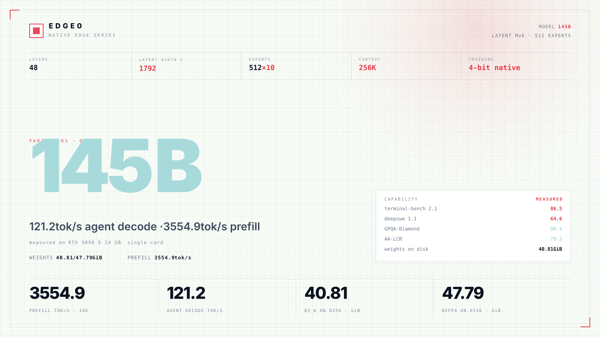
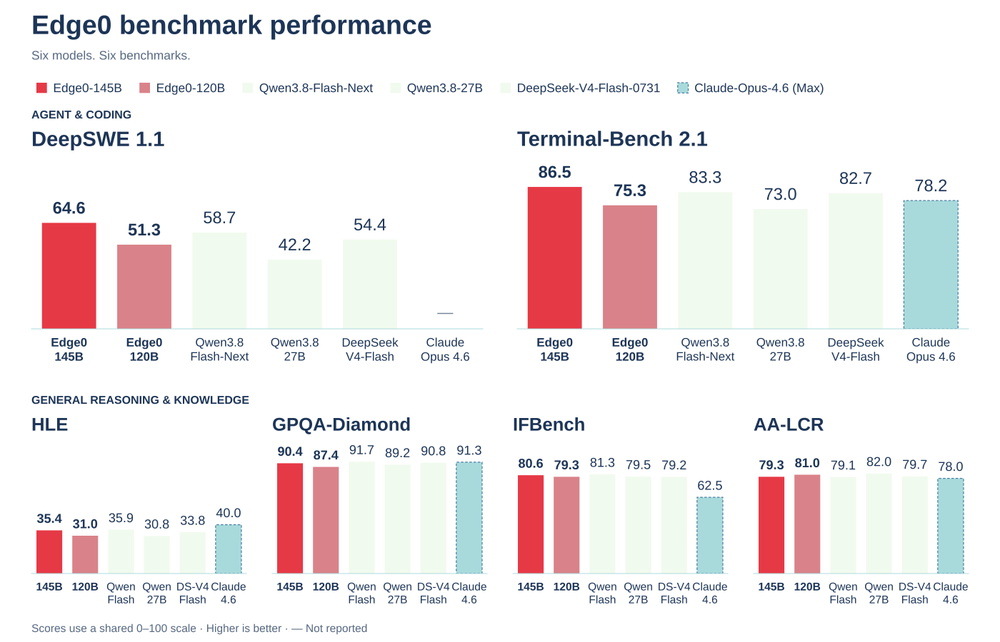
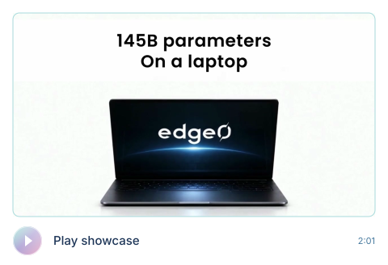

<p align="center"></p>

<h1 align="center">Edge0</h1>

<p align="center">An open-source streaming MoE inference framework</p>

<br>

<p align="center">Think big. Run here.<br>Sparse. By design.</p>

<br>

<p align="center">macOS · iOS · Android · Linux · Windows<br>One program for every Edge0 model</p>

<p align="center"><sub>Project</sub><br>
<br>
<a href="https://arxiv.org/abs/2609.18063"></a> <a href="https://github.com/Edge0-AI/Edge0"></a> <a href="https://edge0.ai/discord"></a> <a href="LICENSE"></a> <a href="https://github.com/Edge0-AI/Edge0/releases"></a>
</p>

<p align="center"><sub>Latest release</sub><br>
<br>
<a href="https://huggingface.co/Edge0/Edge0-145B-q3k"></a> <a href="https://huggingface.co/Edge0/Edge0-145B-NVFP4"></a> <a href="https://huggingface.co/Edge0/Edge0-120B-q3k"></a> <a href="https://huggingface.co/Edge0/Edge0-120B-NVFP4"></a>
</p>

<p align="center"><sub>Old release</sub><br>
<br>
<a href="https://huggingface.co/Edge0/Edge0-35B-A3B-preview"></a> <a href="https://huggingface.co/Edge0/Edge0-8B-A1B-preview"></a> <a href="https://www.modelscope.cn/models/Edge0/Edge0-35B-A3B-preview"></a> <a href="https://www.modelscope.cn/models/Edge0/Edge0-8B-A1B-preview"></a>
</p>

<p align="center">English · <a href="README_zh.md">中文</a> · <a href="README_ja.md">日本語</a> · <a href="README_es.md">Español</a> · <a href="README_fr.md">Français</a></p>

<p align="center"><a href="#news">News</a> · <a href="#about">About</a> · <a href="#models">Models</a> · <a href="#quality">Quality</a> · <a href="#benchmark">Benchmark</a> · <a href="#getting-started">Getting started</a></p>

<br>

## News

<p><a href="docs/models/edge0-145b.md"></a></p>

<p><a href="edge0-infer/README.md"></a></p>

<p><a href="https://github.com/Edge0-AI/Edge0/tree/pre-edge0-infer"></a></p>

<details open>
<summary>More updates</summary>

<p><a href="https://arxiv.org/abs/2609.18063"></a></p>

<p><a href="https://huggingface.co/Edge0/Edge0-35B-A3B-preview"></a></p>

<details>
<summary>Full release notes</summary>

- **[2026-11-13]** We released **`edge0-145b`** and **`edge0-120b`**, latent mixture-of-experts models derived from Qwen3.8-Flash-Next for a single NVIDIA GPU on Linux or Windows. They run on [edge0-strata](edge0-strata/EDGE0.md), which `edge0-infer serve` and `edge0-infer chat` start for them; see the [model page](docs/models/edge0-145b.md). Weights on Hugging Face: [`Edge0-145B-q3k`](https://huggingface.co/Edge0/Edge0-145B-q3k) · [`Edge0-145B-NVFP4`](https://huggingface.co/Edge0/Edge0-145B-NVFP4) · [`Edge0-120B-q3k`](https://huggingface.co/Edge0/Edge0-120B-q3k) · [`Edge0-120B-NVFP4`](https://huggingface.co/Edge0/Edge0-120B-NVFP4).
- **[2026-11-04]** We released the **unified inference engine [`edge0-infer`](edge0-infer/README.md)**: built on [GGML](https://github.com/ggml-org/ggml), one engine and one native C++ API run the same model on macOS, iOS, Android and Windows, with a CLI, an OpenAI-compatible local server, and chat app examples for desktop, Android and iOS. The first release supports `edge0-35b`; `edge0-8b` follows in a later release. It replaces the Python framework and the per-platform engines; the previous code is kept at tag [`pre-edge0-infer`](https://github.com/Edge0-AI/Edge0/tree/pre-edge0-infer).
- **[2026-09-30]** We released the **edge0 inference engines for four platforms — iOS, macOS, Android and Windows** (source at tag [`pre-edge0-infer`](https://github.com/Edge0-AI/Edge0/tree/pre-edge0-infer)).
- **[2026-09-16]** Our technical report is on arXiv: [The Other Half of the Memory Wall: Serving 35B MoEs from SSD with Trained Routing Prediction](https://arxiv.org/abs/2609.18063).
- **[2026-09-08]** Initial open-source release of **edge0**, together with both model tiers — [`Edge0-35B-A3B-preview`](https://huggingface.co/Edge0/Edge0-35B-A3B-preview) and [`Edge0-8B-A1B-preview`](https://huggingface.co/Edge0/Edge0-8B-A1B-preview) — on Hugging Face and ModelScope.

</details>

</details>

<details open>
<summary><h2>Previous release</h2></summary>

→ [35B / 8B release guide](docs/legacy-models.md) — model downloads, architecture, benchmarks, supported platforms and setup instructions.

</details>

## About

<p>Edge0 is an open-source streaming MoE inference framework for running large sparse models on consumer hardware.</p>

Use it through the command line, a local API server, or the Edge0 Chat app.

The latest release brings 145B and 120B latent-MoE models to a single NVIDIA GPU.

Trained natively at 4 bits, both models are available in Q3_K and NVFP4 for local agent workloads.

[`edge0-infer`](edge0-infer/README.md) provides shared `serve` and `chat` commands and selects the engine from the model folder. The latest models run on [edge0-strata](edge0-strata/EDGE0.md), a fork of Strata; the previous 35B release runs on the [GGML-based native engine](docs/legacy-models.md#native-engine-design).

### Platforms

Support depends on the model and its engine.

| Platform | `edge0-145b`, `edge0-120b` (edge0-strata) | `edge0-35b` (native engine) |
| --- | --- | --- |
| **Linux** | NVIDIA GPU (CUDA 13) | CPU |
| **Windows** | NVIDIA GPU (CUDA 13) | CPU, Vulkan |
| **macOS** (Apple Silicon) | — | Metal, CPU |
| **iOS** | — | Metal |
| **Android** | — | CPU |

Use the [145B / 120B setup](#getting-started) for the latest release. The [previous-release guide](docs/legacy-models.md#platforms) covers native backends, platform-specific builds and chat examples. The 8B checkpoint is available; native-engine support is planned.

## Models

<p>145B / 120B are the current latent-MoE series, derived from Qwen3.8-Flash-Next and trained natively at 4 bits.</p>

They run on edge0-strata through `edge0-infer serve` and `edge0-infer chat`, on Linux or Windows with an NVIDIA GPU and CUDA 13.

**145B Q3_K · RTX 5090 D 24 GB:** 121.2 tok/s agent decode · 3554.9 tok/s 16K prefill.

| Tier | Released checkpoint | Inference profile | Engine |
|---|---|---|---|
| [`edge0-145b`](docs/models/edge0-145b.md) | [`Edge0/Edge0-145B-q3k`](https://huggingface.co/Edge0/Edge0-145B-q3k) · [NVFP4](https://huggingface.co/Edge0/Edge0-145B-NVFP4) | Q3_K or NVFP4 latent experts (1792), 48 layers, 512 experts, K=10 | edge0-strata ✅ (Linux or Windows, NVIDIA GPU) |
| [`edge0-120b`](docs/models/edge0-145b.md) | [`Edge0/Edge0-120B-q3k`](https://huggingface.co/Edge0/Edge0-120B-q3k) · [NVFP4](https://huggingface.co/Edge0/Edge0-120B-NVFP4) | Q3_K or NVFP4 latent experts (1280), 48 layers, 512 experts, K=10 | edge0-strata ✅ (Linux or Windows, NVIDIA GPU) |

<details open>
<summary><h3>Model overview · 145B Q3_K</h3></summary>

Q3_K · RTX 5090 D 24 GB. Prefill uses a 16K-token input. Quality scores are model-level results.

<a href="assets/edge0-release/model-overview-145B-q3k.svg"></a>

</details>

## Quality

### 145B / 120B

Six benchmarks, six models. Higher is better. Scores are reported by model, not as separate Q3_K and NVFP4 evaluations.

<a href="assets/edge0-release/quality-overview.svg"></a>

[Copyable scores and all model names](docs/models/edge0-145b.md#quality)

<details>
<summary>Copyable scores · all six models</summary>

Bold values indicate the best score in each column.

| Model | deepswe 1.1 | terminal-bench 2.1 | AA-LCR | IFBench | GPQA-Diamond | HLE |
| --- | ---: | ---: | ---: | ---: | ---: | ---: |
| **Edge0-145B** | **64.6** | **86.5** | 79.3 | 80.6 | 90.4 | 35.4 |
| **Edge0-120B** | 51.3 | 75.3 | 81.0 | 79.3 | 87.4 | 31.0 |
| DeepSeek-V4-Flash-0731 | 54.4 | 82.7 | 79.7 | 79.2 | 90.8 | 33.8 |
| Qwen3.8-Flash-Next | 58.7 | 83.3 | 79.1 | **81.3** | **91.7** | 35.9 |
| Qwen3.8-27B | 42.2 | 73.0 | **82.0** | 79.5 | 89.2 | 30.8 |
| Claude-Opus-4.6 (Max) | / | 78.2 | 78.0 | 62.5 | 91.3 | **40.0** |

</details>

<a name="speed"></a>

## Benchmark

### 145B / 120B

All throughput figures are in tok/s. The headline uses **145B Q3_K** on RTX 5090 D 24 GB.

<details open>
<summary>145B speed table · all machines and builds</summary>

Highlighted rows show Q3_K. Click the table to view it at full size.

<a href="assets/edge0-release/speed-145B.svg"></a>

<details>
<summary>Copyable 145B speed data</summary>

| Machine | Build | 4K prefill | 16K prefill | Chat decode | Agent decode |
|---|---|---:|---:|---:|---:|
| RTX 5090 D 24 GB | Q3_K | 2169.9 | 3554.9 | 99.7 | **121.2** |
| RTX 5090 D 24 GB | NVFP4 | 1839.6 | 3165.7 | 79.6 | 98.3 |
| RTX 4090 24 GB | Q3_K | 2042.0 | 3179.4 | 69.9 | 91.7 |
| RTX Spark N1X 60 GiB | Q3_K | 674.0 | 770.3 | 37.7 | 36.7 |
| RTX Spark N1X 60 GiB | NVFP4 | 821.2 | 922.4 | 40.1 | 46.0 |
| Apple M2 Ultra (Metal) | Q3_K | 755.6 | 800.3 | 60.9 | 57.0 |
| 16 GiB VRAM + 20 GiB RAM | Q3_K | 249 | 335 | 36.8 | 44.9 |

</details>

</details>

<details>
<summary>145B measurement conditions · constrained budget and memory residency</summary>

`16 GiB VRAM + 20 GiB RAM` rows are the RTX 5090 D 24 GB again, constrained by cgroup to a 16 GiB VRAM and
20 GiB system-RAM budget — not a different card. With residency on, the same card holds **Q3_K** (40.81 GiB of weights)
as 23.14 GiB VRAM + 31.28 GiB RAM, and **NVFP4** (47.79 GiB) as 23.25 GiB VRAM + 38.27 GiB RAM — disjoint expert sets,
nothing counted twice.

These residency readings use expert residency enabled, `--no-prefill-borrow`, conv cache = 0 and kv-resident = 0. Host RAM is measured as `RssAnon + RssShmem`. These are single-run readings, not minimum system requirements. See [Usage & troubleshooting](#usage-help) for memory-saving options.

The 16 GiB VRAM + 20 GiB RAM budget is a test limit, not a minimum system requirement. The Apple M2 Ultra row is a Metal measurement, not an announcement of macOS release availability.

</details>

<details open>
<summary>120B speed table · all machines and builds</summary>

<a href="assets/edge0-release/speed-120B.svg"></a>

<details>
<summary>Copyable 120B speed data</summary>

| Machine | Build | 4K prefill | 16K prefill | Chat decode | Agent decode |
|---|---|---:|---:|---:|---:|
| RTX 5090 D 24 GB | Q3_K | 3236.7 | 4576.5 | 130.2 | **144.6** |
| RTX 5090 D 24 GB | NVFP4 | 2668.5 | 4357.1 | 124.9 | 135.5 |
| RTX 4090 24 GB | Q3_K | 2637.5 | 3551.1 | 95.0 | 104.9 |
| RTX Spark N1X 60 GiB | Q3_K | 987.0 | 1081.7 | 47.2 | 68.4 |
| RTX Spark N1X 60 GiB | NVFP4 | 996.4 | 1066.9 | 45.1 | 68.9 |
| Apple M2 Ultra (Metal) | Q3_K | 867.6 | 908.7 | 60.4 | 63.0 |
| 16 GiB VRAM + 20 GiB RAM | Q3_K | 430 | 778 | 62.4 | 73.3 |
| 16 GiB VRAM + 20 GiB RAM | NVFP4 | 361.1 | 619.7 | 51.3 | 59.9 |

</details>

`16 GiB VRAM + 20 GiB RAM` rows are the RTX 5090 D 24 GB again, constrained by cgroup to a 16 GiB VRAM and
20 GiB system-RAM budget — not a different card. With residency on, the same card holds **Q3_K** (27.98 GiB of weights)
as 22.93 GiB VRAM + 18.40 GiB RAM, and **NVFP4** (32.96 GiB) as 23.02 GiB VRAM + 23.40 GiB RAM — disjoint expert sets,
nothing counted twice.

These residency readings use expert residency enabled, `--no-prefill-borrow`, conv cache = 0 and kv-resident = 0. Host RAM is measured as `RssAnon + RssShmem`. These are single-run readings, not minimum system requirements. See [Usage & troubleshooting](#usage-help) for memory-saving options.

</details>

<details open>
<summary><h2>In action</h2></summary>

<p align="center"><a href="assets/edge0-release/showcase.mp4"></a></p>

<p align="center">Recorded with Edge0-145B · <a href="assets/edge0-release/showcase.mp4">Open video ↗</a></p>

<details>
<summary>Five demonstrations · chapter guide</summary>

| Time | Demonstration |
| --- | --- |
| 0:00 | Local Chat & Coding |
| 0:36 | Video Production |
| 0:58 | Manhattan in 3D |
| 1:19 | Cathedral World Building |
| 1:38 | PCB Design |

[Chapter markers (VTT)](assets/edge0-release/showcase-chapters.vtt)

</details>

</details>

## Architecture

Latent MoE compresses expert inputs while keeping attention at full width. The 145B model uses latent width 1792; the 120B model uses 1280. Both route each token to 10 of 512 experts, alongside one shared expert.

<details open>
<summary>Architecture details · diagram and configuration</summary>

<a href="assets/edge0-release/arch-145B.svg"></a>

[Full configuration, routing and both model profiles](docs/models/edge0-145b.md#model-profile).

</details>

<a name="quick-start"></a>

## Getting Started

### 145B / 120B · edge0-strata

Each model folder (Q3_K or NVFP4, Edge0-145B or Edge0-120B) runs through `edge0-infer`, from the command line or from the Edge0 Chat desktop app. Keep the folder as it is:
`edge0-infer` identifies the model by `model_name` in its `model.json`.

For 145B and 120B, use `serve` or `chat`; `run` belongs to the native engine.

<details>
<summary>Platform & documentation notes</summary>

The build instructions target NVIDIA GPUs with CUDA 13 on Linux or Windows (x64 or ARM64). The Apple M2 Ultra measurements use Metal; they do not establish macOS release availability.

</details>

<details>
<summary>Build & command-line instructions</summary>

**1. Build.** Clone the repository, then build two parts. Run the launch commands below from `edge0-infer/`:

```bash
git clone https://github.com/Edge0-AI/Edge0.git edge0
```

- **edge0-strata**, the engine: follow "Build (Linux, NVIDIA)" or "Build (Windows, NVIDIA)" in [edge0-strata/EDGE0.md](edge0-strata/EDGE0.md).
- **edge0-infer**: follow "Build" (Linux) or "Windows" in [edge0-infer/docs/getting-started.md](edge0-infer/docs/getting-started.md).

**2. Run from the command line.** Pass one model folder, such as `Edge0-145B-q3k`, not the folder that holds several of
them. On Windows the program is `build\windows\bin\edge0-infer.exe`.

```bash
build/cpu/bin/edge0-infer serve --model /path/to/Edge0-145B-q3k
```

It prints `Listening: http://127.0.0.1:8000 model=<name>` once the weights are loaded, where `<name>` is `edge0_145b`,
and then serves OpenAI- and Anthropic-compatible endpoints:

```bash
curl localhost:8000/v1/chat/completions -H 'content-type: application/json' -d '{"model":"edge0_145b","messages":[{"role":"user","content":"hi"}],"max_tokens":64}'
```

`edge0-infer chat --model /path/to/Edge0-145B-q3k` opens an interactive session instead. More options:
[edge0-infer/docs/edge0-145b.md](edge0-infer/docs/edge0-145b.md).

</details>

<details>
<summary>Desktop app · Windows</summary>

⬇️ **Download:** **[GitHub Releases](https://github.com/Edge0-AI/Edge0/releases)**

Open **Edge0 Chat** on Windows and choose a model folder, such as `Edge0-145B-q3k`, to run the model locally. To build the app from source, follow the [Edge0 Chat](edge0-infer/examples/desktop/README.md) guide.

</details>

<a name="memory-update"></a>
<a name="deployment-qa"></a>
<a name="memory-deployment"></a>
<a name="usage-help"></a>

## Usage & troubleshooting

145B / 120B · Memory options

<details>
<summary><a name="low-memory"></a>Low RAM · SSD offload</summary>

- **SSD mode:** `--mmap-experts` — read uncached experts from SSD on demand.
- **Low-memory arguments:**

```bash
--resident-budget-gib 20 --expert-profile expert-profile.bin
```

Up to **20 GiB** of host RAM for the expert cache; uncached experts are read from SSD on demand. Includes `--mmap-experts` and disjoint GPU/RAM caches automatically.

**Required:** a static expert profile. Replace `expert-profile.bin` with your profile path.

</details>
<details>
<summary><a name="ram-budget"></a>RAM budget · what 20 GiB covers</summary>

- **Expert cache:** `--resident-budget-gib 20` caps host-RAM expert caching at **20 GiB**, lowered further to fit available memory.
- **Total RAM:** expert cache + other runtime allocations. This flag does **not** set a total-process RAM limit.
- **Benchmark limit:** the 20 GiB total RAM test budget is a separate measurement condition.

</details>
<details>
<summary><a name="expert-residency"></a>GPU / RAM · avoid duplicate experts</summary>

- **Enable:** `--resident-experts` or `--resident-budget-gib N`, with a static `--expert-profile`.
- **Effect:** experts cached in VRAM need no duplicate RAM copy. Compatible with SSD loading.
- **Default:** off, prioritizing speed.
- **Automatically enabled:** `--mmap-experts`, `--resident-cpu-experts`, `--resident-pin`.

</details>

## Documentation

**Latest release · 145B / 120B**

- [Models, measurements and architecture](docs/models/edge0-145b.md)
- [edge0-strata · build and launch contract](edge0-strata/EDGE0.md)
- edge0-infer model guides: [145B](edge0-infer/docs/edge0-145b.md) / [120B](edge0-infer/docs/edge0-120b.md)

**Framework**

- [edge0-infer](edge0-infer/README.md) · command line, local server and chat applications
- [Local server](edge0-infer/docs/local-server.md) / [Testing](edge0-infer/docs/testing.md)
- [Model asset tools and adding a model](edge0-infer/tools/assets/README.md)

<details>
<summary>Previous release · models and native-engine documentation</summary>

- [35B / 8B release guide](docs/legacy-models.md)
- [MoE routing and experts](docs/moe.md) / [prerouter](docs/prerouter.md)
- Model references: [edge0-35b](docs/models/edge0-35b.md) / [edge0-8b](docs/models/edge0-8b.md)
- [Getting started](edge0-infer/docs/getting-started.md): native build, model assets, run, chat and serve across supported platforms
- [Configuration](edge0-infer/docs/configuration.md) / [Native API](edge0-infer/docs/native-api.md)
- [Architecture](edge0-infer/docs/architecture.md) / [Native-engine design](edge0-infer/docs/architecture.md#native-engine) / [Known limitations](edge0-infer/docs/limitations.md)
- [Benchmarking](edge0-infer/docs/benchmarking.md)
- Technical report: [The Other Half of the Memory Wall](https://arxiv.org/abs/2609.18063) ([PDF](paper/main.pdf))

</details>

## Roadmap

<details>
<summary>Q4 2026 · architecture and inference</summary>

**Models & algorithms**

Q4 works two fronts: bringing a next-generation architecture into the
framework, and turning latent reasoning into a real latency saving rather
than just an arithmetic one.

- **Next-gen architecture support (Qwen3.8-Flash class)** — run hybrid
  linear attention (GDN + QSA), gated multi-branch residual, and N-gram
  embedding topologies on edge0. These designs suit SSD streaming offload
  naturally: O(1)-state attention keeps long thinking from becoming a
  KV-cache problem, and lookup-only N-gram tables stream on demand. Goal:
  the tier runs on a single device and benchmarks within an acceptable
  gap of the fp16 base.
- **Latent thinking + batched expert pre-prediction** — make latent
  reasoning a *latency* saving, not only an arithmetic one. The core
  engineering problem: move expert routing from per-position to **once
  per block**, so one prediction covers every position and round of a
  block and **expert load volume decouples from the reasoning loop
  count** — plus cross-block prefetch that loads the next block's experts
  inside the current block's compute window. Progress is measured as
  **end-to-end thinking-phase time at matched accuracy** (never tokens/s).

[Previous-release milestones and planned native-engine support](docs/legacy-models.md#roadmap).

</details>

## Contributing

<details>
<summary>Development workflow and checks</summary>

Contributions are welcome — issues, PRs, benchmark reports and model
ports all count.

Building and testing are described in [Testing](edge0-infer/docs/testing.md);
the checks that need no model assets:

```bash
cd edge0-infer
cmake --preset cpu && cmake --build --preset cpu
ctest --preset cpu -L "L0|L1"
```

For changes under `edge0-infer/`, open issues and PRs in this repository
as usual; the directory is developed in a separate repository, and an
accepted change is applied there first by the maintainers and arrives here
with the next sync. See [CONTRIBUTING](CONTRIBUTING.md).

Workflow: fork → feature branch → PR against `main`. Please keep the
tests passing and add tests for new behavior.

</details>

## Citation

The technical report covers 35B SSD streaming and trained routing prediction.

If you find edge0 useful, please cite our technical report:

```bibtex
@article{lin2026other,
  title   = {The Other Half of the Memory Wall: Serving 35B MoEs from SSD
             with Trained Routing Prediction},
  author  = {Lin, Yu and Wang, Yiming and Cai, Runyuan and Liu, Hanze and
             Zeng, Xiaodong},
  journal = {arXiv preprint arXiv:2609.18063},
  year    = {2026},
  url     = {https://arxiv.org/abs/2609.18063}
}
```

## Contact Us

- **Discord**: [edge0.ai/discord](https://edge0.ai/discord) — community chat and support
- **Email**: samuel@edge0.ai

For bugs and feature requests, please use
[GitHub Issues](https://github.com/Edge0-AI/Edge0/issues).

<details>
<summary><h2>License</h2></summary>

### Framework code

The framework code remains under [Apache-2.0](LICENSE). Bundled components retain their own licenses and [notices](NOTICE), including the [MIT license](edge0-strata/LICENSE) for Strata.

### Model license

Edge0-specific model contributions are licensed under the [Edge0 Community Model License 1.0](licenses/edge0-model/LICENSE), which applies only to contributions that Edge0 owns or is authorized to license. Prior valid licenses remain unchanged.

Subject to applicable upstream terms, the license permits personal use, research, education, modification, noncommercial sharing, internal use and commercial use of generated outputs. It does not require disclosure of private modifications or an Edge0 interface badge.

Separate written Edge0 permission is required for:

- **Model sales and paid distribution**, including covered adapters, deltas and commercial bundles whose principal value is model access.
- **Commercial model services** offering inference or fine-tuning, funded by fees, subscriptions, advertising or related sponsorship.
- **Independent commercial coding or office assistants**, whether inference runs on a server or on the user's device.

See the full license for definitions, exceptions and redistribution requirements. Commercial licensing: [info@edge0.ai](mailto:info@edge0.ai).

### Upstream terms and scope

Qwen materials remain governed by their applicable upstream license. The retained [Qwen Community License 1.0](licenses/edge0-model/third-party/Qwen-LICENSE.txt) is reproduced unchanged; Edge0 permission does not waive Qwen's attribution or separate commercial authorization requirements.

See the [model NOTICE](licenses/edge0-model/NOTICE) for attribution and licensing scope. Framework and third-party code licenses are unaffected.

<details>
<summary><b>Acknowledgements · model lineage and engine credits</b></summary>

We thank the teams behind [Qwen3.8-Flash-Next](https://huggingface.co/Qwen/Qwen3.8-Flash-Next) and [Strata](https://github.com/Niko1221/Strata). Edge0 adds latent MoE support to the Strata engine. `edge0-strata` is a fork of Strata by Niko1221 and the Strata contributors and retains its [MIT license](edge0-strata/LICENSE).

The Edge0 framework code is released under [Apache-2.0](LICENSE); bundled third-party components keep their own licenses (see [NOTICE](NOTICE)). The [earlier releases](docs/legacy-models.md#models) retain their Qwen3.6 and Ling model lineage.

</details>

</details>
