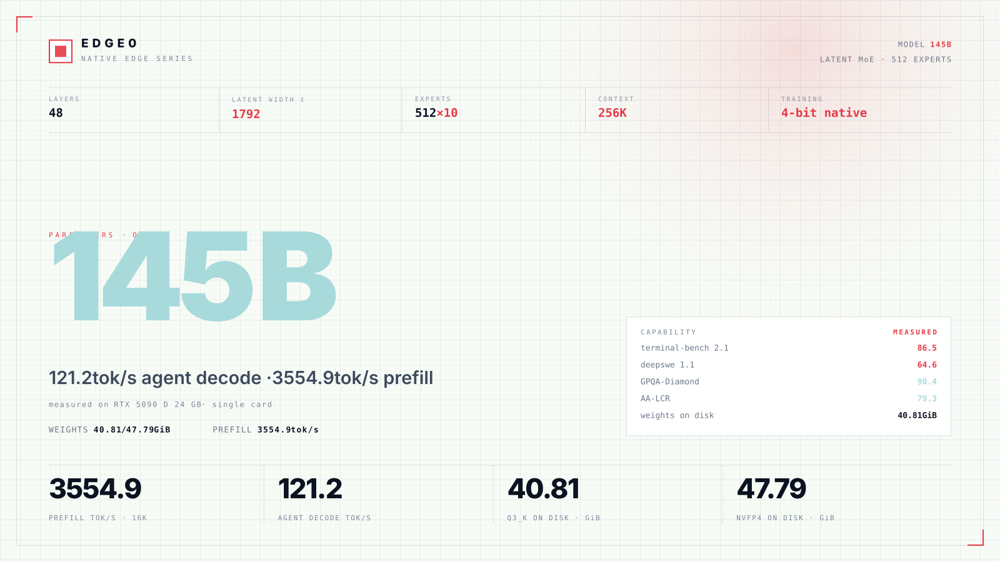
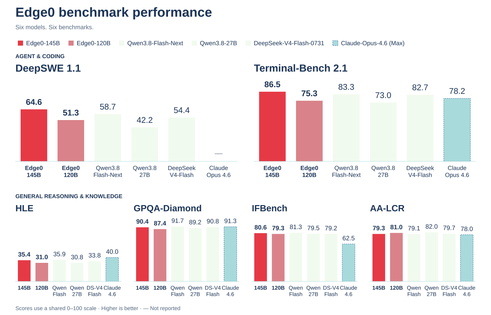
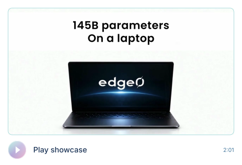

<p align="center"></p>

<h1 align="center">Edge0</h1>

<p align="center">Un framework de inferencia MoE en streaming de código abierto</p>

<br>

<p align="center">Piensa en grande. Ejecútalo aquí.<br>Disperso por diseño.</p>

<br>

<p align="center">macOS · iOS · Android · Linux · Windows<br>Un programa para todos los modelos Edge0</p>

<p align="center"><sub>Proyecto</sub><br>
<br>
<a href="https://arxiv.org/abs/2609.18063"></a> <a href="https://github.com/Edge0-AI/Edge0"></a> <a href="https://edge0.ai/discord"></a> <a href="LICENSE"></a> <a href="https://github.com/Edge0-AI/Edge0/releases"></a>
</p>

<p align="center"><sub>Última versión</sub><br>
<br>
<a href="https://huggingface.co/Edge0/Edge0-145B-q3k"></a> <a href="https://huggingface.co/Edge0/Edge0-145B-NVFP4"></a> <a href="https://huggingface.co/Edge0/Edge0-120B-q3k"></a> <a href="https://huggingface.co/Edge0/Edge0-120B-NVFP4"></a>
</p>

<p align="center"><sub>Versión anterior</sub><br>
<br>
<a href="https://huggingface.co/Edge0/Edge0-35B-A3B-preview"></a> <a href="https://huggingface.co/Edge0/Edge0-8B-A1B-preview"></a> <a href="https://www.modelscope.cn/models/Edge0/Edge0-35B-A3B-preview"></a> <a href="https://www.modelscope.cn/models/Edge0/Edge0-8B-A1B-preview"></a>
</p>

<p align="center"><a href="README.md">English</a> · <a href="README_zh.md">中文</a> · <a href="README_ja.md">日本語</a> · Español · <a href="README_fr.md">Français</a></p>

<p align="center"><a href="#news">Novedades</a> · <a href="#about">Acerca de</a> · <a href="#models">Modelos</a> · <a href="#quality">Calidad</a> · <a href="#benchmark">Rendimiento</a> · <a href="#getting-started">Primeros pasos</a></p>

<br>

<a name="news"></a>

## Novedades

<p><a href="docs/models/edge0-145b.md"></a></p>

<p><a href="edge0-infer/README.md"></a></p>

<p><a href="https://github.com/Edge0-AI/Edge0/tree/pre-edge0-infer"></a></p>

<details open>
<summary>Más novedades</summary>

<p><a href="https://arxiv.org/abs/2609.18063"></a></p>

<p><a href="https://huggingface.co/Edge0/Edge0-35B-A3B-preview"></a></p>

<details>
<summary>Notas de publicación completas</summary>

- **[2026-11-13]** Publicamos **`edge0-145b`** y **`edge0-120b`**, modelos de mezcla de expertos latentes derivados de Qwen3.8-Flash-Next, para una sola GPU NVIDIA en Linux o Windows. Utilizan [edge0-strata](edge0-strata/EDGE0.md), que `edge0-infer serve` y `edge0-infer chat` inician para estos modelos; consulta la [página de modelos](docs/models/edge0-145b.md). Pesos en Hugging Face: [`Edge0-145B-q3k`](https://huggingface.co/Edge0/Edge0-145B-q3k) · [`Edge0-145B-NVFP4`](https://huggingface.co/Edge0/Edge0-145B-NVFP4) · [`Edge0-120B-q3k`](https://huggingface.co/Edge0/Edge0-120B-q3k) · [`Edge0-120B-NVFP4`](https://huggingface.co/Edge0/Edge0-120B-NVFP4).
- **[2026-11-04]** Publicamos el **motor de inferencia unificado [`edge0-infer`](edge0-infer/README.md)**: basado en [GGML](https://github.com/ggml-org/ggml), un motor y una API nativa de C++ ejecutan el mismo modelo en macOS, iOS, Android y Windows, con CLI, servidor local compatible con OpenAI y ejemplos de aplicaciones de chat para escritorio, Android e iOS. La primera versión admite `edge0-35b`; `edge0-8b` llegará en una versión posterior. Sustituye al framework de Python y a los motores específicos de cada plataforma; el código anterior se conserva en la etiqueta [`pre-edge0-infer`](https://github.com/Edge0-AI/Edge0/tree/pre-edge0-infer).
- **[2026-09-30]** Publicamos los **motores de inferencia edge0 para cuatro plataformas: iOS, macOS, Android y Windows** (código en la etiqueta [`pre-edge0-infer`](https://github.com/Edge0-AI/Edge0/tree/pre-edge0-infer)).
- **[2026-09-16]** Nuestro informe técnico está disponible en arXiv: [The Other Half of the Memory Wall: Serving 35B MoEs from SSD with Trained Routing Prediction](https://arxiv.org/abs/2609.18063).
- **[2026-09-08]** Primera publicación de **edge0** como código abierto, junto con los dos tamaños de modelo —[`Edge0-35B-A3B-preview`](https://huggingface.co/Edge0/Edge0-35B-A3B-preview) y [`Edge0-8B-A1B-preview`](https://huggingface.co/Edge0/Edge0-8B-A1B-preview)— en Hugging Face y ModelScope.

</details>

</details>

<a name="previous-release"></a>

<details open>
<summary><h2>Versión anterior</h2></summary>

→ [Guía de la versión 35B / 8B](docs/legacy-models_es.md) — Descargas de modelos, arquitectura, evaluaciones, plataformas compatibles e instrucciones de instalación.

</details>

<a name="about"></a>

## Acerca de

<p>Edge0 es un framework de inferencia MoE en streaming de código abierto para ejecutar grandes modelos dispersos en hardware de consumo.</p>

Úsalo desde la línea de comandos, un servidor API local o la aplicación Edge0 Chat.

La última versión permite ejecutar modelos MoE latentes de 145B y 120B en una sola GPU NVIDIA.

Ambos se entrenan de forma nativa a 4 bits y se ofrecen en Q3_K y NVFP4 para tareas de agentes locales.

[`edge0-infer`](edge0-infer/README.md) proporciona los comandos comunes `serve` y `chat` y selecciona el motor a partir de la carpeta del modelo. Los modelos actuales utilizan [edge0-strata](edge0-strata/EDGE0.md), un fork de Strata; la versión anterior de 35B utiliza el [motor nativo basado en GGML](docs/legacy-models_es.md#native-engine-design).

<a name="platforms"></a>

### Plataformas

La compatibilidad depende del modelo y de su motor.

| Plataforma | `edge0-145b`, `edge0-120b` (edge0-strata) | `edge0-35b` (motor nativo) |
| --- | --- | --- |
| **Linux** | NVIDIA GPU (CUDA 13) | CPU |
| **Windows** | NVIDIA GPU (CUDA 13) | CPU, Vulkan |
| **macOS** (Apple Silicon) | — | Metal, CPU |
| **iOS** | — | Metal |
| **Android** | — | CPU |

Para la última versión, sigue la [instalación de 145B / 120B](#getting-started). La [guía de la versión anterior](docs/legacy-models_es.md#platforms) cubre los backends nativos, las compilaciones por plataforma y los ejemplos de chat. El checkpoint de 8B está disponible; su compatibilidad con el motor nativo está prevista.

<a name="models"></a>

## Modelos

<p>145B / 120B es la serie MoE latente actual, derivada de Qwen3.8-Flash-Next y entrenada de forma nativa a 4 bits.</p>

Se ejecuta en edge0-strata mediante `edge0-infer serve` y `edge0-infer chat`, en Linux o Windows con una GPU NVIDIA y CUDA 13.

**145B Q3_K · RTX 5090 D 24 GB:** 121.2 tok/s de decodificación de agente · 3554.9 tok/s de prefill de 16K.

| Tamaño | Checkpoint publicado | Perfil de inferencia | Motor |
|---|---|---|---|
| [`edge0-145b`](docs/models/edge0-145b.md) | [`Edge0/Edge0-145B-q3k`](https://huggingface.co/Edge0/Edge0-145B-q3k) · [NVFP4](https://huggingface.co/Edge0/Edge0-145B-NVFP4) | Expertos latentes Q3_K o NVFP4 (1792), 48 capas, 512 expertos, K=10 | edge0-strata ✅ (Linux o Windows, GPU NVIDIA) |
| [`edge0-120b`](docs/models/edge0-145b.md) | [`Edge0/Edge0-120B-q3k`](https://huggingface.co/Edge0/Edge0-120B-q3k) · [NVFP4](https://huggingface.co/Edge0/Edge0-120B-NVFP4) | Expertos latentes Q3_K o NVFP4 (1280), 48 capas, 512 expertos, K=10 | edge0-strata ✅ (Linux o Windows, GPU NVIDIA) |

<a name="model-overview--145b-q3_k"></a>

<details open>
<summary><h3>Resumen del modelo · 145B Q3_K</h3></summary>

Q3_K · RTX 5090 D 24 GB. El prefill usa una entrada de 16K tokens. Las puntuaciones de calidad son resultados por modelo.

<a href="assets/edge0-release/model-overview-145B-q3k.svg"></a>

</details>

<a name="quality"></a>

## Calidad

### 145B / 120B

Seis evaluaciones, seis modelos. Cuanto más alto, mejor. Las puntuaciones se presentan por modelo, no como evaluaciones separadas de Q3_K y NVFP4.

<a href="assets/edge0-release/quality-overview.svg"></a>

[Puntuaciones copiables y nombres completos de los modelos](docs/models/edge0-145b.md#quality)

<details>
<summary>Puntuaciones copiables · los seis modelos</summary>

La negrita indica la mejor puntuación de cada columna.

| Modelo | deepswe 1.1 | terminal-bench 2.1 | AA-LCR | IFBench | GPQA-Diamond | HLE |
| --- | ---: | ---: | ---: | ---: | ---: | ---: |
| **Edge0-145B** | **64.6** | **86.5** | 79.3 | 80.6 | 90.4 | 35.4 |
| **Edge0-120B** | 51.3 | 75.3 | 81.0 | 79.3 | 87.4 | 31.0 |
| DeepSeek-V4-Flash-0731 | 54.4 | 82.7 | 79.7 | 79.2 | 90.8 | 33.8 |
| Qwen3.8-Flash-Next | 58.7 | 83.3 | 79.1 | **81.3** | **91.7** | 35.9 |
| Qwen3.8-27B | 42.2 | 73.0 | **82.0** | 79.5 | 89.2 | 30.8 |
| Claude-Opus-4.6 (Max) | / | 78.2 | 78.0 | 62.5 | 91.3 | **40.0** |

</details>

<a name="speed"></a>

<a name="benchmark"></a>

## Rendimiento

<a name="145b--120b-1"></a>

### 145B / 120B

Todas las tasas se expresan en tok/s. La cifra destacada corresponde a **145B Q3_K** en RTX 5090 D 24 GB.

<details open>
<summary>Velocidad de 145B · todos los equipos y formatos</summary>

Las filas resaltadas corresponden a Q3_K. Haz clic en la tabla para verla a tamaño completo.

<a href="assets/edge0-release/speed-145B.svg"></a>

<details>
<summary>Datos copiables de velocidad de 145B</summary>

| Equipo | Formato | Prefill 4K | Prefill 16K | Decodificación de chat | Decodificación de agente |
|---|---|---:|---:|---:|---:|
| RTX 5090 D 24 GB | Q3_K | 2169.9 | 3554.9 | 99.7 | **121.2** |
| RTX 5090 D 24 GB | NVFP4 | 1839.6 | 3165.7 | 79.6 | 98.3 |
| RTX 4090 24 GB | Q3_K | 2042.0 | 3179.4 | 69.9 | 91.7 |
| RTX Spark N1X 60 GiB | Q3_K | 674.0 | 770.3 | 37.7 | 36.7 |
| RTX Spark N1X 60 GiB | NVFP4 | 821.2 | 922.4 | 40.1 | 46.0 |
| Apple M2 Ultra (Metal) | Q3_K | 755.6 | 800.3 | 60.9 | 57.0 |
| 16 GiB VRAM + 20 GiB RAM | Q3_K | 249 | 335 | 36.8 | 44.9 |

</details>

</details>

<details>
<summary>Condiciones de medición de 145B · presupuesto limitado y residencia en memoria</summary>

Las filas `16 GiB VRAM + 20 GiB RAM` usan la misma RTX 5090 D 24 GB, no otra tarjeta. La VRAM se limita con `--vram-reserve-mib 8192`; la RAM del sistema, con un cgroup (`MemoryMax=20G`, sin swap). Con la residencia activada, **Q3_K** (40.81 GiB de pesos) ocupa 23.14 GiB VRAM + 31.28 GiB RAM, y **NVFP4** (47.79 GiB) ocupa 23.25 GiB VRAM + 38.27 GiB RAM en la misma tarjeta. Los conjuntos de expertos son disjuntos: nada se contabiliza dos veces.

El presupuesto de 16 GiB VRAM + 20 GiB RAM es un límite de prueba, no un requisito mínimo del sistema. La fila Apple M2 Ultra es una medición con Metal, no un anuncio de disponibilidad para macOS.

</details>

<details open>
<summary>Velocidad de 120B · todos los equipos y formatos</summary>

<a href="assets/edge0-release/speed-120B.svg"></a>

<details>
<summary>Datos copiables de velocidad de 120B</summary>

| Equipo | Formato | Prefill 4K | Prefill 16K | Decodificación de chat | Decodificación de agente |
|---|---|---:|---:|---:|---:|
| RTX 5090 D 24 GB | Q3_K | 3236.7 | 4576.5 | 130.2 | **144.6** |
| RTX 5090 D 24 GB | NVFP4 | 2668.5 | 4357.1 | 124.9 | 135.5 |
| RTX 4090 24 GB | Q3_K | 2637.5 | 3551.1 | 95.0 | 104.9 |
| RTX Spark N1X 60 GiB | Q3_K | 987.0 | 1081.7 | 47.2 | 68.4 |
| RTX Spark N1X 60 GiB | NVFP4 | 996.4 | 1066.9 | 45.1 | 68.9 |
| Apple M2 Ultra (Metal) | Q3_K | 867.6 | 908.7 | 60.4 | 63.0 |
| 16 GiB VRAM + 20 GiB RAM | Q3_K | 430 | 778 | 62.4 | 73.3 |
| 16 GiB VRAM + 20 GiB RAM | NVFP4 | 361.1 | 619.7 | 51.3 | 59.9 |

</details>

Las filas `16 GiB VRAM + 20 GiB RAM` también usan la RTX 5090 D 24 GB, limitada mediante cgroup a un presupuesto de 16 GiB de VRAM y 20 GiB de RAM del sistema; no se trata de otra tarjeta. Con la residencia activada, **Q3_K** (27.98 GiB de pesos) ocupa 22.93 GiB VRAM + 18.40 GiB RAM, y **NVFP4** (32.96 GiB) ocupa 23.02 GiB VRAM + 23.40 GiB RAM en la misma tarjeta. Los conjuntos de expertos son disjuntos: nada se contabiliza dos veces.

</details>

<a name="in-action"></a>

<details open>
<summary><h2>En acción</h2></summary>

<p align="center"><a href="assets/edge0-release/showcase.mp4"></a></p>

<p align="center">Grabado con Edge0-145B · <a href="assets/edge0-release/showcase.mp4">Abrir vídeo ↗</a></p>

<details>
<summary>Cinco demostraciones · guía de capítulos</summary>

| Tiempo | Demostración |
| --- | --- |
| 0:00 | Chat y programación locales |
| 0:36 | Producción de vídeo |
| 0:58 | Manhattan en 3D |
| 1:19 | Creación de un entorno de catedral |
| 1:38 | Diseño de PCB |

[Marcadores de capítulos (VTT)](assets/edge0-release/showcase-chapters.vtt)

</details>

</details>

<a name="architecture"></a>

## Arquitectura

El MoE latente comprime las entradas de los expertos y mantiene la atención a anchura completa. El modelo de 145B usa una anchura latente de 1792; el de 120B, de 1280. Ambos enrutan cada token a 10 de los 512 expertos, además de un experto compartido.

<details open>
<summary>Detalles de arquitectura · diagrama y configuración</summary>

<a href="assets/edge0-release/arch-145B.svg"></a>

[Configuración completa, enrutamiento y perfiles de ambos modelos](docs/models/edge0-145b.md#model-profile).

</details>

<a name="quick-start"></a>

<a name="getting-started"></a>

## Primeros pasos

### 145B / 120B · edge0-strata

Cada carpeta de modelo (Q3_K o NVFP4, Edge0-145B o Edge0-120B) se ejecuta mediante `edge0-infer`, desde la línea de comandos o la aplicación de escritorio Edge0 Chat. Conserva la estructura de la carpeta: `edge0-infer` identifica el modelo mediante `model_name` en su `model.json`.

Para 145B y 120B, usa `serve` o `chat`; `run` corresponde al motor nativo.

<details>
<summary>Notas sobre plataformas y documentación</summary>

Las instrucciones de compilación están destinadas a GPU NVIDIA con CUDA 13 en Linux o Windows (x64 o ARM64). Las mediciones de Apple M2 Ultra usan Metal; no establecen la disponibilidad de una versión para macOS.

</details>

<details>
<summary>Instrucciones de compilación y línea de comandos</summary>

**1. Compilar.** Clona el repositorio y compila las dos partes. Ejecuta los siguientes comandos de inicio desde `edge0-infer/`:

```bash
git clone https://github.com/Edge0-AI/Edge0.git edge0
```

- **edge0-strata**, el motor: sigue «Build (Linux, NVIDIA)» o «Build (Windows, NVIDIA)» en [edge0-strata/EDGE0.md](edge0-strata/EDGE0.md).
- **edge0-infer**: sigue «Build» (Linux) o «Windows» en [edge0-infer/docs/getting-started.md](edge0-infer/docs/getting-started.md).

**2. Ejecutar desde la línea de comandos.** Indica una sola carpeta de modelo, como `Edge0-145B-q3k`, no la carpeta que contiene varios modelos. En Windows el programa es `build\windows\bin\edge0-infer.exe`.

```bash
build/cpu/bin/edge0-infer serve --model /path/to/Edge0-145B-q3k
```

Una vez cargados los pesos, muestra `Listening: http://127.0.0.1:8000 model=<name>`, donde `<name>` es `edge0_145b`, y ofrece endpoints compatibles con OpenAI y Anthropic:

```bash
curl localhost:8000/v1/chat/completions -H 'content-type: application/json' -d '{"model":"edge0_145b","messages":[{"role":"user","content":"hi"}],"max_tokens":64}'
```

`edge0-infer chat --model /path/to/Edge0-145B-q3k` abre una sesión interactiva. Más opciones: [edge0-infer/docs/edge0-145b.md](edge0-infer/docs/edge0-145b.md).

</details>

<details>
<summary>Aplicación de escritorio · Windows</summary>

⬇️ **Descargar:** **[GitHub Releases](https://github.com/Edge0-AI/Edge0/releases)**

Abre **Edge0 Chat** en Windows y selecciona una carpeta de modelo, como `Edge0-145B-q3k`, para ejecutarlo localmente. Para compilar la aplicación desde el código fuente, sigue la guía de [Edge0 Chat](edge0-infer/examples/desktop/README.md).

</details>

<a name="documentation"></a>

## Documentación

**Última versión · 145B / 120B**

- [Modelos, mediciones y arquitectura](docs/models/edge0-145b.md)
- [edge0-strata · requisitos de compilación e inicio](edge0-strata/EDGE0.md)
- Guías de modelos de edge0-infer: [145B](edge0-infer/docs/edge0-145b.md) / [120B](edge0-infer/docs/edge0-120b.md)

**Framework**

- [edge0-infer](edge0-infer/README.md) · línea de comandos, servidor local y aplicaciones de chat
- [Servidor local](edge0-infer/docs/local-server.md) / [Pruebas](edge0-infer/docs/testing.md)
- [Herramientas de recursos de modelos y cómo añadir un modelo](edge0-infer/tools/assets/README.md)

<details>
<summary>Versión anterior · modelos y documentación del motor nativo</summary>

- [Guía de la versión 35B / 8B](docs/legacy-models_es.md)
- [Enrutamiento MoE y expertos](docs/moe.md) / [prerouter](docs/prerouter.md)
- Referencias de modelos: [edge0-35b](docs/models/edge0-35b.md) / [edge0-8b](docs/models/edge0-8b.md)
- [Primeros pasos](edge0-infer/docs/getting-started.md): compilación nativa, recursos de modelos, run, chat y serve en las plataformas compatibles
- [Configuración](edge0-infer/docs/configuration.md) / [API nativa](edge0-infer/docs/native-api.md)
- [Arquitectura](edge0-infer/docs/architecture.md) / [Diseño del motor nativo](edge0-infer/docs/architecture.md#native-engine) / [Limitaciones conocidas](edge0-infer/docs/limitations.md)
- [Mediciones de rendimiento](edge0-infer/docs/benchmarking.md)
- Informe técnico: [The Other Half of the Memory Wall](https://arxiv.org/abs/2609.18063) ([PDF](paper/main.pdf))

</details>

<a name="roadmap"></a>

## Hoja de ruta

<details>
<summary>Cuarto trimestre de 2026 · arquitectura e inferencia</summary>

**Modelos y algoritmos**

El cuarto trimestre aborda dos frentes: incorporar una arquitectura de nueva generación al framework y convertir el razonamiento latente en una reducción real de latencia, no solo del número de operaciones.

- **Compatibilidad con arquitecturas de nueva generación (clase Qwen3.8-Flash)** — ejecutar atención lineal híbrida (GDN + QSA), conexiones residuales multirrama con compuertas y topologías de embeddings N-gram en edge0. Estos diseños encajan de forma natural con la descarga en streaming a SSD: la atención con estado O(1) evita que el razonamiento prolongado se convierta en un problema de KV-cache, y las tablas N-gram de solo consulta se cargan bajo demanda. Objetivo: ejecutar el modelo en un solo dispositivo y obtener resultados con una diferencia aceptable respecto al modelo base fp16.
- **Razonamiento latente + predicción anticipada de expertos por lotes** — reducir la *latencia* del razonamiento latente, no solo sus operaciones aritméticas. El reto central consiste en pasar del enrutamiento por posición a **una vez por bloque**, para que una predicción cubra todas las posiciones y rondas del bloque y **el volumen de expertos cargados sea independiente del número de iteraciones de razonamiento**. Se añade la precarga entre bloques, que carga los expertos del siguiente bloque durante el cálculo del actual. El progreso se mide por el **tiempo total de la fase de razonamiento a igual precisión**, nunca por tokens/s.

[Hitos de la versión anterior y compatibilidad prevista con el motor nativo](docs/legacy-models_es.md#roadmap).

</details>

<a name="contributing"></a>

## Contribuir

<details>
<summary>Flujo de desarrollo y comprobaciones</summary>

Todas las contribuciones son bienvenidas: issues, PR, informes de rendimiento y adaptaciones de modelos.

La compilación y las pruebas se describen en [Pruebas](edge0-infer/docs/testing.md). Estas comprobaciones no requieren recursos de modelos:

```bash
cd edge0-infer
cmake --preset cpu && cmake --build --preset cpu
ctest --preset cpu -L "L0|L1"
```

Para cambios en `edge0-infer/`, abre issues y PR en este repositorio como de costumbre. Ese directorio se desarrolla en otro repositorio; los mantenedores aplican primero allí los cambios aceptados y llegan aquí con la siguiente sincronización. Consulta [CONTRIBUTING](CONTRIBUTING.md).

Flujo: fork → rama de funcionalidad → PR dirigido a `main`. Mantén las pruebas aprobadas y añade pruebas para los comportamientos nuevos.

</details>

<a name="citation"></a>

## Cita

El informe técnico trata la inferencia de 35B en streaming desde SSD y la predicción de enrutamiento entrenada.

Si edge0 te resulta útil, cita nuestro informe técnico:

```bibtex
@article{lin2026other,
  title   = {The Other Half of the Memory Wall: Serving 35B MoEs from SSD
             with Trained Routing Prediction},
  author  = {Lin, Yu and Wang, Yiming and Cai, Runyuan and Liu, Hanze and
             Zeng, Xiaodong},
  journal = {arXiv preprint arXiv:2609.18063},
  year    = {2026},
  url     = {https://arxiv.org/abs/2609.18063}
}
```

<a name="contact-us"></a>

## Contacto

- **Discord**: [edge0.ai/discord](https://edge0.ai/discord) — conversación y soporte de la comunidad
- **Correo electrónico**: samuel@edge0.ai

Para errores y solicitudes de funciones, utiliza [GitHub Issues](https://github.com/Edge0-AI/Edge0/issues).

<a name="license"></a>

<details>
<summary><h2>Licencia</h2></summary>

<a name="framework-code"></a>

### Código del framework

El código del framework sigue bajo [Apache-2.0](LICENSE). Los componentes incluidos conservan sus propias licencias y [avisos](NOTICE), incluida la [licencia MIT](edge0-strata/LICENSE) de Strata.

<a name="model-license"></a>

### Licencia de los modelos

Las contribuciones específicas de Edge0 a los modelos se ofrecen bajo la [Edge0 Community Model License 1.0](licenses/edge0-model/LICENSE), aplicable únicamente a las contribuciones que Edge0 posee o está autorizado a licenciar. Las licencias válidas anteriores no cambian.

Sujeta a las condiciones aplicables de los proveedores originales, la licencia permite el uso personal, la investigación, la educación, la modificación, la distribución no comercial, el uso interno y el uso comercial de los resultados generados. No exige revelar modificaciones privadas ni mostrar una insignia de Edge0 en la interfaz.

Se requiere un permiso escrito independiente de Edge0 para:

- **Venta de modelos y distribución de pago**, incluidos los adaptadores y deltas cubiertos, así como los paquetes comerciales cuyo valor principal sea el acceso al modelo.
- **Servicios comerciales de modelos** que ofrezcan inferencia o ajuste fino y se financien mediante pagos, suscripciones, publicidad o patrocinios relacionados.
- **Asistentes comerciales independientes de programación u ofimática**, tanto si la inferencia se ejecuta en un servidor como en el dispositivo del usuario.

Consulta la licencia completa para conocer las definiciones, excepciones y requisitos de redistribución. Licencias comerciales: [info@edge0.ai](mailto:info@edge0.ai).

<a name="upstream-terms-and-scope"></a>

### Condiciones de origen y alcance

Los materiales de Qwen siguen sujetos a su licencia de origen aplicable. La [Qwen Community License 1.0](licenses/edge0-model/third-party/Qwen-LICENSE.txt) conservada se reproduce sin modificaciones; el permiso de Edge0 no exime de los requisitos de atribución de Qwen ni de sus autorizaciones comerciales independientes.

Consulta el [NOTICE del modelo](licenses/edge0-model/NOTICE) para conocer las atribuciones y el alcance de las licencias. Las licencias del framework y del código de terceros no se ven afectadas.

<details>
<summary><b>Agradecimientos · linaje de los modelos y créditos del motor</b></summary>

Agradecemos a los equipos de [Qwen3.8-Flash-Next](https://huggingface.co/Qwen/Qwen3.8-Flash-Next) y [Strata](https://github.com/Niko1221/Strata). Edge0 añade compatibilidad con MoE latente al motor Strata. `edge0-strata` es un fork de Strata, de Niko1221 y los colaboradores de Strata, y conserva su [licencia MIT](edge0-strata/LICENSE).

El código del framework Edge0 se publica bajo [Apache-2.0](LICENSE); los componentes de terceros incluidos mantienen sus propias licencias (véase [NOTICE](NOTICE)). Las [versiones anteriores](docs/legacy-models_es.md#models) conservan su linaje de modelos Qwen3.6 y Ling.

</details>

</details>
