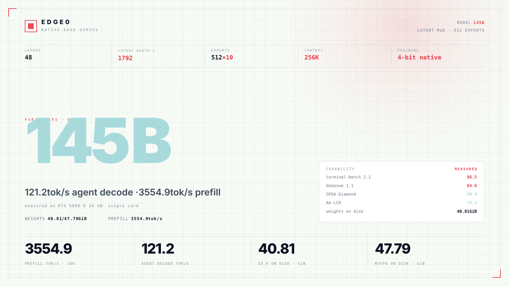
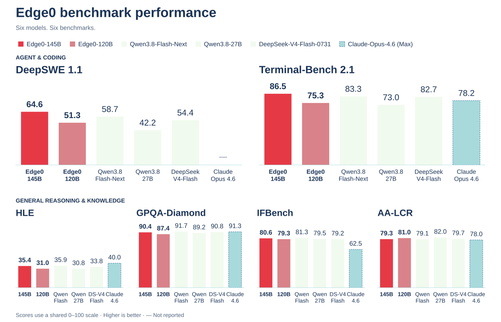
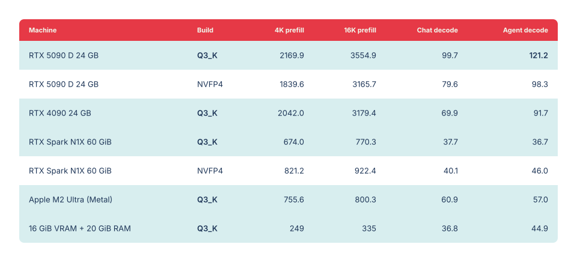
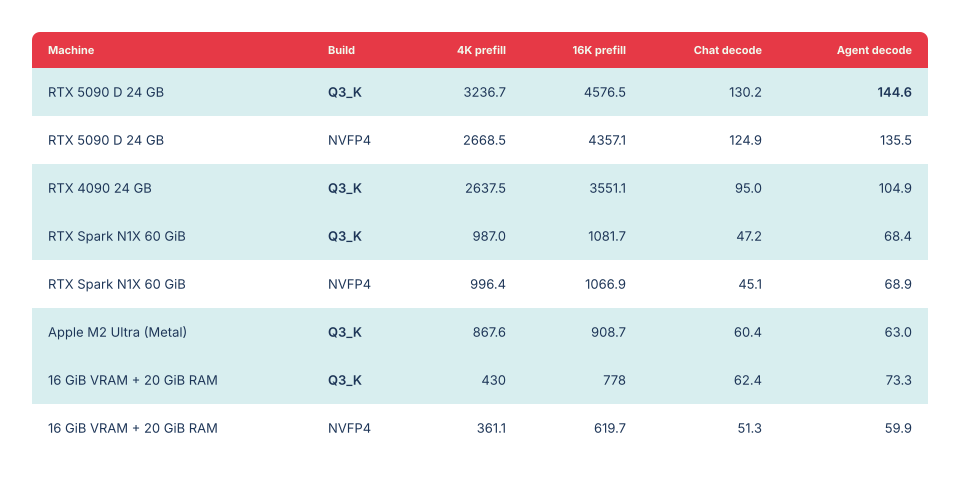
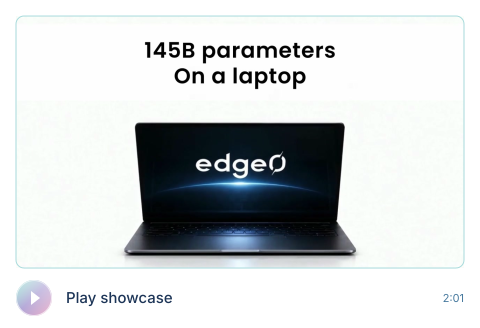
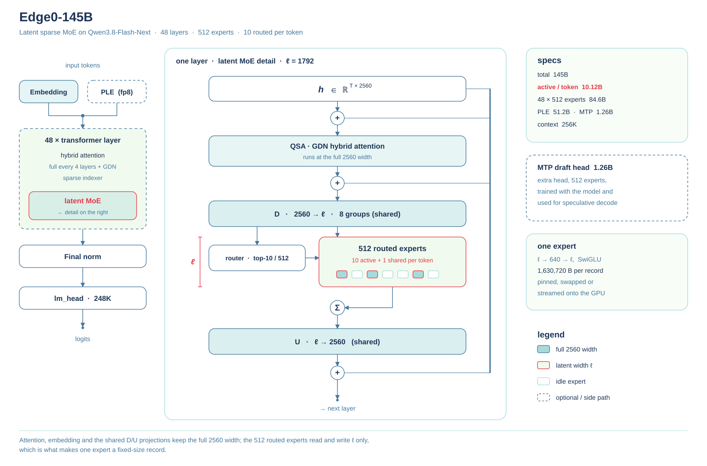

<p align="center"></p>

<h1 align="center">Edge0</h1>

<p align="center">Un framework d’inférence MoE en streaming, open source</p>

<br>

<p align="center">Voyez grand. Exécutez ici.<br>La parcimonie, dès la conception.</p>

<br>

<p align="center">macOS · iOS · Android · Linux · Windows<br>Un programme pour tous les modèles Edge0</p>

<p align="center"><sub>Projet</sub><br>
<br>
<a href="https://arxiv.org/abs/2609.18063"></a> <a href="https://github.com/Edge0-AI/Edge0"></a> <a href="https://edge0.ai/discord"></a> <a href="LICENSE"></a> <a href="https://github.com/Edge0-AI/Edge0/releases"></a>
</p>

<p align="center"><sub>Dernière version</sub><br>
<br>
<a href="https://huggingface.co/Edge0/Edge0-145B-q3k"></a> <a href="https://huggingface.co/Edge0/Edge0-145B-NVFP4"></a> <a href="https://huggingface.co/Edge0/Edge0-120B-q3k"></a> <a href="https://huggingface.co/Edge0/Edge0-120B-NVFP4"></a>
</p>

<p align="center"><sub>Version précédente</sub><br>
<br>
<a href="https://huggingface.co/Edge0/Edge0-35B-A3B-preview"></a> <a href="https://huggingface.co/Edge0/Edge0-8B-A1B-preview"></a> <a href="https://www.modelscope.cn/models/Edge0/Edge0-35B-A3B-preview"></a> <a href="https://www.modelscope.cn/models/Edge0/Edge0-8B-A1B-preview"></a>
</p>

<p align="center"><a href="README.md">English</a> · <a href="README_zh.md">中文</a> · <a href="README_ja.md">日本語</a> · <a href="README_es.md">Español</a> · Français</p>

<p align="center"><a href="#news">Actualités</a> · <a href="#about">À propos</a> · <a href="#models">Modèles</a> · <a href="#quality">Qualité</a> · <a href="#benchmark">Performances</a> · <a href="#getting-started">Premiers pas</a></p>

<br>

<a name="news"></a>

## Actualités

<p><a href="docs/models/edge0-145b.md"></a></p>

<p><a href="edge0-infer/README.md"></a></p>

<p><a href="https://github.com/Edge0-AI/Edge0/tree/pre-edge0-infer"></a></p>

<details open>
<summary>Plus d’actualités</summary>

<p><a href="https://arxiv.org/abs/2609.18063"></a></p>

<p><a href="https://huggingface.co/Edge0/Edge0-35B-A3B-preview"></a></p>

<details>
<summary>Notes de version complètes</summary>

- **[2026-11-13]** Nous avons publié **`edge0-145b`** et **`edge0-120b`**, des modèles à mélange d’experts latents dérivés de Qwen3.8-Flash-Next, pour un seul GPU NVIDIA sous Linux ou Windows. Ils utilisent [edge0-strata](edge0-strata/EDGE0.md), lancé pour eux par `edge0-infer serve` et `edge0-infer chat` ; voir la [page des modèles](docs/models/edge0-145b.md). Poids sur Hugging Face : [`Edge0-145B-q3k`](https://huggingface.co/Edge0/Edge0-145B-q3k) · [`Edge0-145B-NVFP4`](https://huggingface.co/Edge0/Edge0-145B-NVFP4) · [`Edge0-120B-q3k`](https://huggingface.co/Edge0/Edge0-120B-q3k) · [`Edge0-120B-NVFP4`](https://huggingface.co/Edge0/Edge0-120B-NVFP4).
- **[2026-11-04]** Nous avons publié le **moteur d’inférence unifié [`edge0-infer`](edge0-infer/README.md)** : fondé sur [GGML](https://github.com/ggml-org/ggml), un moteur et une API native C++ exécutent le même modèle sous macOS, iOS, Android et Windows, avec une CLI, un serveur local compatible OpenAI et des exemples d’applications de chat pour ordinateur, Android et iOS. La première version prend en charge `edge0-35b` ; `edge0-8b` suivra dans une prochaine version. Ce moteur remplace le framework Python et les moteurs propres à chaque plateforme ; l’ancien code est conservé sous le tag [`pre-edge0-infer`](https://github.com/Edge0-AI/Edge0/tree/pre-edge0-infer).
- **[2026-09-30]** Nous avons publié les **moteurs d’inférence edge0 pour quatre plateformes : iOS, macOS, Android et Windows** (sources sous le tag [`pre-edge0-infer`](https://github.com/Edge0-AI/Edge0/tree/pre-edge0-infer)).
- **[2026-09-16]** Notre rapport technique est disponible sur arXiv : [The Other Half of the Memory Wall: Serving 35B MoEs from SSD with Trained Routing Prediction](https://arxiv.org/abs/2609.18063).
- **[2026-09-08]** Première publication open source d’**edge0**, accompagnée des deux tailles de modèle — [`Edge0-35B-A3B-preview`](https://huggingface.co/Edge0/Edge0-35B-A3B-preview) et [`Edge0-8B-A1B-preview`](https://huggingface.co/Edge0/Edge0-8B-A1B-preview) — sur Hugging Face et ModelScope.

</details>

</details>

<a name="previous-release"></a>

<details open>
<summary><h2>Version précédente</h2></summary>

→ [Guide de la version 35B / 8B](docs/legacy-models_fr.md) — Téléchargements, architecture, évaluations, plateformes prises en charge et installation.

</details>

<a name="about"></a>

## À propos

<p>Edge0 est un framework d’inférence MoE en streaming, open source, qui exécute de grands modèles parcimonieux sur du matériel grand public.</p>

Utilisez-le en ligne de commande, via un serveur API local ou avec l’application Edge0 Chat.

La dernière version permet d’exécuter les modèles MoE latents de 145B et 120B sur un seul GPU NVIDIA ou sur un Mac Apple Silicon.

Tous deux sont entraînés nativement en 4 bits et proposés aux formats Q3_K et NVFP4 pour les tâches d’agents locaux.

[`edge0-infer`](edge0-infer/README.md) fournit les commandes communes `serve` et `chat` et sélectionne le moteur à partir du dossier du modèle. Les modèles actuels utilisent [edge0-strata](edge0-strata/EDGE0.md), un fork de Strata ; la version précédente de 35B utilise le [moteur natif fondé sur GGML](docs/legacy-models_fr.md#native-engine-design).

<a name="platforms"></a>

### Plateformes

La prise en charge dépend du modèle et de son moteur.

| Plateforme | `edge0-145b`, `edge0-120b` (edge0-strata) | `edge0-35b` (moteur natif) |
| --- | --- | --- |
| **Linux** | NVIDIA GPU (CUDA 13) | CPU |
| **Windows** | NVIDIA GPU (CUDA 13) | CPU, Vulkan |
| **macOS** (Apple Silicon) | Metal | Metal, CPU |
| **iOS** | — | Metal |
| **Android** | — | CPU |

Pour la dernière version, suivez l’[installation de 145B / 120B](#getting-started). Le [guide de la version précédente](docs/legacy-models_fr.md#platforms) couvre les backends natifs, les compilations par plateforme et les exemples de chat. Le checkpoint 8B est disponible ; sa prise en charge par le moteur natif est prévue.

<a name="models"></a>

## Modèles

<p>145B / 120B est la série MoE latente actuelle, dérivée de Qwen3.8-Flash-Next et entraînée nativement en 4 bits.</p>

Ces modèles fonctionnent sur edge0-strata via `edge0-infer serve` et `edge0-infer chat`, sous Linux ou Windows avec un GPU NVIDIA et CUDA 13, ou sous macOS avec Metal sur Apple Silicon.

**145B Q3_K · RTX 5090 D 24 GB :** décodage agent à 121.2 tok/s · préremplissage 16K à 3554.9 tok/s.

| Taille | Checkpoint publié | Profil d’inférence | Moteur |
|---|---|---|---|
| [`edge0-145b`](docs/models/edge0-145b.md) | [`Edge0/Edge0-145B-q3k`](https://huggingface.co/Edge0/Edge0-145B-q3k) · [NVFP4](https://huggingface.co/Edge0/Edge0-145B-NVFP4) | Experts latents Q3_K ou NVFP4 (1792), 48 couches, 512 experts, K=10 | edge0-strata ✅ (Linux ou Windows, GPU NVIDIA ; macOS Apple Silicon, Metal, Q3_K) |
| [`edge0-120b`](docs/models/edge0-145b.md) | [`Edge0/Edge0-120B-q3k`](https://huggingface.co/Edge0/Edge0-120B-q3k) · [NVFP4](https://huggingface.co/Edge0/Edge0-120B-NVFP4) | Experts latents Q3_K ou NVFP4 (1280), 48 couches, 512 experts, K=10 | edge0-strata ✅ (Linux ou Windows, GPU NVIDIA ; macOS Apple Silicon, Metal, Q3_K) |

<a name="model-overview--145b-q3_k"></a>

<details open>
<summary><h3>Vue d’ensemble · 145B Q3_K</h3></summary>

Q3_K · RTX 5090 D 24 GB. Le préremplissage utilise une entrée de 16K tokens. Les scores de qualité sont des résultats par modèle.

<a href="assets/edge0-release/model-overview-145B-q3k.svg"></a>

</details>

<a name="quality"></a>

## Qualité

### 145B / 120B

Six évaluations, six modèles. Un score plus élevé est meilleur. Les résultats sont présentés par modèle, et non sous forme d’évaluations distinctes de Q3_K et NVFP4.

<a href="assets/edge0-release/quality-overview.svg"></a>

[Scores copiables et noms complets des modèles](docs/models/edge0-145b.md#quality)

<details>
<summary>Scores copiables · les six modèles</summary>

Le gras indique le meilleur score de chaque colonne.

| Modèle | deepswe 1.1 | terminal-bench 2.1 | AA-LCR | IFBench | GPQA-Diamond | HLE |
| --- | ---: | ---: | ---: | ---: | ---: | ---: |
| **Edge0-145B** | **64.6** | **86.5** | 79.3 | 80.6 | 90.4 | 35.4 |
| **Edge0-120B** | 51.3 | 75.3 | 81.0 | 79.3 | 87.4 | 31.0 |
| DeepSeek-V4-Flash-0731 | 54.4 | 82.7 | 79.7 | 79.2 | 90.8 | 33.8 |
| Qwen3.8-Flash-Next | 58.7 | 83.3 | 79.1 | **81.3** | **91.7** | 35.9 |
| Qwen3.8-27B | 42.2 | 73.0 | **82.0** | 79.5 | 89.2 | 30.8 |
| Claude-Opus-4.6 (Max) | / | 78.2 | 78.0 | 62.5 | 91.3 | **40.0** |

</details>

<a name="speed"></a>

<a name="benchmark"></a>

## Performances

<a name="145b--120b-1"></a>

### 145B / 120B

Tous les débits sont exprimés en tok/s. Le chiffre mis en avant correspond à **145B Q3_K** sur RTX 5090 D 24 GB.

<details open>
<summary>Vitesse de 145B · tous les appareils et formats</summary>

Les lignes mises en évidence correspondent à Q3_K. Cliquez sur le tableau pour l’afficher en taille réelle.

<a href="assets/edge0-release/speed-145B.svg"></a>

<details>
<summary>Données de vitesse copiables pour 145B</summary>

| Appareil | Format | Préremplissage 4K | Préremplissage 16K | Décodage chat | Décodage agent |
|---|---|---:|---:|---:|---:|
| RTX 5090 D 24 GB | Q3_K | 2169.9 | 3554.9 | 99.7 | **121.2** |
| RTX 5090 D 24 GB | NVFP4 | 1839.6 | 3165.7 | 79.6 | 98.3 |
| RTX 4090 24 GB | Q3_K | 2042.0 | 3179.4 | 69.9 | 91.7 |
| RTX Spark N1X 60 GiB | Q3_K | 674.0 | 770.3 | 37.7 | 36.7 |
| RTX Spark N1X 60 GiB | NVFP4 | 821.2 | 922.4 | 40.1 | 46.0 |
| Apple M2 Ultra (Metal) | Q3_K | 755.6 | 800.3 | 60.9 | 57.0 |
| 16 GiB VRAM + 20 GiB RAM | Q3_K | 249 | 335 | 36.8 | 44.9 |

</details>

</details>

<details>
<summary>Conditions de mesure de 145B · budget limité et résidence en mémoire</summary>

Les lignes `16 GiB VRAM + 20 GiB RAM` utilisent la même RTX 5090 D 24 GB, pas une autre carte. La VRAM est limitée par `--vram-reserve-mib 8192` ; la RAM système par un cgroup (`MemoryMax=20G`, sans swap). Avec la résidence activée, **Q3_K** (40.81 GiB de poids) occupe 23.14 GiB VRAM + 31.28 GiB RAM, et **NVFP4** (47.79 GiB) occupe 23.25 GiB VRAM + 38.27 GiB RAM sur cette même carte. Les ensembles d’experts sont disjoints, sans double comptage.

Le budget de 16 GiB VRAM + 20 GiB RAM est une limite de test, pas une configuration minimale requise. La ligne Apple M2 Ultra est une mesure sous Metal.

</details>

<details open>
<summary>Vitesse de 120B · tous les appareils et formats</summary>

<a href="assets/edge0-release/speed-120B.svg"></a>

<details>
<summary>Données de vitesse copiables pour 120B</summary>

| Appareil | Format | Préremplissage 4K | Préremplissage 16K | Décodage chat | Décodage agent |
|---|---|---:|---:|---:|---:|
| RTX 5090 D 24 GB | Q3_K | 3236.7 | 4576.5 | 130.2 | **144.6** |
| RTX 5090 D 24 GB | NVFP4 | 2668.5 | 4357.1 | 124.9 | 135.5 |
| RTX 4090 24 GB | Q3_K | 2637.5 | 3551.1 | 95.0 | 104.9 |
| RTX Spark N1X 60 GiB | Q3_K | 987.0 | 1081.7 | 47.2 | 68.4 |
| RTX Spark N1X 60 GiB | NVFP4 | 996.4 | 1066.9 | 45.1 | 68.9 |
| Apple M2 Ultra (Metal) | Q3_K | 867.6 | 908.7 | 60.4 | 63.0 |
| 16 GiB VRAM + 20 GiB RAM | Q3_K | 430 | 778 | 62.4 | 73.3 |
| 16 GiB VRAM + 20 GiB RAM | NVFP4 | 361.1 | 619.7 | 51.3 | 59.9 |

</details>

Les lignes `16 GiB VRAM + 20 GiB RAM` utilisent elles aussi la RTX 5090 D 24 GB, limitée par cgroup à un budget de 16 GiB de VRAM et de 20 GiB de RAM système ; il ne s’agit pas d’une autre carte. Avec la résidence activée, **Q3_K** (27.98 GiB de poids) occupe 22.93 GiB VRAM + 18.40 GiB RAM, et **NVFP4** (32.96 GiB) occupe 23.02 GiB VRAM + 23.40 GiB RAM sur cette même carte. Les ensembles d’experts sont disjoints, sans double comptage.

</details>

<a name="in-action"></a>

<details open>
<summary><h2>En action</h2></summary>

<p align="center"><a href="assets/edge0-release/showcase.mp4"></a></p>

<p align="center">Enregistré avec Edge0-145B · <a href="assets/edge0-release/showcase.mp4">Ouvrir la vidéo ↗</a></p>

<details>
<summary>Cinq démonstrations · guide des chapitres</summary>

| Temps | Démonstration |
| --- | --- |
| 0:00 | Chat et programmation en local |
| 0:36 | Production vidéo |
| 0:58 | Manhattan en 3D |
| 1:19 | Création d’un environnement de cathédrale |
| 1:38 | Conception de PCB |

[Repères de chapitres (VTT)](assets/edge0-release/showcase-chapters.vtt)

</details>

</details>

## Architecture

Le MoE latent compresse les entrées des experts tout en conservant l’attention à pleine largeur. Le modèle 145B utilise une largeur latente de 1792, contre 1280 pour le 120B. Tous deux acheminent chaque token vers 10 des 512 experts, auxquels s’ajoute un expert partagé.

<details open>
<summary>Détails de l’architecture · schéma et configuration</summary>

<a href="assets/edge0-release/arch-145B.svg"></a>

[Configuration complète, routage et profils des deux modèles](docs/models/edge0-145b.md#model-profile).

</details>

<a name="quick-start"></a>

<a name="getting-started"></a>

## Premiers pas

### 145B / 120B · edge0-strata

Chaque dossier de modèle (Q3_K ou NVFP4, Edge0-145B ou Edge0-120B) s’exécute via `edge0-infer`, depuis la ligne de commande ou l’application de bureau Edge0 Chat. Conservez la structure du dossier : `edge0-infer` identifie le modèle grâce à `model_name` dans son `model.json`.

Pour 145B et 120B, utilisez `serve` ou `chat` ; `run` est réservé au moteur natif.

<details>
<summary>Notes sur les plateformes et la documentation</summary>

Les instructions de compilation couvrent les GPU NVIDIA avec CUDA 13 sous Linux ou Windows (x64 ou ARM64), et Metal sur macOS Apple Silicon.

</details>

<details>
<summary>Compilation et ligne de commande</summary>

**1. Compiler.** Clonez le dépôt, puis compilez les deux parties. Exécutez les commandes de lancement ci-dessous depuis `edge0-infer/` :

```bash
git clone https://github.com/Edge0-AI/Edge0.git edge0
```

- **edge0-strata**, le moteur : suivez « Build (Linux, NVIDIA) », « Build (Windows, NVIDIA) » ou « Build (macOS, Apple Silicon) » dans [edge0-strata/EDGE0.md](edge0-strata/EDGE0.md).
- **edge0-infer** : suivez « Build » (Linux) ou « Windows » dans [edge0-infer/docs/getting-started.md](edge0-infer/docs/getting-started.md).

**2. Exécuter en ligne de commande.** Indiquez un seul dossier de modèle, tel que `Edge0-145B-q3k`, et non le dossier contenant plusieurs modèles. Sous Windows, le programme est `build\windows\bin\edge0-infer.exe`.

```bash
build/cpu/bin/edge0-infer serve --model /path/to/Edge0-145B-q3k
```

Une fois les poids chargés, le programme affiche `Listening: http://127.0.0.1:8000 model=<name>`, où `<name>` vaut `edge0_145b`, puis expose des endpoints compatibles OpenAI et Anthropic :

```bash
curl localhost:8000/v1/chat/completions -H 'content-type: application/json' -d '{"model":"edge0_145b","messages":[{"role":"user","content":"hi"}],"max_tokens":64}'
```

`edge0-infer chat --model /path/to/Edge0-145B-q3k` ouvre une session interactive. Autres options : [edge0-infer/docs/edge0-145b.md](edge0-infer/docs/edge0-145b.md).

</details>

<details>
<summary>Application de bureau · Windows · macOS</summary>

⬇️ **Télécharger :** **[GitHub Releases](https://github.com/Edge0-AI/Edge0/releases)**

Ouvrez **Edge0 Chat** sous Windows ou macOS (Apple Silicon) et choisissez un dossier de modèle, tel que `Edge0-145B-q3k`, pour l’exécuter localement. Pour compiler l’application depuis les sources, suivez le guide [Edge0 Chat](edge0-infer/examples/desktop/README.md).

</details>

## Documentation

**Dernière version · 145B / 120B**

- [Modèles, mesures et architecture](docs/models/edge0-145b.md)
- [edge0-strata · conventions de compilation et de lancement](edge0-strata/EDGE0.md)
- Guides des modèles edge0-infer : [145B](edge0-infer/docs/edge0-145b.md) / [120B](edge0-infer/docs/edge0-120b.md)

**Framework**

- [edge0-infer](edge0-infer/README.md) · ligne de commande, serveur local et applications de chat
- [Serveur local](edge0-infer/docs/local-server.md) / [Tests](edge0-infer/docs/testing.md)
- [Outils de ressources des modèles et ajout d’un modèle](edge0-infer/tools/assets/README.md)

<details>
<summary>Version précédente · modèles et documentation du moteur natif</summary>

- [Guide de la version 35B / 8B](docs/legacy-models_fr.md)
- [Routage MoE et experts](docs/moe.md) / [prerouter](docs/prerouter.md)
- Références des modèles : [edge0-35b](docs/models/edge0-35b.md) / [edge0-8b](docs/models/edge0-8b.md)
- [Premiers pas](edge0-infer/docs/getting-started.md) : compilation native, ressources des modèles, run, chat et serve sur les plateformes prises en charge
- [Configuration](edge0-infer/docs/configuration.md) / [API native](edge0-infer/docs/native-api.md)
- [Architecture](edge0-infer/docs/architecture.md) / [Conception du moteur natif](edge0-infer/docs/architecture.md#native-engine) / [Limitations connues](edge0-infer/docs/limitations.md)
- [Mesures de performances](edge0-infer/docs/benchmarking.md)
- Rapport technique : [The Other Half of the Memory Wall](https://arxiv.org/abs/2609.18063) ([PDF](paper/main.pdf))

</details>

<a name="roadmap"></a>

## Feuille de route

<details>
<summary>Quatrième trimestre 2026 · architecture et inférence</summary>

**Modèles et algorithmes**

Deux axes structurent le quatrième trimestre : intégrer une architecture de nouvelle génération et transformer le raisonnement latent en un véritable gain de latence, au-delà de la seule réduction du calcul.

- **Prise en charge des architectures de nouvelle génération (classe Qwen3.8-Flash)** — exécuter l’attention linéaire hybride (GDN + QSA), les résidus multibranches à portes et les topologies d’embeddings N-gram sur edge0. Ces conceptions conviennent naturellement à la décharge en streaming vers le SSD : l’attention à état O(1) évite que les longues phases de réflexion deviennent un problème de KV-cache, et les tables N-gram utilisées uniquement en consultation se chargent à la demande. Objectif : exécuter le modèle sur un seul appareil avec un écart d’évaluation acceptable par rapport à la base fp16.
- **Réflexion latente + préprédiction d’experts par lots** — faire du raisonnement latent un gain de *latence*, et pas seulement de calcul. Le problème central est de passer d’un routage par position à **un routage par bloc**, afin qu’une prédiction couvre toutes les positions et toutes les itérations du bloc, et que **le volume d’experts chargés soit indépendant du nombre de boucles de raisonnement**. S’y ajoute la prélecture entre blocs, qui charge les experts du bloc suivant pendant le calcul du bloc actuel. Les progrès se mesurent par le **temps de bout en bout de la phase de réflexion à précision égale**, jamais en tokens/s.

[Jalons de la version précédente et prise en charge prévue par le moteur natif](docs/legacy-models_fr.md#roadmap).

</details>

<a name="contributing"></a>

## Contribuer

<details>
<summary>Processus de développement et vérifications</summary>

Toutes les contributions sont bienvenues : issues, PR, rapports de performances et portages de modèles.

La compilation et les tests sont décrits dans [Tests](edge0-infer/docs/testing.md). Ces vérifications ne nécessitent aucun fichier de modèle :

```bash
cd edge0-infer
cmake --preset cpu && cmake --build --preset cpu
ctest --preset cpu -L "L0|L1"
```

Pour les changements dans `edge0-infer/`, ouvrez les issues et PR dans ce dépôt comme d’habitude. Ce répertoire est développé dans un dépôt distinct : les mainteneurs y appliquent d’abord les changements acceptés, qui arrivent ici à la synchronisation suivante. Voir [CONTRIBUTING](CONTRIBUTING.md).

Processus : fork → branche de fonctionnalité → PR vers `main`. Veillez à ce que les tests réussissent et ajoutez-en pour les nouveaux comportements.

</details>

## Citation

Le rapport technique porte sur l’inférence de 35B en streaming depuis un SSD et la prédiction de routage apprise.

Si edge0 vous est utile, veuillez citer notre rapport technique :

```bibtex
@article{lin2026other,
  title   = {The Other Half of the Memory Wall: Serving 35B MoEs from SSD
             with Trained Routing Prediction},
  author  = {Lin, Yu and Wang, Yiming and Cai, Runyuan and Liu, Hanze and
             Zeng, Xiaodong},
  journal = {arXiv preprint arXiv:2609.18063},
  year    = {2026},
  url     = {https://arxiv.org/abs/2609.18063}
}
```

<a name="contact-us"></a>

## Contact

- **Discord** : [edge0.ai/discord](https://edge0.ai/discord) — échanges et assistance de la communauté
- **E-mail** : samuel@edge0.ai

Pour les bugs et les demandes de fonctionnalités, utilisez [GitHub Issues](https://github.com/Edge0-AI/Edge0/issues).

<a name="license"></a>

<details>
<summary><h2>Licence</h2></summary>

<a name="framework-code"></a>

### Code du framework

Le code du framework reste sous [Apache-2.0](LICENSE). Les composants inclus conservent leurs licences et [mentions](NOTICE) propres, notamment la [licence MIT](edge0-strata/LICENSE) de Strata.

<a name="model-license"></a>

### Licence des modèles

Les contributions propres à Edge0 aux modèles sont sous [Edge0 Community Model License 1.0](licenses/edge0-model/LICENSE). Celle-ci ne s’applique qu’aux contributions détenues par Edge0 ou qu’Edge0 est autorisé à licencier. Les licences antérieures valides restent inchangées.

Sous réserve des conditions amont applicables, la licence autorise l’usage personnel, la recherche, l’éducation, la modification, le partage non commercial, l’usage interne et l’usage commercial des résultats générés. Elle n’impose ni la divulgation des modifications privées ni l’affichage d’un badge Edge0 dans l’interface.

Une autorisation écrite distincte d’Edge0 est nécessaire pour :

- **La vente de modèles et la distribution payante**, y compris les adaptateurs et deltas couverts ainsi que les offres commerciales groupées dont la valeur principale est l’accès au modèle.
- **Les services commerciaux de modèles** proposant de l’inférence ou de l’ajustement fin, financés par des paiements, abonnements, publicités ou parrainages associés.
- **Les assistants commerciaux indépendants de programmation ou de bureautique**, que l’inférence s’exécute sur un serveur ou sur l’appareil de l’utilisateur.

Consultez la licence complète pour les définitions, exceptions et obligations de redistribution. Licences commerciales : [info@edge0.ai](mailto:info@edge0.ai).

<a name="upstream-terms-and-scope"></a>

### Conditions amont et périmètre

Les éléments de Qwen restent régis par leur licence amont applicable. La [Qwen Community License 1.0](licenses/edge0-model/third-party/Qwen-LICENSE.txt) conservée est reproduite sans modification ; l’autorisation d’Edge0 ne dispense pas des exigences d’attribution de Qwen ni de ses autorisations commerciales distinctes.

Voir le [NOTICE du modèle](licenses/edge0-model/NOTICE) pour les attributions et le périmètre des licences. Les licences du framework et du code tiers ne sont pas affectées.

<details>
<summary><b>Remerciements · filiation des modèles et crédits du moteur</b></summary>

Nous remercions les équipes de [Qwen3.8-Flash-Next](https://huggingface.co/Qwen/Qwen3.8-Flash-Next) et de [Strata](https://github.com/Niko1221/Strata). Edge0 ajoute la prise en charge du MoE latent au moteur Strata. `edge0-strata` est un fork de Strata, créé par Niko1221 et les contributeurs de Strata, et conserve sa [licence MIT](edge0-strata/LICENSE).

Le code du framework Edge0 est publié sous [Apache-2.0](LICENSE) ; les composants tiers inclus gardent leurs licences propres (voir [NOTICE](NOTICE)). Les [versions précédentes](docs/legacy-models_fr.md#models) conservent leur filiation avec Qwen3.6 et Ling.

</details>

</details>
