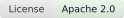
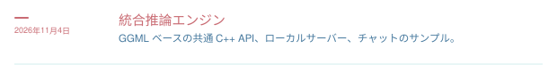
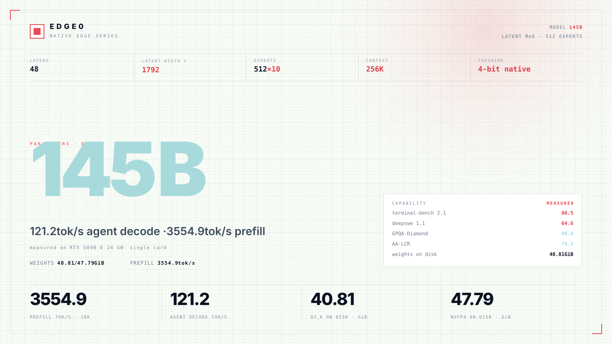
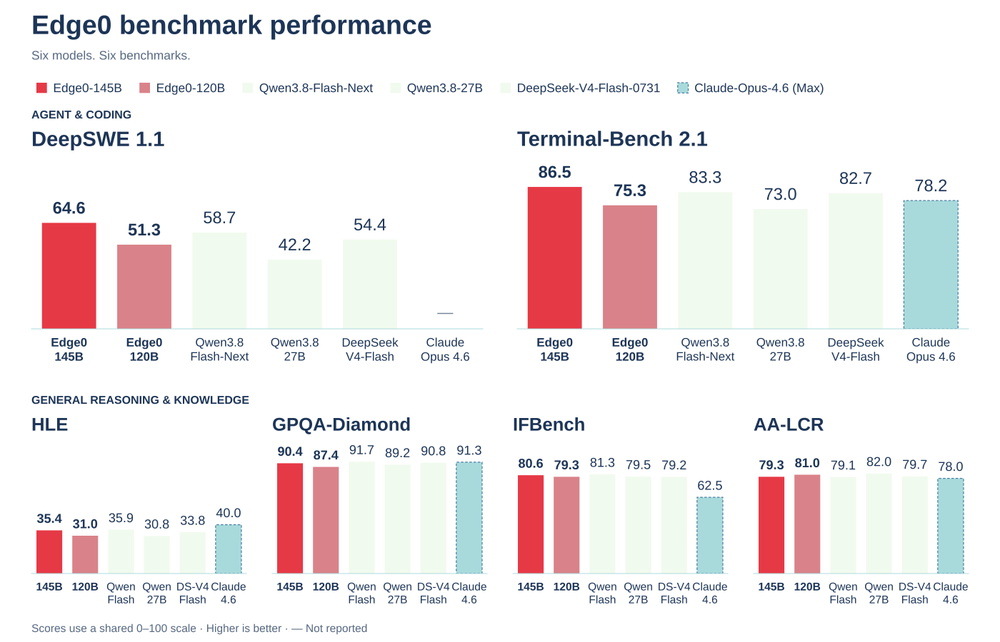
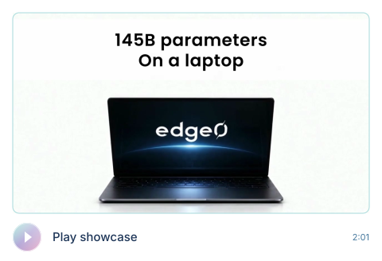

<p align="center"></p>

<h1 align="center">Edge0</h1>

<p align="center">オープンソースのストリーミング MoE 推論フレームワーク</p>

<br>

<p align="center">大きなモデルを、このマシンで。<br>設計から、スパースに。</p>

<br>

<p align="center">macOS · iOS · Android · Linux · Windows<br>すべての Edge0 モデルを、ひとつのプログラムで</p>

<p align="center"><sub>プロジェクト</sub><br>
<br>
<a href="https://arxiv.org/abs/2609.18063"></a> <a href="https://github.com/Edge0-AI/Edge0"></a> <a href="https://edge0.ai/discord"></a> <a href="LICENSE"></a> <a href="https://github.com/Edge0-AI/Edge0/releases"></a>
</p>

<p align="center"><sub>最新リリース</sub><br>
<br>
<a href="https://huggingface.co/Edge0/Edge0-145B-q3k"></a> <a href="https://huggingface.co/Edge0/Edge0-145B-NVFP4"></a> <a href="https://huggingface.co/Edge0/Edge0-120B-q3k"></a> <a href="https://huggingface.co/Edge0/Edge0-120B-NVFP4"></a>
</p>

<p align="center"><sub>以前のリリース</sub><br>
<br>
<a href="https://huggingface.co/Edge0/Edge0-35B-A3B-preview"></a> <a href="https://huggingface.co/Edge0/Edge0-8B-A1B-preview"></a> <a href="https://www.modelscope.cn/models/Edge0/Edge0-35B-A3B-preview"></a> <a href="https://www.modelscope.cn/models/Edge0/Edge0-8B-A1B-preview"></a>
</p>

<p align="center"><a href="README.md">English</a> · <a href="README_zh.md">中文</a> · 日本語 · <a href="README_es.md">Español</a> · <a href="README_fr.md">Français</a></p>

<p align="center"><a href="#news">ニュース</a> · <a href="#about">概要</a> · <a href="#models">モデル</a> · <a href="#quality">性能評価</a> · <a href="#benchmark">速度測定</a> · <a href="#getting-started">はじめに</a></p>

<br>

<a name="news"></a>

## ニュース

<p><a href="docs/models/edge0-145b.md"></a></p>

<p><a href="edge0-infer/README.md"></a></p>

<p><a href="https://github.com/Edge0-AI/Edge0/tree/pre-edge0-infer"></a></p>

<details open>
<summary>過去のニュース</summary>

<p><a href="https://arxiv.org/abs/2609.18063"></a></p>

<p><a href="https://huggingface.co/Edge0/Edge0-35B-A3B-preview"></a></p>

<details>
<summary>リリースノート全文</summary>

- **[2026-11-13]** **`edge0-145b`** と **`edge0-120b`** を公開しました。Qwen3.8-Flash-Next をベースとする潜在空間 MoE モデルで、Linux または Windows 上の NVIDIA GPU 1枚で動作します。[edge0-strata](edge0-strata/EDGE0.md) を使用し、`edge0-infer serve` と `edge0-infer chat` がこのエンジンを起動します。詳細は[モデルページ](docs/models/edge0-145b.md)をご覧ください。Hugging Face の重み：[`Edge0-145B-q3k`](https://huggingface.co/Edge0/Edge0-145B-q3k) · [`Edge0-145B-NVFP4`](https://huggingface.co/Edge0/Edge0-145B-NVFP4) · [`Edge0-120B-q3k`](https://huggingface.co/Edge0/Edge0-120B-q3k) · [`Edge0-120B-NVFP4`](https://huggingface.co/Edge0/Edge0-120B-NVFP4)。
- **[2026-11-04]** **統合推論エンジン [`edge0-infer`](edge0-infer/README.md)** を公開しました。[GGML](https://github.com/ggml-org/ggml) を基盤に、ひとつのエンジンとネイティブ C++ API で同じモデルを macOS、iOS、Android、Windows 上で実行できます。CLI、OpenAI 互換のローカルサーバー、デスクトップ・Android・iOS 向けチャットアプリのサンプルを提供します。初回リリースは `edge0-35b` に対応し、`edge0-8b` は今後対応予定です。Python フレームワークとプラットフォーム別エンジンを置き換え、従来のコードは [`pre-edge0-infer`](https://github.com/Edge0-AI/Edge0/tree/pre-edge0-infer) タグに保存しています。
- **[2026-09-30]** **iOS、macOS、Android、Windows の4プラットフォーム向け edge0 推論エンジン**を公開しました（ソースは [`pre-edge0-infer`](https://github.com/Edge0-AI/Edge0/tree/pre-edge0-infer) タグ）。
- **[2026-09-16]** 技術報告書を arXiv で公開しました：[The Other Half of the Memory Wall: Serving 35B MoEs from SSD with Trained Routing Prediction](https://arxiv.org/abs/2609.18063)。
- **[2026-09-08]** **edge0** を初めてオープンソースで公開し、2つのモデル規模、[`Edge0-35B-A3B-preview`](https://huggingface.co/Edge0/Edge0-35B-A3B-preview) と [`Edge0-8B-A1B-preview`](https://huggingface.co/Edge0/Edge0-8B-A1B-preview) を Hugging Face と ModelScope で公開しました。

</details>

</details>

<a name="previous-release"></a>

<details open>
<summary><h2>以前のリリース</h2></summary>

→ [35B / 8B リリースガイド](docs/legacy-models_ja.md) — モデルのダウンロード、アーキテクチャ、ベンチマーク、対応プラットフォーム、セットアップ手順。

</details>

<a name="about"></a>

## 概要

<p>Edge0 は、コンシューマー向けハードウェアで大規模なスパースモデルを実行するための、オープンソースのストリーミング MoE 推論フレームワークです。</p>

コマンドライン、ローカル API サーバー、Edge0 Chat アプリから利用できます。

最新リリースでは、145B と 120B の潜在空間 MoE モデルを NVIDIA GPU 1枚、または Apple Silicon の Mac で実行できます。

両モデルともネイティブ4ビット学習を採用し、ローカルのエージェント処理向けに Q3_K と NVFP4 を提供します。

[`edge0-infer`](edge0-infer/README.md) は共通の `serve` と `chat` コマンドを提供し、モデルフォルダーに基づいてエンジンを選択します。最新モデルは Strata のフォークである [edge0-strata](edge0-strata/EDGE0.md)、以前の 35B リリースは [GGML ベースのネイティブエンジン](docs/legacy-models_ja.md#native-engine-design)で動作します。

<a name="platforms"></a>

### 対応プラットフォーム

対応範囲はモデルとエンジンによって異なります。

| プラットフォーム | `edge0-145b`, `edge0-120b` (edge0-strata) | `edge0-35b`（ネイティブエンジン） |
| --- | --- | --- |
| **Linux** | NVIDIA GPU (CUDA 13) | CPU |
| **Windows** | NVIDIA GPU (CUDA 13) | CPU, Vulkan |
| **macOS** (Apple Silicon) | Metal | Metal, CPU |
| **iOS** | — | Metal |
| **Android** | — | CPU |

最新リリースには [145B / 120B のセットアップ手順](#getting-started)をご利用ください。[以前のリリースのガイド](docs/legacy-models_ja.md#platforms)ではネイティブバックエンド、各プラットフォームのビルド、チャットのサンプルを説明しています。8B チェックポイントは公開済みで、ネイティブエンジンへの対応は計画中です。

<a name="models"></a>

## モデル

<p>145B / 120B は現在の潜在空間 MoE シリーズです。Qwen3.8-Flash-Next をベースに、ネイティブ4ビット学習を採用しています。</p>

NVIDIA GPU と CUDA 13 を備えた Linux または Windows、あるいは Apple Silicon の Metal を使う macOS で、`edge0-infer serve` と `edge0-infer chat` を通じて edge0-strata 上で実行します。

**145B Q3_K · RTX 5090 D 24 GB：** エージェントデコード 121.2 tok/s · 16K プリフィル 3554.9 tok/s。

| モデル規模 | 公開チェックポイント | 推論構成 | エンジン |
|---|---|---|---|
| [`edge0-145b`](docs/models/edge0-145b.md) | [`Edge0/Edge0-145B-q3k`](https://huggingface.co/Edge0/Edge0-145B-q3k) · [NVFP4](https://huggingface.co/Edge0/Edge0-145B-NVFP4) | Q3_K または NVFP4 の潜在空間エキスパート（1792）、48層、512エキスパート、K=10 | edge0-strata ✅（Linux または Windows、NVIDIA GPU。macOS は Apple Silicon、Metal、Q3_K） |
| [`edge0-120b`](docs/models/edge0-145b.md) | [`Edge0/Edge0-120B-q3k`](https://huggingface.co/Edge0/Edge0-120B-q3k) · [NVFP4](https://huggingface.co/Edge0/Edge0-120B-NVFP4) | Q3_K または NVFP4 の潜在空間エキスパート（1280）、48層、512エキスパート、K=10 | edge0-strata ✅（Linux または Windows、NVIDIA GPU。macOS は Apple Silicon、Metal、Q3_K） |

<a name="model-overview--145b-q3_k"></a>

<details open>
<summary><h3>モデル概要 · 145B Q3_K</h3></summary>

Q3_K · RTX 5090 D 24 GB。プリフィルは 16K token の入力で測定しています。評価スコアはモデル単位の結果です。

<a href="assets/edge0-release/model-overview-145B-q3k.svg"></a>

</details>

<a name="quality"></a>

## 性能評価

### 145B / 120B

6つのベンチマーク、6つのモデル。スコアは高いほど良好です。モデル単位の結果であり、Q3_K と NVFP4 を個別に評価したものではありません。

<a href="assets/edge0-release/quality-overview.svg"></a>

[コピー可能なスコアと全モデル名](docs/models/edge0-145b.md#quality)

<details>
<summary>コピー可能なスコア · 全6モデル</summary>

太字は各列の最高スコアを示します。

| モデル | deepswe 1.1 | terminal-bench 2.1 | AA-LCR | IFBench | GPQA-Diamond | HLE |
| --- | ---: | ---: | ---: | ---: | ---: | ---: |
| **Edge0-145B** | **64.6** | **86.5** | 79.3 | 80.6 | 90.4 | 35.4 |
| **Edge0-120B** | 51.3 | 75.3 | 81.0 | 79.3 | 87.4 | 31.0 |
| DeepSeek-V4-Flash-0731 | 54.4 | 82.7 | 79.7 | 79.2 | 90.8 | 33.8 |
| Qwen3.8-Flash-Next | 58.7 | 83.3 | 79.1 | **81.3** | **91.7** | 35.9 |
| Qwen3.8-27B | 42.2 | 73.0 | **82.0** | 79.5 | 89.2 | 30.8 |
| Claude-Opus-4.6 (Max) | / | 78.2 | 78.0 | 62.5 | 91.3 | **40.0** |

</details>

<a name="speed"></a>

<a name="benchmark"></a>

## 速度測定

<a name="145b--120b-1"></a>

### 145B / 120B

スループットの単位はすべて tok/s です。代表値は RTX 5090 D 24 GB 上の **145B Q3_K** です。

<details open>
<summary>145B 速度表 · 全機器・全形式</summary>

強調表示した行は Q3_K です。表をクリックすると原寸で表示できます。

<a href="assets/edge0-release/speed-145B.svg"></a>

<details>
<summary>コピー可能な 145B 速度データ</summary>

| 機器 | 形式 | 4K プリフィル | 16K プリフィル | チャットデコード | エージェントデコード |
|---|---|---:|---:|---:|---:|
| RTX 5090 D 24 GB | Q3_K | 2169.9 | 3554.9 | 99.7 | **121.2** |
| RTX 5090 D 24 GB | NVFP4 | 1839.6 | 3165.7 | 79.6 | 98.3 |
| RTX 4090 24 GB | Q3_K | 2042.0 | 3179.4 | 69.9 | 91.7 |
| RTX Spark N1X 60 GiB | Q3_K | 674.0 | 770.3 | 37.7 | 36.7 |
| RTX Spark N1X 60 GiB | NVFP4 | 821.2 | 922.4 | 40.1 | 46.0 |
| Apple M2 Ultra (Metal) | Q3_K | 755.6 | 800.3 | 60.9 | 57.0 |
| 16 GiB VRAM + 20 GiB RAM | Q3_K | 249 | 335 | 36.8 | 44.9 |

</details>

</details>

<details>
<summary>145B 測定条件 · メモリ予算の制限と常駐</summary>

`16 GiB VRAM + 20 GiB RAM` の行も同じ RTX 5090 D 24 GB です（別のカードではありません）。VRAM は `--vram-reserve-mib 8192`、システム RAM は cgroup（`MemoryMax=20G`、スワップなし）で制限しています。常駐を有効にすると、同じカードで **Q3_K**（重み 40.81 GiB）は 23.14 GiB VRAM + 31.28 GiB RAM、**NVFP4**（47.79 GiB）は 23.25 GiB VRAM + 38.27 GiB RAM を使用します。両メモリに置かれるエキスパート集合は重複せず、二重計上していません。

16 GiB VRAM + 20 GiB RAM は測定時の制限であり、最小システム要件ではありません。Apple M2 Ultra の行は Metal での測定結果です。

</details>

<details open>
<summary>120B 速度表 · 全機器・全形式</summary>

<a href="assets/edge0-release/speed-120B.svg"></a>

<details>
<summary>コピー可能な 120B 速度データ</summary>

| 機器 | 形式 | 4K プリフィル | 16K プリフィル | チャットデコード | エージェントデコード |
|---|---|---:|---:|---:|---:|
| RTX 5090 D 24 GB | Q3_K | 3236.7 | 4576.5 | 130.2 | **144.6** |
| RTX 5090 D 24 GB | NVFP4 | 2668.5 | 4357.1 | 124.9 | 135.5 |
| RTX 4090 24 GB | Q3_K | 2637.5 | 3551.1 | 95.0 | 104.9 |
| RTX Spark N1X 60 GiB | Q3_K | 987.0 | 1081.7 | 47.2 | 68.4 |
| RTX Spark N1X 60 GiB | NVFP4 | 996.4 | 1066.9 | 45.1 | 68.9 |
| Apple M2 Ultra (Metal) | Q3_K | 867.6 | 908.7 | 60.4 | 63.0 |
| 16 GiB VRAM + 20 GiB RAM | Q3_K | 430 | 778 | 62.4 | 73.3 |
| 16 GiB VRAM + 20 GiB RAM | NVFP4 | 361.1 | 619.7 | 51.3 | 59.9 |

</details>

`16 GiB VRAM + 20 GiB RAM` の行も RTX 5090 D 24 GB を使用し、cgroup で VRAM を 16 GiB、システム RAM を 20 GiB に制限したものです。別のカードではありません。常駐を有効にすると、同じカードで **Q3_K**（重み 27.98 GiB）は 22.93 GiB VRAM + 18.40 GiB RAM、**NVFP4**（32.96 GiB）は 23.02 GiB VRAM + 23.40 GiB RAM を使用します。両メモリに置かれるエキスパート集合は重複せず、二重計上していません。

</details>

<a name="in-action"></a>

<details open>
<summary><h2>動作デモ</h2></summary>

<p align="center"><a href="assets/edge0-release/showcase.mp4"></a></p>

<p align="center">Edge0-145B で収録 · <a href="assets/edge0-release/showcase.mp4">動画を開く ↗</a></p>

<details>
<summary>5つのデモ · チャプターガイド</summary>

| 時間 | デモ |
| --- | --- |
| 0:00 | ローカルチャットとコーディング |
| 0:36 | 動画制作 |
| 0:58 | 3D のマンハッタン |
| 1:19 | 大聖堂のワールド制作 |
| 1:38 | PCB 設計 |

[チャプターマーカー（VTT）](assets/edge0-release/showcase-chapters.vtt)

</details>

</details>

<a name="architecture"></a>

## アーキテクチャ

潜在空間 MoE は、注意機構をフル幅に維持しながらエキスパート入力を圧縮します。潜在幅は 145B が 1792、120B が 1280 です。両モデルとも各 token を 512 エキスパート中の10個にルーティングし、さらに共有エキスパートを1個備えています。

<details open>
<summary>アーキテクチャ詳細 · 図と構成</summary>

<a href="assets/edge0-release/arch-145B.svg"></a>

[完全な構成、ルーティング、両モデルの仕様](docs/models/edge0-145b.md#model-profile)。

</details>

<a name="quick-start"></a>

<a name="getting-started"></a>

## はじめに

### 145B / 120B · edge0-strata

各モデルフォルダー（Q3_K または NVFP4、Edge0-145B または Edge0-120B）は、コマンドラインまたは Edge0 Chat デスクトップアプリから `edge0-infer` を通じて実行します。フォルダー構成は変更しないでください。`edge0-infer` は `model.json` 内の `model_name` でモデルを識別します。

145B と 120B には `serve` または `chat` を使用します。`run` はネイティブエンジン用です。

<details>
<summary>プラットフォームと文書について</summary>

ビルド手順は、Linux または Windows（x64 または ARM64）上の CUDA 13 対応 NVIDIA GPU と、Apple Silicon macOS 上の Metal を対象にします。

</details>

<details>
<summary>ビルドとコマンドラインの手順</summary>

**1. ビルド。** リポジトリをクローンし、2つの部分をビルドします。以下の起動コマンドは `edge0-infer/` 内で実行してください。

```bash
git clone https://github.com/Edge0-AI/Edge0.git edge0
```

- エンジン **edge0-strata**：[edge0-strata/EDGE0.md](edge0-strata/EDGE0.md) の「Build (Linux, NVIDIA)」、「Build (Windows, NVIDIA)」または「Build (macOS, Apple Silicon)」を参照してください。
- **edge0-infer**：[edge0-infer/docs/getting-started.md](edge0-infer/docs/getting-started.md) の「Build」（Linux）または「Windows」を参照してください。

**2. コマンドラインから実行。** `Edge0-145B-q3k` など、単一のモデルフォルダーを指定します。複数モデルを格納した親フォルダーではありません。Windows のプログラムは `build\windows\bin\edge0-infer.exe` です。

```bash
build/cpu/bin/edge0-infer serve --model /path/to/Edge0-145B-q3k
```

重みのロード後に `Listening: http://127.0.0.1:8000 model=<name>` と表示されます。`<name>` は `edge0_145b` です。その後、OpenAI および Anthropic 互換エンドポイントを提供します。

```bash
curl localhost:8000/v1/chat/completions -H 'content-type: application/json' -d '{"model":"edge0_145b","messages":[{"role":"user","content":"hi"}],"max_tokens":64}'
```

`edge0-infer chat --model /path/to/Edge0-145B-q3k` は対話セッションを起動します。その他のオプションは [edge0-infer/docs/edge0-145b.md](edge0-infer/docs/edge0-145b.md) を参照してください。

</details>

<details>
<summary>デスクトップアプリ · Windows · macOS</summary>

⬇️ **ダウンロード：** **[GitHub Releases](https://github.com/Edge0-AI/Edge0/releases)**

Windows または macOS（Apple Silicon）で **Edge0 Chat** を開き、`Edge0-145B-q3k` などのモデルフォルダーを選ぶと、ローカルで実行できます。ソースからアプリをビルドする場合は [Edge0 Chat](edge0-infer/examples/desktop/README.md) ガイドを参照してください。

</details>

<a name="documentation"></a>

## ドキュメント

**最新リリース · 145B / 120B**

- [モデル、測定結果、アーキテクチャ](docs/models/edge0-145b.md)
- [edge0-strata · ビルドと起動の取り決め](edge0-strata/EDGE0.md)
- edge0-infer モデルガイド：[145B](edge0-infer/docs/edge0-145b.md) / [120B](edge0-infer/docs/edge0-120b.md)

**フレームワーク**

- [edge0-infer](edge0-infer/README.md) · コマンドライン、ローカルサーバー、チャットアプリ
- [ローカルサーバー](edge0-infer/docs/local-server.md) / [テスト](edge0-infer/docs/testing.md)
- [モデルアセット用ツールとモデルの追加](edge0-infer/tools/assets/README.md)

<details>
<summary>以前のリリース · モデルとネイティブエンジンの文書</summary>

- [35B / 8B リリースガイド](docs/legacy-models_ja.md)
- [MoE のルーティングとエキスパート](docs/moe.md) / [prerouter](docs/prerouter.md)
- モデルリファレンス：[edge0-35b](docs/models/edge0-35b.md) / [edge0-8b](docs/models/edge0-8b.md)
- [はじめに](edge0-infer/docs/getting-started.md)：対応プラットフォームでのネイティブビルド、モデルアセット、run、chat、serve
- [設定](edge0-infer/docs/configuration.md) / [ネイティブ API](edge0-infer/docs/native-api.md)
- [アーキテクチャ](edge0-infer/docs/architecture.md) / [ネイティブエンジンの設計](edge0-infer/docs/architecture.md#native-engine) / [既知の制限](edge0-infer/docs/limitations.md)
- [ベンチマーク](edge0-infer/docs/benchmarking.md)
- 技術報告書：[The Other Half of the Memory Wall](https://arxiv.org/abs/2609.18063)（[PDF](paper/main.pdf)）

</details>

<a name="roadmap"></a>

## ロードマップ

<details>
<summary>2026年第4四半期 · アーキテクチャと推論</summary>

**モデルとアルゴリズム**

第4四半期は、次世代アーキテクチャの導入と、潜在空間での推論を計算量の削減だけでなく実際のレイテンシ短縮につなげることの2点に取り組みます。

- **次世代アーキテクチャ対応（Qwen3.8-Flash クラス）** — ハイブリッド線形注意（GDN + QSA）、ゲート付き多分岐残差、N-gram 埋め込み構成を edge0 で実行します。これらは SSD ストリーミングオフロードと相性がよく、O(1) 状態の注意機構は長い思考による KV-cache の問題を避け、参照専用の N-gram テーブルは必要に応じて読み込めます。目標は単一デバイスで動作し、fp16 ベースモデルとの評価差を許容範囲に収めることです。
- **潜在空間での思考 + エキスパートの一括事前予測** — 潜在空間での推論を、演算量だけでなく*レイテンシ*の削減につなげます。中核課題は、位置ごとのルーティングを**ブロックごとに1回**へ変え、ひとつの予測でブロック内の全位置・全ラウンドをカバーし、**エキスパートのロード量を推論ループ回数から切り離す**ことです。さらに、現在のブロックの計算中に次のブロックのエキスパートをプリフェッチします。進捗は**同等の精度での思考フェーズ全体の所要時間**で評価し、tokens/s では評価しません。

[以前のリリースのマイルストーンとネイティブエンジンの対応予定](docs/legacy-models_ja.md#roadmap)。

</details>

<a name="contributing"></a>

## コントリビューション

<details>
<summary>開発フローとチェック</summary>

issue、PR、ベンチマーク報告、モデル移植など、さまざまな貢献を歓迎します。

ビルドとテストは[テスト文書](edge0-infer/docs/testing.md)で説明しています。モデルアセットなしで実行できるチェックは次のとおりです。

```bash
cd edge0-infer
cmake --preset cpu && cmake --build --preset cpu
ctest --preset cpu -L "L0|L1"
```

`edge0-infer/` の変更も通常どおりこのリポジトリに issue や PR を提出してください。このディレクトリは別のリポジトリで開発されているため、採用された変更はメンテナーが先にそちらへ適用し、次回の同期でこちらに反映されます。[CONTRIBUTING](CONTRIBUTING.md) を参照してください。

流れ：fork → 機能ブランチ → `main` 宛てに PR。テストの成功を維持し、新しい動作にはテストを追加してください。

</details>

<a name="citation"></a>

## 引用

技術報告書は、35B の SSD ストリーミングと学習済みルーティング予測を扱っています。

edge0 が役立った場合は、技術報告書を引用してください。

```bibtex
@article{lin2026other,
  title   = {The Other Half of the Memory Wall: Serving 35B MoEs from SSD
             with Trained Routing Prediction},
  author  = {Lin, Yu and Wang, Yiming and Cai, Runyuan and Liu, Hanze and
             Zeng, Xiaodong},
  journal = {arXiv preprint arXiv:2609.18063},
  year    = {2026},
  url     = {https://arxiv.org/abs/2609.18063}
}
```

<a name="contact-us"></a>

## お問い合わせ

- **Discord**：[edge0.ai/discord](https://edge0.ai/discord) — コミュニティでの交流とサポート
- **メール**：samuel@edge0.ai

バグ報告と機能要望には [GitHub Issues](https://github.com/Edge0-AI/Edge0/issues) をご利用ください。

<a name="license"></a>

<details>
<summary><h2>ライセンス</h2></summary>

<a name="framework-code"></a>

### フレームワークのコード

フレームワークのコードは引き続き [Apache-2.0](LICENSE) です。同梱コンポーネントはそれぞれのライセンスと[通知](NOTICE)を保持し、Strata には [MIT ライセンス](edge0-strata/LICENSE)が適用されます。

<a name="model-license"></a>

### モデルのライセンス

Edge0 固有のモデルへの貢献には [Edge0 Community Model License 1.0](licenses/edge0-model/LICENSE) が適用されます。対象は Edge0 が所有するか、ライセンスを付与する権限を持つ貢献に限られます。以前の有効なライセンスは変更されません。

適用される上流の条件に従う限り、個人利用、研究、教育、改変、非商用共有、内部利用、生成物の商用利用を認めます。非公開の改変の開示や、画面への Edge0 バッジ表示は要求しません。

次の場合は Edge0 の別途書面による許可が必要です。

- **モデルの販売と有料配布**。対象アダプター、差分、およびモデルへのアクセスが主な価値となる商用バンドルを含みます。
- **商用モデルサービス**。料金、サブスクリプション、広告、関連スポンサー収入で運営され、推論またはファインチューニングを提供するものです。
- **独立した商用コーディング・オフィスアシスタント**。推論をサーバーで行うか、ユーザーのデバイスで行うかは問いません。

定義、例外、再配布の条件はライセンス全文をご確認ください。商用ライセンス窓口：[info@edge0.ai](mailto:info@edge0.ai)。

<a name="upstream-terms-and-scope"></a>

### 上流の条件と適用範囲

Qwen の素材には引き続き該当する上流ライセンスが適用されます。同梱の [Qwen Community License 1.0](licenses/edge0-model/third-party/Qwen-LICENSE.txt) は原文のまま収録しています。Edge0 の許可によって、Qwen の帰属表示や別途商用許可の要件が免除されることはありません。

帰属表示とライセンス範囲は[モデルの NOTICE](licenses/edge0-model/NOTICE)をご覧ください。フレームワークと第三者コードのライセンスは影響を受けません。

<details>
<summary><b>謝辞 · モデルの系譜とエンジンの出典</b></summary>

[Qwen3.8-Flash-Next](https://huggingface.co/Qwen/Qwen3.8-Flash-Next) と [Strata](https://github.com/Niko1221/Strata) のチームに感謝します。Edge0 は Strata エンジンに潜在空間 MoE のサポートを追加しています。`edge0-strata` は Niko1221 と Strata コントリビューターによる Strata のフォークで、[MIT ライセンス](edge0-strata/LICENSE)を維持しています。

Edge0 フレームワークのコードは [Apache-2.0](LICENSE) で公開され、同梱の第三者コンポーネントは各自のライセンスを維持します（[NOTICE](NOTICE) 参照）。[以前のリリース](docs/legacy-models_ja.md#models)は Qwen3.6 と Ling のモデル系譜を維持しています。

</details>

</details>
