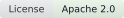
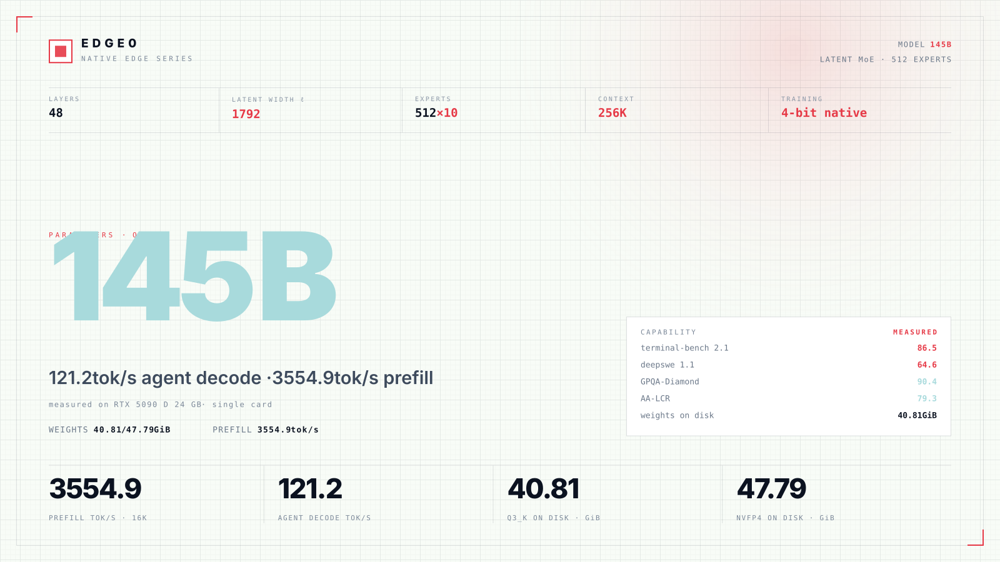
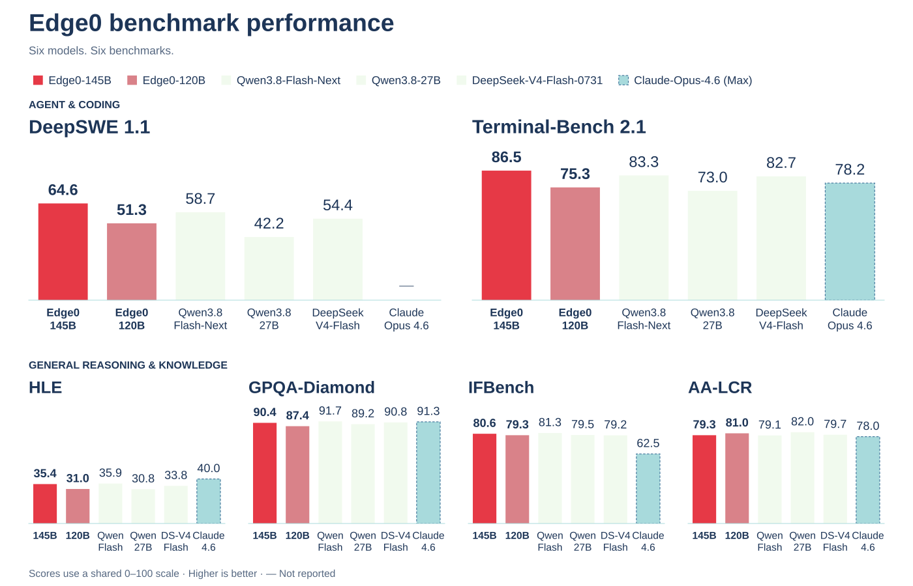
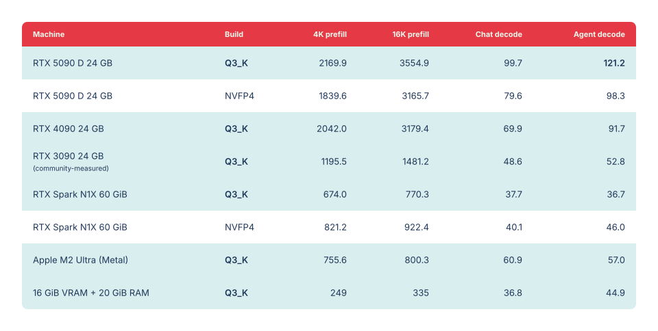
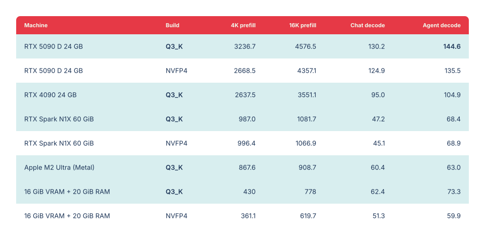
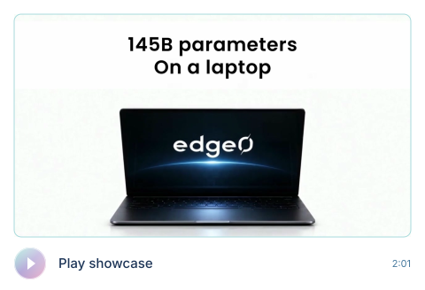
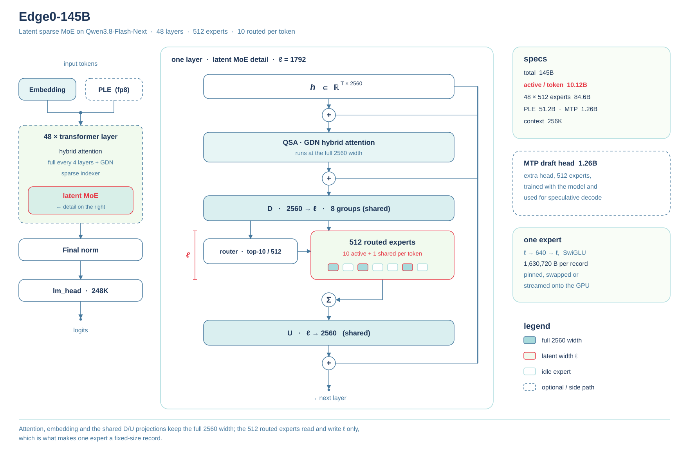

<p align="center"></p>

<h1 align="center">Edge0</h1>

<p align="center">오픈소스 스트리밍 MoE 추론 프레임워크</p>

<br>

<p align="center">크게 생각하세요. 여기서 실행하세요.<br>희소성, 설계부터.</p>

<br>

<p align="center">macOS · iOS · Android · Linux · Windows<br>모든 Edge0 모델을 위한 하나의 프로그램</p>

<p align="center"><sub>프로젝트</sub><br>
<br>
<a href="https://arxiv.org/abs/2609.18063"></a> <a href="https://github.com/Edge0-AI/Edge0"></a> <a href="https://edge0.ai/discord"></a> <a href="LICENSE"></a> <a href="https://github.com/Edge0-AI/Edge0/releases"></a>
</p>

<p align="center"><sub>최신 릴리스</sub><br>
<br>
<a href="https://huggingface.co/Edge0/Edge0-145B-q3k"></a> <a href="https://huggingface.co/Edge0/Edge0-145B-NVFP4"></a> <a href="https://huggingface.co/Edge0/Edge0-120B-q3k"></a> <a href="https://huggingface.co/Edge0/Edge0-120B-NVFP4"></a>
</p>

<p align="center"><sub>이전 릴리스</sub><br>
<br>
<a href="https://huggingface.co/Edge0/Edge0-35B-A3B-preview"></a> <a href="https://huggingface.co/Edge0/Edge0-8B-A1B-preview"></a> <a href="https://www.modelscope.cn/models/Edge0/Edge0-35B-A3B-preview"></a> <a href="https://www.modelscope.cn/models/Edge0/Edge0-8B-A1B-preview"></a>
</p>

<p align="center"><a href="README.md">English</a> · <a href="README_zh.md">中文</a> · <a href="README_ja.md">日本語</a> · <a href="README_es.md">Español</a> · <a href="README_fr.md">Français</a> · 한국어</p>

<p align="center"><a href="#news">뉴스</a> · <a href="#about">소개</a> · <a href="#models">모델</a> · <a href="#quality">품질</a> · <a href="#benchmark">벤치마크</a> · <a href="#getting-started">시작하기</a></p>

<br>

## 뉴스

<p><a href="docs/models/edge0-145b.md"></a></p>

<p><a href="edge0-infer/README.md"></a></p>

<p><a href="https://github.com/Edge0-AI/Edge0/tree/pre-edge0-infer"></a></p>

<details open>
<summary>더 많은 업데이트</summary>

<p><a href="https://arxiv.org/abs/2609.18063"></a></p>

<p><a href="https://huggingface.co/Edge0/Edge0-35B-A3B-preview"></a></p>

<details>
<summary>전체 릴리스 노트</summary>

- **[2026-11-13]** Linux 또는 Windows에서 NVIDIA GPU 한 장을 위한, Qwen3.8-Flash-Next에서 파생된 latent 전문가 혼합 모델 **`edge0-145b`**와 **`edge0-120b`**를 공개했습니다. 두 모델은 `edge0-infer serve`와 `edge0-infer chat`이 시작해 주는 [edge0-strata](edge0-strata/EDGE0.md)에서 실행됩니다. 자세한 내용은 [모델 페이지](docs/models/edge0-145b.md)를 참고하십시오. 가중치는 Hugging Face에 있습니다: [`Edge0-145B-q3k`](https://huggingface.co/Edge0/Edge0-145B-q3k) · [`Edge0-145B-NVFP4`](https://huggingface.co/Edge0/Edge0-145B-NVFP4) · [`Edge0-120B-q3k`](https://huggingface.co/Edge0/Edge0-120B-q3k) · [`Edge0-120B-NVFP4`](https://huggingface.co/Edge0/Edge0-120B-NVFP4).
- **[2026-11-04]** **통합 추론 엔진 [`edge0-infer`](edge0-infer/README.md)**를 공개했습니다. [GGML](https://github.com/ggml-org/ggml) 기반으로, 하나의 엔진과 하나의 네이티브 C++ API가 macOS, iOS, Android, Windows에서 같은 모델을 실행하며, CLI, OpenAI 호환 로컬 서버, 그리고 데스크톱·Android·iOS용 채팅 앱 예제를 제공합니다. 첫 릴리스는 `edge0-35b`를 지원하고 `edge0-8b`는 이후 릴리스에서 지원합니다. Python 프레임워크와 플랫폼별 엔진을 대체하며, 이전 코드는 [`pre-edge0-infer`](https://github.com/Edge0-AI/Edge0/tree/pre-edge0-infer) 태그에 보관되어 있습니다.
- **[2026-09-30]** **네 개 플랫폼용 edge0 추론 엔진 — iOS, macOS, Android, Windows**를 공개했습니다(소스는 [`pre-edge0-infer`](https://github.com/Edge0-AI/Edge0/tree/pre-edge0-infer) 태그).
- **[2026-09-16]** 기술 보고서를 arXiv에 공개했습니다: [The Other Half of the Memory Wall: Serving 35B MoEs from SSD with Trained Routing Prediction](https://arxiv.org/abs/2609.18063).
- **[2026-09-08]** **edge0**의 최초 오픈소스 릴리스와 함께 두 모델 티어 — [`Edge0-35B-A3B-preview`](https://huggingface.co/Edge0/Edge0-35B-A3B-preview)와 [`Edge0-8B-A1B-preview`](https://huggingface.co/Edge0/Edge0-8B-A1B-preview) — 를 Hugging Face와 ModelScope에 공개했습니다.

</details>

</details>

<details open>
<summary><h2>이전 릴리스</h2></summary>

→ [35B / 8B 릴리스 가이드](docs/legacy-models.md) — 모델 다운로드, 아키텍처, 벤치마크, 지원 플랫폼, 설정 방법.

</details>

## 소개

<p>Edge0는 소비자용 하드웨어에서 대형 희소 모델을 실행하기 위한 오픈소스 스트리밍 MoE 추론 프레임워크입니다.</p>

명령줄, 로컬 API 서버, 또는 Edge0 Chat 앱에서 사용할 수 있습니다.

최신 릴리스는 145B와 120B latent-MoE 모델을 NVIDIA GPU 한 장이나 Apple Silicon Mac에서 실행합니다.

두 모델 모두 네이티브로 4비트 학습되었으며, 로컬 에이전트 워크로드를 위해 Q3_K와 NVFP4로 제공됩니다.

[`edge0-infer`](edge0-infer/README.md)는 공통 `serve`와 `chat` 명령을 제공하고, 모델 폴더를 보고 엔진을 선택합니다. 최신 모델은 Strata의 포크인 [edge0-strata](edge0-strata/EDGE0.md)에서 실행되고, 이전 35B 릴리스는 [GGML 기반 네이티브 엔진](docs/legacy-models.md#native-engine-design)에서 실행됩니다.

### 플랫폼

지원 여부는 모델과 해당 엔진에 따라 다릅니다.

| 플랫폼 | `edge0-145b`, `edge0-120b` (edge0-strata) | `edge0-35b` (네이티브 엔진) |
| --- | --- | --- |
| **Linux** | NVIDIA GPU (CUDA 13) | CPU |
| **Windows** | NVIDIA GPU (CUDA 13) | CPU, Vulkan |
| **macOS** (Apple Silicon) | Metal | Metal, CPU |
| **iOS** | — | Metal |
| **Android** | — | CPU |

최신 릴리스에는 [145B / 120B 설정](#getting-started)을 사용하십시오. [이전 릴리스 가이드](docs/legacy-models.md#platforms)는 네이티브 백엔드, 플랫폼별 빌드, 채팅 예제를 다룹니다. 8B 체크포인트는 제공되며, 네이티브 엔진 지원은 계획 중입니다.

## 모델

<p>145B / 120B는 현재의 latent-MoE 시리즈로, Qwen3.8-Flash-Next에서 파생되어 4비트로 네이티브 학습되었습니다.</p>

Linux 또는 Windows에서 NVIDIA GPU와 CUDA 13으로, 또는 macOS에서 Apple Silicon의 Metal로 `edge0-infer serve`와 `edge0-infer chat`을 통해 edge0-strata에서 실행됩니다.

**145B Q3_K · RTX 5090 D 24 GB:** 에이전트 디코드 121.2 tok/s · 16K 프리필 3554.9 tok/s.

| 등급 | 출시된 체크포인트 | 추론 프로필 | 엔진 |
|---|---|---|---|
| [`edge0-145b`](docs/models/edge0-145b.md) | [`Edge0/Edge0-145B-q3k`](https://huggingface.co/Edge0/Edge0-145B-q3k) · [NVFP4](https://huggingface.co/Edge0/Edge0-145B-NVFP4) | Q3_K 또는 NVFP4 latent 전문가 (1792), 48 레이어, 512 전문가, K=10 | edge0-strata ✅ (Linux 또는 Windows, NVIDIA GPU; macOS Apple Silicon, Metal) |
| [`edge0-120b`](docs/models/edge0-145b.md) | [`Edge0/Edge0-120B-q3k`](https://huggingface.co/Edge0/Edge0-120B-q3k) · [NVFP4](https://huggingface.co/Edge0/Edge0-120B-NVFP4) | Q3_K 또는 NVFP4 latent 전문가 (1280), 48 레이어, 512 전문가, K=10 | edge0-strata ✅ (Linux 또는 Windows, NVIDIA GPU; macOS Apple Silicon, Metal) |

<details open>
<summary><h3>모델 개요 · 145B Q3_K</h3></summary>

Q3_K · RTX 5090 D 24 GB. 프리필은 16K 토큰 입력을 사용합니다. 품질 점수는 모델 단위 결과입니다.

<a href="assets/edge0-release/model-overview-145B-q3k.svg"></a>

</details>

## 품질

### 145B / 120B

벤치마크 6종, 모델 6종. 높을수록 좋습니다. 점수는 모델 단위로 보고되며, Q3_K와 NVFP4를 별도로 평가한 값이 아닙니다.

<a href="assets/edge0-release/quality-overview.svg"></a>

[복사 가능한 점수와 전체 모델 이름](docs/models/edge0-145b.md#quality)

<details>
<summary>복사 가능한 점수 · 6개 모델 전체</summary>

굵은 값은 각 열에서 가장 좋은 점수를 나타냅니다.

| 모델 | deepswe 1.1 | terminal-bench 2.1 | AA-LCR | IFBench | GPQA-Diamond | HLE |
| --- | ---: | ---: | ---: | ---: | ---: | ---: |
| **Edge0-145B** | **64.6** | **86.5** | 79.3 | 80.6 | 90.4 | 35.4 |
| **Edge0-120B** | 51.3 | 75.3 | 81.0 | 79.3 | 87.4 | 31.0 |
| DeepSeek-V4-Flash-0731 | 54.4 | 82.7 | 79.7 | 79.2 | 90.8 | 33.8 |
| Qwen3.8-Flash-Next | 58.7 | 83.3 | 79.1 | **81.3** | **91.7** | 35.9 |
| Qwen3.8-27B | 42.2 | 73.0 | **82.0** | 79.5 | 89.2 | 30.8 |
| Claude-Opus-4.6 (Max) | / | 78.2 | 78.0 | 62.5 | 91.3 | **40.0** |

</details>

<a name="speed"></a>

## 벤치마크

### 145B / 120B

모든 처리량 수치는 tok/s입니다. 대표 수치는 RTX 5090 D 24 GB에서의 **145B Q3_K** 기준입니다.

<details open>
<summary>145B 속도 표 · 모든 머신과 빌드</summary>

강조된 행은 Q3_K입니다. 표를 클릭하면 원본 크기로 볼 수 있습니다.

<a href="assets/edge0-release/speed-145B.svg"></a>

<details>
<summary>복사 가능한 145B 속도 데이터</summary>

| 머신 | 빌드 | 4K 프리필 | 16K 프리필 | 채팅 디코드 | 에이전트 디코드 |
|---|---|---:|---:|---:|---:|
| RTX 5090 D 24 GB | Q3_K | 2169.9 | 3554.9 | 99.7 | **121.2** |
| RTX 5090 D 24 GB | NVFP4 | 1839.6 | 3165.7 | 79.6 | 98.3 |
| RTX 4090 24 GB | Q3_K | 2042.0 | 3179.4 | 69.9 | 91.7 |
| RTX 3090 24 GB (community-measured) | Q3_K | 1195.5 | 1481.2 | 48.6 | 52.8 |
| RTX Spark N1X 60 GiB | Q3_K | 674.0 | 770.3 | 37.7 | 36.7 |
| RTX Spark N1X 60 GiB | NVFP4 | 821.2 | 922.4 | 40.1 | 46.0 |
| Apple M2 Ultra (Metal) | Q3_K | 755.6 | 800.3 | 60.9 | 57.0 |
| 16 GiB VRAM + 20 GiB RAM | Q3_K | 249 | 335 | 36.8 | 44.9 |

</details>

</details>

<details>
<summary>145B 측정 조건 · 제한된 예산과 메모리 상주</summary>

`16 GiB VRAM + 20 GiB RAM` 행은 다른 카드가 아니라 동일한 RTX 5090 D 24 GB입니다. VRAM은 `--vram-reserve-mib 8192`로 제한하고, 시스템 RAM은 cgroup(`MemoryMax=20G`, 스왑 없음)으로 제한했습니다. 상주 기능을 켜면 같은 카드가 **Q3_K**(가중치 40.81 GiB)를
23.14 GiB VRAM + 31.28 GiB RAM으로, **NVFP4**(47.79 GiB)를 23.25 GiB VRAM + 38.27 GiB RAM으로 보관합니다. 전문가 집합은 서로 겹치지 않아
중복 집계되는 값이 없습니다.

메모리 절약 옵션은 [사용법 및 문제 해결](#usage-help)을 참고하십시오.

16 GiB VRAM + 20 GiB RAM 예산은 테스트 한도이며 최소 시스템 요구 사항이 아닙니다. Apple M2 Ultra 행은 Metal 측정값입니다.

`RTX 3090 24 GB (community-measured)` 행은 RTX 3090 24 GB에서 Edge0 v0.2.0(`3203c39`)과 기본 `edge0-infer serve` 설정으로 측정한 커뮤니티 결과입니다. 출처: [MAJOR//minor, CUDA Recipes 006](https://majorminor.xyz/research/cuda-recipes-006) 및 [원시 데이터](https://github.com/majorminorlabs/cuda-recipes/tree/main/006-edge0-145b).

</details>

<details open>
<summary>120B 속도 표 · 모든 머신과 빌드</summary>

<a href="assets/edge0-release/speed-120B.svg"></a>

<details>
<summary>복사 가능한 120B 속도 데이터</summary>

| 머신 | 빌드 | 4K 프리필 | 16K 프리필 | 채팅 디코드 | 에이전트 디코드 |
|---|---|---:|---:|---:|---:|
| RTX 5090 D 24 GB | Q3_K | 3236.7 | 4576.5 | 130.2 | **144.6** |
| RTX 5090 D 24 GB | NVFP4 | 2668.5 | 4357.1 | 124.9 | 135.5 |
| RTX 4090 24 GB | Q3_K | 2637.5 | 3551.1 | 95.0 | 104.9 |
| RTX Spark N1X 60 GiB | Q3_K | 987.0 | 1081.7 | 47.2 | 68.4 |
| RTX Spark N1X 60 GiB | NVFP4 | 996.4 | 1066.9 | 45.1 | 68.9 |
| Apple M2 Ultra (Metal) | Q3_K | 867.6 | 908.7 | 60.4 | 63.0 |
| 16 GiB VRAM + 20 GiB RAM | Q3_K | 430 | 778 | 62.4 | 73.3 |
| 16 GiB VRAM + 20 GiB RAM | NVFP4 | 361.1 | 619.7 | 51.3 | 59.9 |

</details>

`16 GiB VRAM + 20 GiB RAM` 행 역시 RTX 5090 D 24 GB이며, cgroup으로 VRAM 16 GiB와
시스템 RAM 20 GiB 예산을 적용한 것입니다. 다른 카드가 아닙니다. 상주 기능을 켜면 같은 카드가 **Q3_K**(가중치 27.98 GiB)를
22.93 GiB VRAM + 18.40 GiB RAM으로, **NVFP4**(32.96 GiB)를 23.02 GiB VRAM + 23.40 GiB RAM으로 보관합니다. 전문가 집합은 서로 겹치지 않아
중복 집계되는 값이 없습니다.

이 상주 측정값은 전문가 상주를 켜고 `--no-prefill-borrow`, conv cache = 0, kv-resident = 0으로 측정했습니다. 호스트 RAM은 `RssAnon + RssShmem`으로 측정합니다. 단일 실행 측정값이며 최소 시스템 요구 사항이 아닙니다. 메모리 절약 옵션은 [사용법 및 문제 해결](#usage-help)을 참고하십시오.

</details>

<details open>
<summary><h2>실제 동작</h2></summary>

<p align="center"><a href="assets/edge0-release/showcase.mp4"></a></p>

<p align="center">Edge0-145B로 녹화 · <a href="assets/edge0-release/showcase.mp4">영상 열기 ↗</a></p>

<details>
<summary>다섯 가지 데모 · 챕터 안내</summary>

| 시간 | 데모 |
| --- | --- |
| 0:00 | 로컬 채팅 & 코딩 |
| 0:36 | 영상 제작 |
| 0:58 | 3D로 보는 맨해튼 |
| 1:19 | 대성당 월드 빌딩 |
| 1:38 | PCB 설계 |

[챕터 마커 (VTT)](assets/edge0-release/showcase-chapters.vtt)

</details>

</details>

## 아키텍처

Latent MoE는 어텐션은 전체 폭으로 유지하면서 전문가 입력을 압축합니다. 145B 모델은 latent 폭 1792, 120B 모델은 1280을 사용합니다. 두 모델 모두 각 토큰을 512개 전문가 중 10개로 라우팅하며, 공유 전문가 하나가 함께 쓰입니다.

<details open>
<summary>아키텍처 세부 정보 · 다이어그램과 구성</summary>

<a href="assets/edge0-release/arch-145B.svg"></a>

[전체 구성, 라우팅, 두 모델 프로필](docs/models/edge0-145b.md#model-profile).

</details>

<a name="quick-start"></a>

## 시작하기

### 145B / 120B · edge0-strata

각 모델 폴더(Q3_K 또는 NVFP4, Edge0-145B 또는 Edge0-120B)는 `edge0-infer`를 통해 명령줄이나 Edge0 Chat 데스크톱 앱에서 실행됩니다. 폴더는 그대로 두십시오:
`edge0-infer`는 `model.json`의 `model_name`으로 모델을 식별합니다.

145B와 120B에는 `serve` 또는 `chat`을 사용하십시오. `run`은 네이티브 엔진에 속합니다.

<details>
<summary>플랫폼 및 문서 참고 사항</summary>

빌드 안내는 Linux 또는 Windows(x64 또는 ARM64)에서 CUDA 13을 쓰는 NVIDIA GPU와, Apple Silicon macOS의 Metal을 다룹니다.

</details>

<details>
<summary>빌드 및 명령줄 안내</summary>

**1. 빌드.** 저장소를 클론한 뒤 두 부분을 빌드합니다. 아래 실행 명령은 `edge0-infer/`에서 실행하십시오:

```bash
git clone https://github.com/Edge0-AI/Edge0.git edge0
```

- **edge0-strata**(엔진): [edge0-strata/EDGE0.md](edge0-strata/EDGE0.md)의 "Build (Linux, NVIDIA)", "Build (Windows, NVIDIA)", "Build (macOS, Apple Silicon)" 절차를 따르십시오.
- **edge0-infer**: [edge0-infer/docs/getting-started.md](edge0-infer/docs/getting-started.md)의 "Build"(Linux) 또는 "Windows" 절차를 따르십시오.

**2. 명령줄에서 실행.** 모델 폴더 하나만 지정하십시오. 예를 들어 `Edge0-145B-q3k`이며, 여러 모델을 담은
상위 폴더가 아닙니다. Windows에서 프로그램은 `build\windows\bin\edge0-infer.exe`입니다.

```bash
build/cpu/bin/edge0-infer serve --model /path/to/Edge0-145B-q3k
```

가중치 로딩이 끝나면 `Listening: http://127.0.0.1:8000 model=<name>`을 출력하며, 여기서 `<name>`은 `edge0_145b`입니다.
그다음 OpenAI 및 Anthropic 호환 엔드포인트를 제공합니다:

```bash
curl localhost:8000/v1/chat/completions -H 'content-type: application/json' -d '{"model":"edge0_145b","messages":[{"role":"user","content":"hi"}],"max_tokens":64}'
```

`edge0-infer chat --model /path/to/Edge0-145B-q3k`는 대신 대화형 세션을 엽니다. 더 많은 옵션:
[edge0-infer/docs/edge0-145b.md](edge0-infer/docs/edge0-145b.md).

</details>

<details>
<summary>GPU 두 장 · 두 번째 카드의 전문가 티어</summary>

두 번째 NVIDIA 카드는 첫 번째 카드의 VRAM에 들어가지 않는 전문가를 보관하고, 디코딩 시
두 전문가 형식 모두에 이 카드를 사용합니다. 카드 간 NVLink나 P2P는 필요하지 않습니다.

`edge0-infer`는 엔진을 카드 한 장에서 실행하므로(`--device`는 카드 하나), 두 장을 쓰려면
`serve/server.py --config`가 읽는 구성으로 엔진을 시작하십시오(구성에는 `exe`, `args`, `cwd`, `env`가 있습니다):

- `"gpu": [0, 1]`을 설정하십시오 — 엔진의 device 0이 첫 번째 카드, device 1이 두 번째 카드입니다;
- `"args"`에 다음을 추가하십시오: `"--peer-device", "1", "--peer-reserve-mib", "1024", "--peer-slots", "0"`.

```bash
cd /path/to/Edge0-145B-q3k
/path/to/edge0-strata/.venv/bin/python /path/to/edge0-strata/serve/server.py \
  --engine strata --config ./model-two-gpus.json
```

시작 로그에 두 번째 카드의 티어(`peer GPU 1: … experts, … GiB`)가 출력되고, 서버는 카드 한 장일 때와
같은 엔드포인트를 제공합니다. `--peer-device`는 `--layer-split`이나
`--expert-cache-device1..3`과 함께 사용할 수 없습니다. 자세한 내용: [GPU 두 장](edge0-strata/EDGE0.md#two-gpus-linux-nvidia).

</details>

<details>
<summary>데스크톱 앱 · Windows · macOS</summary>

⬇️ **다운로드:** **[GitHub Releases](https://github.com/Edge0-AI/Edge0/releases)**

Windows 또는 macOS(Apple Silicon)에서 **Edge0 Chat**을 엽니다. **Models**에서 Hugging Face나 ModelScope의 모델을 다운로드하거나, 이미 가진 모델 폴더(예: `Edge0-145B-q3k`)를 추가한 뒤 로드하면 로컬에서 모델이 실행됩니다. macOS에서는 앱이 네 개 폴더를 모두 제공하고 Metal로 실행하며, NVFP4 폴더는 전체 전문가 풀을 통합 메모리에 유지합니다. 앱을 소스에서 빌드하려면 [Edge0 Chat](edge0-infer/examples/desktop/README.md) 가이드를 따르십시오.

</details>

<details>
<summary>이미지 · 비전</summary>

모델 폴더의 `mmproj-BF16.gguf`가 비전 인코더입니다. 모델의 `model.json`에서 `args` 옆에 다음을 추가하십시오:

```json
"vision": {"exe": "/path/to/strata-vision", "mmproj": "./mmproj-BF16.gguf",
           "model": "./model-skeleton.gguf", "gpu": false}
```

그리고 `"args"`에 `--vision`을 추가하십시오. `strata-vision`은 `setup.py --setup --vision yes`가 받는 엔진 아카이브에 포함되어 있습니다.
소스는 이 저장소의 `edge0-strata/tools/vision/`에도 있습니다. 메인 빌드가 컴파일하지 않는 별도 CMake 프로젝트이며,
엔진이 고정한 커밋의 llama.cpp 체크아웃에 맞춰 빌드합니다(`third_party/llama.cpp`는 벤더링되지 않으며, 메인 CMake가 이를 받아온
트리에는 `build/_deps/strata_llamacpp-src` 아래에 있습니다):

```sh
cmake -S edge0-strata/tools/vision -B build-vision -DLLAMA_DIR=/path/to/llama.cpp
cmake --build build-vision --target strata-vision
```

그러면 로그에 `images on`이 표시됩니다. 채팅에서 `/image`로 사진을 보내거나, OpenAI API로 `image_url` 파트를 전송하십시오.

</details>

<a name="memory-update"></a>
<a name="deployment-qa"></a>
<a name="memory-deployment"></a>
<a name="usage-help"></a>

## 사용법 및 문제 해결

145B / 120B · 메모리 옵션

<details>
<summary><a name="low-memory"></a>적은 RAM · SSD 오프로드</summary>

- **SSD 모드:** `--mmap-experts` — 캐시되지 않은 전문가를 필요할 때 SSD에서 읽습니다.
- **저메모리 인수:**

```bash
--resident-budget-gib 20 --expert-profile expert-profile.bin
```

호스트 RAM을 전문가 캐시용으로 최대 **20 GiB**까지 사용합니다. 캐시에 없는 전문가는 필요할 때 SSD에서 읽습니다. `--mmap-experts`와 서로 겹치지 않는 GPU/RAM 캐시가 자동으로 포함됩니다.

**필수:** 정적 전문가 프로필. `expert-profile.bin`을 실제 프로필 경로로 바꾸십시오.

</details>
<details>
<summary><a name="ram-budget"></a>RAM 예산 · 20 GiB가 포함하는 범위</summary>

- **전문가 캐시:** `--resident-budget-gib 20`은 호스트 RAM의 전문가 캐시를 **20 GiB**로 제한하며, 가용 메모리에 맞춰 더 낮아질 수 있습니다.
- **총 RAM:** 전문가 캐시 + 기타 런타임 할당. 이 플래그는 프로세스 전체의 RAM 한도를 설정하지 **않습니다**.
- **벤치마크 한도:** 20 GiB 총 RAM 테스트 예산은 별도의 측정 조건입니다.

</details>
<details>
<summary><a name="expert-residency"></a>GPU / RAM · 전문가 중복 방지</summary>

- **활성화:** `--resident-experts` 또는 `--resident-budget-gib N`과 정적 `--expert-profile`을 함께 사용합니다.
- **효과:** VRAM에 캐시된 전문가는 RAM에 중복 사본이 필요 없습니다. SSD 로딩과 호환됩니다.
- **기본값:** 꺼짐(속도 우선).
- **자동 활성화:** `--mmap-experts`, `--resident-cpu-experts`, `--resident-pin`.

</details>

### 용량 제어 · VRAM과 호스트 RAM

이 설정은 팩의 `model.json`(플래그는 `args`, 환경 변수는 `env`)에 있으므로, 여기서 바꾸면
해당 모델의 모든 실행에 적용됩니다.

| 플래그 | 의미 | 기본값 |
|---|---|---|
| `--vram-reserve-mib N` | 데스크톱, 드라이버, 기타 프로세스를 위해 남겨 두는 VRAM. 엔진은 남은 용량으로 캐시 크기를 정합니다. | `700` |
| `--expert-cache N\|auto` | VRAM에 유지하는 전문가 슬롯 수. `auto`는 고정 점유량(프로젝션, MTP 드래프트, 검증 버퍼, D/U 디바이스 버퍼)을 뺀 여유 VRAM에서 개수를 산출합니다. | `0` |
| `--kv-resident N` | QSA 레이어별로 VRAM에 유지하는 KV 셀 수. 나머지는 피닝된 호스트 RAM에서 스트리밍되어 전문가용 VRAM이 확보됩니다. | `0` |
| `--spec N` | MTP 드래프터의 검증 윈도: 검사 1회당 제안하는 토큰 수. 윈도가 크면 검증 버퍼도 커지며(4일 때 약 180 MiB), 모든 윈도가 레이어마다 고정 비용을 낼 때 효과가 있습니다. MTP 레이어가 없으면 추측 실행도 없습니다. | `4` |
| `--resident-budget-gib N` | 호스트 RAM 전문가 캐시의 상한. VRAM 캐시에 **없는** 전문가만 담으므로 두 집합은 겹치지 않고, 값은 가용 RAM에서 여유분을 뺀 값으로 제한됩니다. 정적 `--expert-profile`이 필요합니다. | `0` |
| `--mmap-experts` | 전문가를 피닝하지 않고 팩 파일을 통해 필요할 때 읽으므로 RAM에 상주하는 것이 없습니다. | 꺼짐 |

## 문서

**최신 릴리스 · 145B / 120B**

- [모델, 측정값, 아키텍처](docs/models/edge0-145b.md)
- [edge0-strata · 빌드와 실행 계약](edge0-strata/EDGE0.md)
- edge0-infer 모델 가이드: [145B](edge0-infer/docs/edge0-145b.md) / [120B](edge0-infer/docs/edge0-120b.md)

**프레임워크**

- [edge0-infer](edge0-infer/README.md) · 명령줄, 로컬 서버, 채팅 애플리케이션
- [로컬 서버](edge0-infer/docs/local-server.md) / [테스트](edge0-infer/docs/testing.md)
- [모델 자산 도구와 모델 추가하기](edge0-infer/tools/assets/README.md)

<details>
<summary>이전 릴리스 · 모델과 네이티브 엔진 문서</summary>

- [35B / 8B 릴리스 가이드](docs/legacy-models.md)
- [MoE 라우팅과 전문가](docs/moe.md) / [prerouter](docs/prerouter.md)
- 모델 레퍼런스: [edge0-35b](docs/models/edge0-35b.md) / [edge0-8b](docs/models/edge0-8b.md)
- [시작하기](edge0-infer/docs/getting-started.md): 지원 플랫폼 전반의 네이티브 빌드, 모델 자산, 실행, 채팅, 서빙
- [구성](edge0-infer/docs/configuration.md) / [네이티브 API](edge0-infer/docs/native-api.md)
- [아키텍처](edge0-infer/docs/architecture.md) / [네이티브 엔진 설계](edge0-infer/docs/architecture.md#native-engine) / [알려진 제한](edge0-infer/docs/limitations.md)
- [벤치마킹](edge0-infer/docs/benchmarking.md)
- 기술 보고서: [The Other Half of the Memory Wall](https://arxiv.org/abs/2609.18063) ([PDF](paper/main.pdf))

</details>

## 로드맵

<details>
<summary>2026년 4분기 · 아키텍처와 추론</summary>

**모델과 알고리즘**

4분기는 두 갈래로 진행합니다. 차세대 아키텍처를
프레임워크에 들여오는 일, 그리고 latent 추론을 산술적 이득이 아니라
실제 지연 시간 절감으로 바꾸는 일입니다.

- **차세대 아키텍처 지원 (Qwen3.8-Flash급)** — 하이브리드
  선형 어텐션(GDN + QSA), 게이티드 다중 분기 잔차, N-gram
  임베딩 토폴로지를 edge0에서 실행합니다. 이런 설계는 SSD 스트리밍 오프로드와
  자연스럽게 맞습니다. O(1) 상태 어텐션은 긴 사고가
  KV 캐시 문제로 번지지 않게 하고, 조회 전용 N-gram 테이블은 필요할 때 스트리밍됩니다. 목표:
  해당 티어가 단일 디바이스에서 실행되고 fp16 베이스와
  허용 가능한 격차 안에서 벤치마크되는 것입니다.
- **Latent 사고 + 배치 전문가 사전 예측** — latent
  추론을 산술적 절감이 아니라 *지연 시간* 절감으로 만듭니다. 핵심
  엔지니어링 과제는 전문가 라우팅을 위치별 방식에서 **블록당
  한 번**으로 옮기는 것입니다. 그러면 예측 한 번이 블록의 모든 위치와
  라운드를 덮고, **전문가 로드량이 추론 루프 횟수와
  분리됩니다** — 여기에 현재 블록의 연산 구간 안에서 다음 블록의
  전문가를 미리 불러오는 블록 간 프리페치가 더해집니다. 진척도는
  **동일 정확도에서의 엔드투엔드 사고 단계 시간**으로 측정합니다(tokens/s는 절대 아닙니다).

[이전 릴리스 마일스톤과 계획된 네이티브 엔진 지원](docs/legacy-models.md#roadmap).

</details>

## 기여하기

<details>
<summary>개발 워크플로와 검사</summary>

기여를 환영합니다 — 이슈, PR, 벤치마크 보고, 모델 포팅 모두
의미 있는 기여입니다.

빌드와 테스트는 [테스트](edge0-infer/docs/testing.md)에 설명되어 있습니다.
모델 자산이 필요 없는 검사는 다음과 같습니다:

```bash
cd edge0-infer
cmake --preset cpu && cmake --build --preset cpu
ctest --preset cpu -L "L0|L1"
```

워크플로: 포크 → 기능 브랜치 → `main` 대상 PR. 테스트를 통과 상태로 유지하고
새 동작에는 테스트를 추가해 주십시오. 동작 변경은 먼저 이슈에서
합의하고, 관련 수정은 한 PR에 모아 주시고, 열어 두는 PR은
최대 두 개로 유지해 주십시오.

</details>

## 인용

기술 보고서는 35B SSD 스트리밍과 학습된 라우팅 예측을 다룹니다.

edge0가 유용하다면 기술 보고서를 인용해 주십시오:

```bibtex
@article{lin2026other,
  title   = {The Other Half of the Memory Wall: Serving 35B MoEs from SSD
             with Trained Routing Prediction},
  author  = {Lin, Yu and Wang, Yiming and Cai, Runyuan and Liu, Hanze and
             Zeng, Xiaodong},
  journal = {arXiv preprint arXiv:2609.18063},
  year    = {2026},
  url     = {https://arxiv.org/abs/2609.18063}
}
```

## 문의

- **Discord**: [edge0.ai/discord](https://edge0.ai/discord) — 커뮤니티 채팅 및 지원
- **이메일**: samuel@edge0.ai

버그와 기능 요청은
[GitHub Issues](https://github.com/Edge0-AI/Edge0/issues)를 이용해 주십시오.

<details>
<summary><h2>라이선스</h2></summary>

### 프레임워크 코드

프레임워크 코드는 [Apache-2.0](LICENSE)으로 유지됩니다. 번들 구성 요소는 자체 라이선스와 [고지](NOTICE)를 유지하며, Strata의 [MIT 라이선스](edge0-strata/LICENSE)도 포함됩니다.

### 모델 라이선스

Edge0 자체 모델 기여분은 [Edge0 Community Model License 1.0](licenses/edge0-model/LICENSE)에 따라 라이선스되며, 이 라이선스는 Edge0가 소유하거나 라이선스를 부여할 권한이 있는 기여분에만 적용됩니다. 이전의 유효한 라이선스는 변경되지 않습니다.

관련 업스트림 약관이 적용되는 범위에서, 이 라이선스는 개인적 사용, 연구, 교육, 수정, 비상업적 공유, 내부 사용, 생성된 출력의 상업적 사용을 허용합니다. 비공개 수정 사항의 공개나 Edge0 인터페이스 배지는 요구하지 않습니다.

다음의 경우에는 Edge0의 별도 서면 허가가 필요합니다:

- **모델 판매 및 유료 배포**: 해당 어댑터, 델타, 그리고 주요 가치가 모델 접근인 상업용 번들을 포함합니다.
- **상업적 모델 서비스**: 추론이나 파인튜닝을 제공하고 요금, 구독, 광고 또는 관련 후원으로 자금을 조달하는 경우.
- **독립적인 상업용 코딩 또는 오피스 어시스턴트**: 추론이 서버에서 실행되든 사용자 기기에서 실행되든 해당합니다.

정의, 예외, 재배포 요건은 전체 라이선스를 참고하십시오. 상업용 라이선스: [info@edge0.ai](mailto:info@edge0.ai).

### 업스트림 약관과 적용 범위

Qwen 자료는 해당 업스트림 라이선스를 계속 따릅니다. 보존된 [Qwen Community License 1.0](licenses/edge0-model/third-party/Qwen-LICENSE.txt)은 변경 없이 그대로 수록되어 있으며, Edge0의 허가는 Qwen의 저작자 표시나 별도 상업적 허가 요건을 면제하지 않습니다.

저작자 표시와 라이선스 범위는 [모델 NOTICE](licenses/edge0-model/NOTICE)를 참고하십시오. 프레임워크와 서드파티 코드 라이선스는 영향을 받지 않습니다.

<details>
<summary><b>감사의 글 · 모델 계보와 엔진 크레딧</b></summary>

[Qwen3.8-Flash-Next](https://huggingface.co/Qwen/Qwen3.8-Flash-Next)와 [Strata](https://github.com/Niko1221/Strata)를 만든 팀에 감사드립니다. Edge0은 Strata 엔진에 latent MoE 지원을 추가합니다. `edge0-strata`는 Niko1221과 Strata 기여자들이 만든 Strata의 포크이며 [MIT 라이선스](edge0-strata/LICENSE)를 유지합니다.

Edge0 프레임워크 코드는 [Apache-2.0](LICENSE)으로 배포됩니다. 번들된 서드파티 구성 요소는 자체 라이선스를 유지합니다([NOTICE](NOTICE) 참고). [이전 릴리스](docs/legacy-models.md#models)는 Qwen3.6과 Ling 모델 계보를 유지합니다.

</details>

</details>
