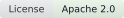
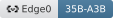
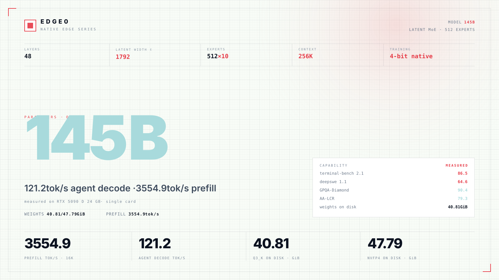
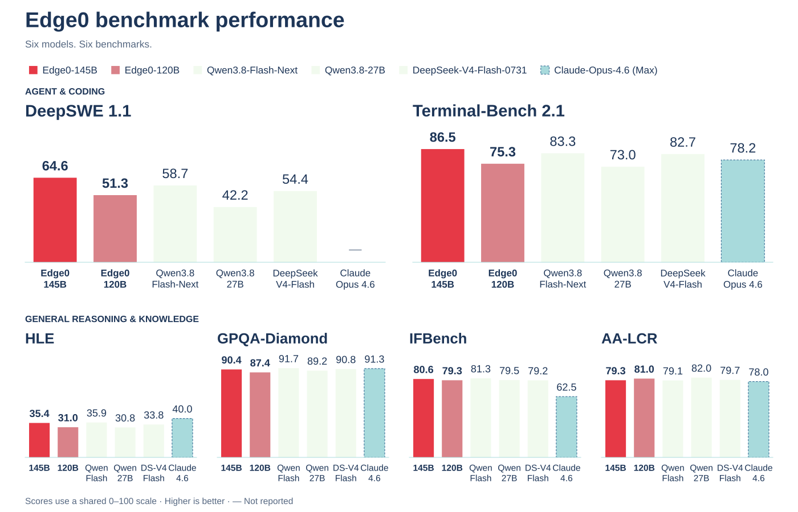
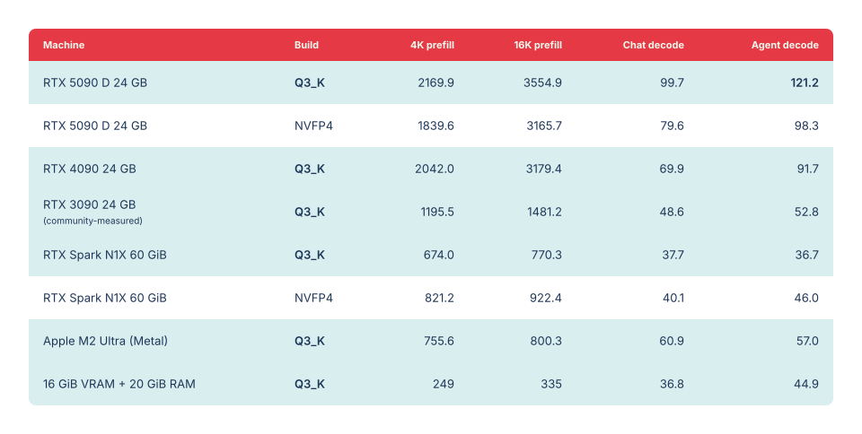
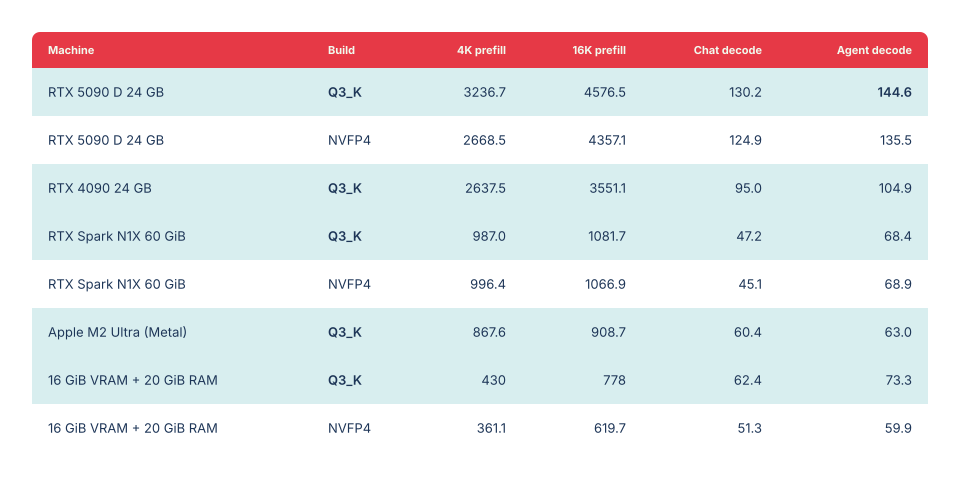
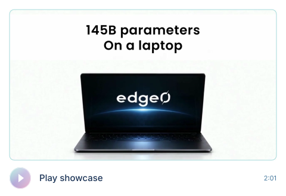
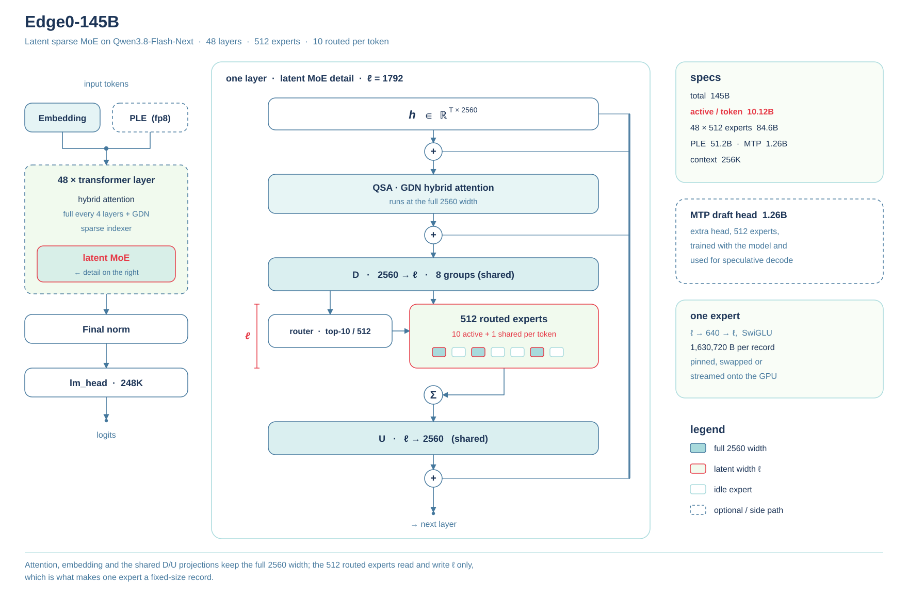

<p align="center"></p>

<h1 align="center">Edge0</h1>

<p align="center">오픈소스 스트리밍 MoE 추론 프레임워크</p>

<br>

<p align="center">크게 생각하고, 여기서 실행하세요.<br>희소성을 고려한 설계.</p>

<br>

<p align="center">macOS · iOS · Android · Linux · Windows<br>모든 Edge0 모델을 위한 하나의 프로그램</p>

<p align="center"><sub>프로젝트</sub><br>
<br>
<a href="https://arxiv.org/abs/2609.18063"></a> <a href="https://github.com/Edge0-AI/Edge0"></a> <a href="https://edge0.ai/discord"></a> <a href="LICENSE"></a> <a href="https://github.com/Edge0-AI/Edge0/releases"></a>
</p>

<p align="center"><sub>최신 릴리스</sub><br>
<br>
<a href="https://huggingface.co/Edge0/Edge0-145B-q3k"></a> <a href="https://huggingface.co/Edge0/Edge0-145B-NVFP4"></a> <a href="https://huggingface.co/Edge0/Edge0-120B-q3k"></a> <a href="https://huggingface.co/Edge0/Edge0-120B-NVFP4"></a>
</p>

<p align="center"><sub>이전 릴리스</sub><br>
<br>
<a href="https://huggingface.co/Edge0/Edge0-35B-A3B-preview"></a> <a href="https://huggingface.co/Edge0/Edge0-8B-A1B-preview"></a> <a href="https://www.modelscope.cn/models/Edge0/Edge0-35B-A3B-preview"></a> <a href="https://www.modelscope.cn/models/Edge0/Edge0-8B-A1B-preview"></a>
</p>

<p align="center"><a href="README.md">English</a> · <a href="README_zh.md">中文</a> · <a href="README_ja.md">日本語</a> · <a href="README_es.md">Español</a> · <a href="README_fr.md">Français</a> · 한국어</p>

<p align="center"><a href="#news">소식</a> · <a href="#about">소개</a> · <a href="#models">모델</a> · <a href="#quality">품질</a> · <a href="#benchmark">벤치마크</a> · <a href="#getting-started">시작하기</a></p>

<br>

<a name="news"></a>

## 소식

<p><a href="docs/models/edge0-145b.md"></a></p>

<p><a href="edge0-infer/README.md"></a></p>

<p><a href="https://github.com/Edge0-AI/Edge0/tree/pre-edge0-infer"></a></p>

<details open>
<summary>더 많은 소식</summary>

<p><a href="https://arxiv.org/abs/2609.18063"></a></p>

<p><a href="https://huggingface.co/Edge0/Edge0-35B-A3B-preview"></a></p>

<details>
<summary>전체 릴리스 노트</summary>

- **[2026-11-13]** Qwen3.8-Flash-Next 기반 잠재 MoE 모델 **`edge0-145b`**와 **`edge0-120b`**를 공개했습니다. Linux 또는 Windows에서 NVIDIA GPU 한 개로 실행합니다. `edge0-infer serve`와 `edge0-infer chat`은 [edge0-strata](edge0-strata/EDGE0.md)를 시작합니다. 자세한 내용은 [모델 페이지](docs/models/edge0-145b.md)를 참고하세요. Hugging Face 가중치: [145B Q3_K](https://huggingface.co/Edge0/Edge0-145B-q3k) · [145B NVFP4](https://huggingface.co/Edge0/Edge0-145B-NVFP4) · [120B Q3_K](https://huggingface.co/Edge0/Edge0-120B-q3k) · [120B NVFP4](https://huggingface.co/Edge0/Edge0-120B-NVFP4).
- **[2026-11-04]** **통합 추론 엔진 [`edge0-infer`](edge0-infer/README.md)**를 공개했습니다. [GGML](https://github.com/ggml-org/ggml) 기반 엔진과 네이티브 C++ API 하나로 macOS, iOS, Android, Windows에서 같은 모델을 실행합니다. CLI, OpenAI 호환 로컬 서버와 데스크톱·Android·iOS 채팅 앱 예제도 제공합니다. 첫 릴리스는 `edge0-35b`를 지원하며 `edge0-8b`는 추후 지원합니다. Python 프레임워크와 플랫폼별 엔진을 대체하며, 이전 코드는 [`pre-edge0-infer`](https://github.com/Edge0-AI/Edge0/tree/pre-edge0-infer) 태그에 보관합니다.
- **[2026-09-30]** iOS, macOS, Android, Windows용 추론 엔진을 공개했습니다([소스](https://github.com/Edge0-AI/Edge0/tree/pre-edge0-infer)).
- **[2026-09-16]** 기술 보고서 [The Other Half of the Memory Wall: Serving 35B MoEs from SSD with Trained Routing Prediction](https://arxiv.org/abs/2609.18063)을 arXiv에 공개했습니다.
- **[2026-09-08]** edge0와 [35B](https://huggingface.co/Edge0/Edge0-35B-A3B-preview) 및 [8B](https://huggingface.co/Edge0/Edge0-8B-A1B-preview) 프리뷰 모델을 Hugging Face와 ModelScope에 공개했습니다.

</details>

</details>

<details open>
<summary><h2>이전 릴리스</h2></summary>

→ [35B / 8B 릴리스 가이드](docs/legacy-models.md): 모델 다운로드, 아키텍처, 벤치마크, 지원 플랫폼과 설치 방법.

</details>

<a name="about"></a>

## 소개

Edge0는 소비자용 하드웨어에서 대규모 희소 모델을 실행하는 오픈소스 스트리밍 MoE 추론 프레임워크입니다.

명령줄, 로컬 API 서버 또는 Edge0 Chat 앱으로 사용할 수 있습니다. 최신 145B와 120B 잠재 MoE 모델은 NVIDIA GPU 한 개 또는 Apple Silicon Mac에서 실행됩니다. 두 모델은 4비트로 학습되었으며 로컬 에이전트 작업에 사용할 수 있는 Q3_K와 NVFP4 형식으로 제공됩니다.

[`edge0-infer`](edge0-infer/README.md)는 공통 `serve` 및 `chat` 명령을 제공하고 모델 폴더에 따라 엔진을 선택합니다. 최신 모델은 Strata의 포크인 [edge0-strata](edge0-strata/EDGE0.md)에서, 이전 35B 모델은 [GGML 기반 네이티브 엔진](docs/legacy-models.md#native-engine-design)에서 실행합니다.

### 플랫폼

지원 여부는 모델과 엔진에 따라 다릅니다.

| 플랫폼 | `edge0-145b`, `edge0-120b` (edge0-strata) | `edge0-35b` (네이티브 엔진) |
| --- | --- | --- |
| **Linux** | NVIDIA GPU (CUDA 13) | CPU |
| **Windows** | NVIDIA GPU (CUDA 13) | CPU, Vulkan |
| **macOS** (Apple Silicon) | Metal | Metal, CPU |
| **iOS** | — | Metal |
| **Android** | — | CPU |

최신 릴리스는 [145B / 120B 설치 방법](#getting-started)을 참고하세요. [이전 릴리스 가이드](docs/legacy-models.md#platforms)는 네이티브 백엔드, 플랫폼별 빌드와 채팅 예제를 다룹니다. 8B 체크포인트는 공개되어 있으며 네이티브 엔진 지원은 예정되어 있습니다.

<a name="models"></a>

## 모델

145B와 120B는 Qwen3.8-Flash-Next 기반의 최신 잠재 MoE 모델로, 4비트로 학습되었습니다.

`edge0-infer serve` 또는 `edge0-infer chat`으로 edge0-strata를 실행합니다. NVIDIA GPU와 CUDA 13을 사용하는 Linux·Windows 또는 Apple Silicon의 Metal을 사용하는 macOS를 지원합니다.

**145B Q3_K · RTX 5090 D 24 GB:** 에이전트 디코딩 121.2 tok/s · 16K 프리필 3554.9 tok/s.

| 모델 | 공개 체크포인트 | 추론 구성 | 엔진 |
|---|---|---|---|
| [`edge0-145b`](docs/models/edge0-145b.md) | [`Edge0/Edge0-145B-q3k`](https://huggingface.co/Edge0/Edge0-145B-q3k) · [NVFP4](https://huggingface.co/Edge0/Edge0-145B-NVFP4) | Q3_K 또는 NVFP4 잠재 전문가 (1792), 48개 레이어, 512개 전문가, K=10 | edge0-strata ✅ (Linux 또는 Windows, NVIDIA GPU; macOS Apple Silicon, Metal, Q3_K) |
| [`edge0-120b`](docs/models/edge0-145b.md) | [`Edge0/Edge0-120B-q3k`](https://huggingface.co/Edge0/Edge0-120B-q3k) · [NVFP4](https://huggingface.co/Edge0/Edge0-120B-NVFP4) | Q3_K 또는 NVFP4 잠재 전문가 (1280), 48개 레이어, 512개 전문가, K=10 | edge0-strata ✅ (Linux 또는 Windows, NVIDIA GPU; macOS Apple Silicon, Metal, Q3_K) |

<details open>
<summary><h3>모델 개요 · 145B Q3_K</h3></summary>

Q3_K · RTX 5090 D 24 GB. 프리필에는 16K 토큰 입력을 사용했습니다. 품질 점수는 모델 단위 결과입니다.

<a href="assets/edge0-release/model-overview-145B-q3k.svg"></a>

</details>

<a name="quality"></a>

## 품질

### 145B / 120B

6개 모델을 6개 벤치마크로 비교했습니다. 점수가 높을수록 좋으며, Q3_K와 NVFP4를 별도로 평가하지 않고 모델별 점수를 표시합니다.

<a href="assets/edge0-release/quality-overview.svg"></a>

[복사 가능한 점수와 전체 모델 이름](docs/models/edge0-145b.md#quality)

<details>
<summary>복사 가능한 점수 · 전체 6개 모델</summary>

굵은 값은 각 열의 최고 점수입니다.

| 모델 | deepswe 1.1 | terminal-bench 2.1 | AA-LCR | IFBench | GPQA-Diamond | HLE |
| --- | ---: | ---: | ---: | ---: | ---: | ---: |
| **Edge0-145B** | **64.6** | **86.5** | 79.3 | 80.6 | 90.4 | 35.4 |
| **Edge0-120B** | 51.3 | 75.3 | 81.0 | 79.3 | 87.4 | 31.0 |
| DeepSeek-V4-Flash-0731 | 54.4 | 82.7 | 79.7 | 79.2 | 90.8 | 33.8 |
| Qwen3.8-Flash-Next | 58.7 | 83.3 | 79.1 | **81.3** | **91.7** | 35.9 |
| Qwen3.8-27B | 42.2 | 73.0 | **82.0** | 79.5 | 89.2 | 30.8 |
| Claude-Opus-4.6 (Max) | / | 78.2 | 78.0 | 62.5 | 91.3 | **40.0** |

</details>

<a name="speed"></a>

<a name="benchmark"></a>

## 벤치마크

### 145B / 120B

처리량 단위는 모두 tok/s입니다. 대표 수치는 RTX 5090 D 24 GB에서 측정한 **145B Q3_K** 결과입니다.

<details open>
<summary>145B 속도 표 · 전체 기기와 빌드</summary>

강조된 행은 Q3_K 결과입니다. 표를 클릭하면 원래 크기로 볼 수 있습니다.

<a href="assets/edge0-release/speed-145B.svg"></a>

<details>
<summary>복사 가능한 145B 속도 데이터</summary>

| 기기 | 빌드 | 4K 프리필 | 16K 프리필 | 채팅 디코딩 | 에이전트 디코딩 |
|---|---|---:|---:|---:|---:|
| RTX 5090 D 24 GB | Q3_K | 2169.9 | 3554.9 | 99.7 | **121.2** |
| RTX 5090 D 24 GB | NVFP4 | 1839.6 | 3165.7 | 79.6 | 98.3 |
| RTX 4090 24 GB | Q3_K | 2042.0 | 3179.4 | 69.9 | 91.7 |
| RTX Spark N1X 60 GiB | Q3_K | 674.0 | 770.3 | 37.7 | 36.7 |
| RTX Spark N1X 60 GiB | NVFP4 | 821.2 | 922.4 | 40.1 | 46.0 |
| Apple M2 Ultra (Metal) | Q3_K | 755.6 | 800.3 | 60.9 | 57.0 |
| 16 GiB VRAM + 20 GiB RAM | Q3_K | 249 | 335 | 36.8 | 44.9 |

</details>

</details>

<details>
<summary>145B 측정 조건 · 메모리 제한 및 상주</summary>

`16 GiB VRAM + 20 GiB RAM` 행은 동일한 RTX 5090 D 24 GB에서 측정했습니다. VRAM은 `--vram-reserve-mib 8192`로, 시스템 RAM은 cgroup(`MemoryMax=20G`, 스왑 없음)으로 제한했습니다. 전문가 상주를 켰을 때 **Q3_K** 가중치 40.81 GiB는 VRAM 23.14 GiB와 RAM 31.28 GiB에, **NVFP4** 47.79 GiB는 VRAM 23.25 GiB와 RAM 38.27 GiB에 저장됩니다. 두 메모리의 전문가 집합은 겹치지 않습니다.

이 제한은 테스트 조건이며 최소 시스템 요구 사항이 아닙니다. Apple M2 Ultra 행은 Metal 측정 결과입니다. 메모리 절약 옵션은 [사용법과 문제 해결](#usage-help)을 참고하세요.

</details>

<details open>
<summary>120B 속도 표 · 전체 기기와 빌드</summary>

<a href="assets/edge0-release/speed-120B.svg"></a>

<details>
<summary>복사 가능한 120B 속도 데이터</summary>

| 기기 | 빌드 | 4K 프리필 | 16K 프리필 | 채팅 디코딩 | 에이전트 디코딩 |
|---|---|---:|---:|---:|---:|
| RTX 5090 D 24 GB | Q3_K | 3236.7 | 4576.5 | 130.2 | **144.6** |
| RTX 5090 D 24 GB | NVFP4 | 2668.5 | 4357.1 | 124.9 | 135.5 |
| RTX 4090 24 GB | Q3_K | 2637.5 | 3551.1 | 95.0 | 104.9 |
| RTX Spark N1X 60 GiB | Q3_K | 987.0 | 1081.7 | 47.2 | 68.4 |
| RTX Spark N1X 60 GiB | NVFP4 | 996.4 | 1066.9 | 45.1 | 68.9 |
| Apple M2 Ultra (Metal) | Q3_K | 867.6 | 908.7 | 60.4 | 63.0 |
| 16 GiB VRAM + 20 GiB RAM | Q3_K | 430 | 778 | 62.4 | 73.3 |
| 16 GiB VRAM + 20 GiB RAM | NVFP4 | 361.1 | 619.7 | 51.3 | 59.9 |

</details>

`16 GiB VRAM + 20 GiB RAM` 행은 동일한 RTX 5090 D 24 GB를 사용하고 cgroup으로 VRAM 16 GiB와 시스템 RAM 20 GiB를 제한한 결과입니다. 전문가 상주를 켰을 때 **Q3_K** 가중치 27.98 GiB는 VRAM 22.93 GiB와 RAM 18.40 GiB에, **NVFP4** 32.96 GiB는 VRAM 23.02 GiB와 RAM 23.40 GiB에 저장됩니다. 두 메모리의 전문가 집합은 겹치지 않습니다.

상주 측정은 전문가 상주 활성화, `--no-prefill-borrow`, conv cache = 0, kv-resident = 0 조건에서 수행했습니다. 호스트 RAM은 `RssAnon + RssShmem`으로 측정했습니다. 단일 실행 결과이며 최소 시스템 요구 사항이 아닙니다. 메모리 절약 옵션은 [사용법과 문제 해결](#usage-help)을 참고하세요.

</details>

<details open>
<summary><h2>실행 모습</h2></summary>

<p align="center"><a href="assets/edge0-release/showcase.mp4"></a></p>

<p align="center">Edge0-145B로 녹화 · <a href="assets/edge0-release/showcase.mp4">영상 열기 ↗</a></p>

<details>
<summary>다섯 가지 시연 · 구간 안내</summary>

| 시간 | 시연 |
| --- | --- |
| 0:00 | 로컬 채팅과 코딩 |
| 0:36 | 영상 제작 |
| 0:58 | 3D 맨해튼 |
| 1:19 | 대성당 월드 제작 |
| 1:38 | PCB 설계 |

[구간 마커 (VTT)](assets/edge0-release/showcase-chapters.vtt)

</details>

</details>

## 아키텍처

잠재 MoE는 어텐션의 전체 너비를 유지하면서 전문가 입력을 압축합니다. 145B 모델의 잠재 너비는 1792, 120B는 1280입니다. 두 모델 모두 공유 전문가 한 개와 함께 각 토큰을 512개 전문가 중 10개로 라우팅합니다.

<details open>
<summary>아키텍처 상세 · 다이어그램과 설정</summary>

<a href="assets/edge0-release/arch-145B.svg"></a>

[전체 설정, 라우팅 및 두 모델의 구성](docs/models/edge0-145b.md#model-profile).

</details>

<a name="quick-start"></a>

<a name="getting-started"></a>

## 시작하기

### 145B / 120B · edge0-strata

각 모델 폴더(Q3_K 또는 NVFP4, Edge0-145B 또는 Edge0-120B)는 명령줄이나 Edge0 Chat 데스크톱 앱에서 `edge0-infer`로 실행합니다. 폴더를 그대로 유지하세요. `edge0-infer`는 `model.json`의 `model_name`으로 모델을 식별합니다.

145B와 120B에는 `serve` 또는 `chat`을 사용하세요. `run`은 네이티브 엔진용입니다.

<details>
<summary>플랫폼 및 문서 안내</summary>

빌드 안내는 Linux 또는 Windows(x64 또는 ARM64)의 CUDA 13 NVIDIA GPU와 Apple Silicon macOS의 Metal을 다룹니다.

</details>

<details>
<summary>빌드 및 명령줄 실행</summary>

**1. 빌드.** 저장소를 복제한 다음 두 구성 요소를 빌드합니다. 아래 실행 명령은 `edge0-infer/`에서 실행하세요:

```bash
git clone https://github.com/Edge0-AI/Edge0.git edge0
```

- 엔진 **edge0-strata**: [edge0-strata/EDGE0.md](edge0-strata/EDGE0.md)의 "Build (Linux, NVIDIA)", "Build (Windows, NVIDIA)" 또는 "Build (macOS, Apple Silicon)"을 따르세요.
- **edge0-infer**: [시작하기](edge0-infer/docs/getting-started.md)의 "Build"(Linux) 또는 "Windows"를 따르세요.

**2. 명령줄 실행.** 여러 모델을 담은 상위 폴더가 아닌 `Edge0-145B-q3k` 같은 단일 모델 폴더를 지정합니다. Windows 실행 파일은 `build\windows\bin\edge0-infer.exe`입니다.

```bash
build/cpu/bin/edge0-infer serve --model /path/to/Edge0-145B-q3k
```

가중치를 불러오면 `Listening: http://127.0.0.1:8000 model=<name>`이 출력됩니다. 여기서 `<name>`은 `edge0_145b`이며, 이후 OpenAI 및 Anthropic 호환 엔드포인트를 사용할 수 있습니다.

```bash
curl localhost:8000/v1/chat/completions -H 'content-type: application/json' -d '{"model":"edge0_145b","messages":[{"role":"user","content":"hi"}],"max_tokens":64}'
```

`edge0-infer chat --model /path/to/Edge0-145B-q3k`으로 대화형 세션을 열 수도 있습니다. 추가 옵션은 [145B 가이드](edge0-infer/docs/edge0-145b.md)를 참고하세요.

</details>

<details>
<summary>GPU 두 개 · 두 번째 카드의 전문가 계층</summary>

두 번째 NVIDIA 카드는 첫 번째 카드의 VRAM에 들어가지 않는 전문가를 보관합니다. 디코딩은 두 전문가 형식 모두에서 이를 사용하며 NVLink나 P2P는 필요하지 않습니다.

`edge0-infer`는 한 카드에서 엔진을 실행하므로, 두 카드를 쓰려면 `serve/server.py --config`가 읽는 설정(`exe`, `args`, `cwd`, `env` 포함)으로 엔진을 시작합니다.

- `"gpu": [0, 1]`을 설정합니다. 엔진의 장치 0은 첫 번째 카드, 장치 1은 두 번째 카드입니다.
- `"args"`에 `"--peer-device", "1", "--peer-reserve-mib", "1024", "--peer-slots", "0"`을 추가합니다.

```bash
cd /path/to/Edge0-145B-q3k
/path/to/edge0-strata/.venv/bin/python /path/to/edge0-strata/serve/server.py \
  --engine strata --config ./model-two-gpus.json
```

시작 로그에 두 번째 카드의 계층(`peer GPU 1: … experts, … GiB`)이 출력되며, 서버는 단일 카드와 같은 엔드포인트를 제공합니다. `--peer-device`는 `--layer-split` 또는 `--expert-cache-device1..3`과 함께 사용할 수 없습니다. 자세한 내용은 [두 GPU 사용법](edge0-strata/EDGE0.md#two-gpus-linux-nvidia)을 참고하세요.

</details>

<details>
<summary>데스크톱 앱 · Windows · macOS</summary>

⬇️ **다운로드:** **[GitHub Releases](https://github.com/Edge0-AI/Edge0/releases)**

Windows 또는 macOS(Apple Silicon)에서 **Edge0 Chat**을 여세요. **Models**에서 Hugging Face나 ModelScope의 모델을 다운로드하거나 기존 모델 폴더(예: `Edge0-145B-q3k`)를 추가한 뒤 로드하면 로컬에서 실행할 수 있습니다. macOS 앱은 Q3_K 모델만 제공하고 실행합니다. 소스에서 빌드하려면 [Edge0 Chat 가이드](edge0-infer/examples/desktop/README.md)를 참고하세요.

</details>

<details>
<summary>이미지 · 비전</summary>

모델 폴더의 `mmproj-BF16.gguf`는 비전 인코더입니다. 모델의 `model.json`에서 `args` 옆에 다음을 추가하세요:

```json
"vision": {"exe": "/path/to/strata-vision", "mmproj": "./mmproj-BF16.gguf",
           "model": "./model-skeleton.gguf", "gpu": false}
```

`"args"`에도 `--vision`을 추가하세요. `strata-vision`은 이 저장소에 포함되지 않습니다. `setup.py --setup --vision yes`로 가져오거나 Strata 체크아웃에서 `tools/vision`을 빌드하세요. 로그에 `images on`이 표시되면 채팅에서 `/image`로 사진을 보내거나 OpenAI API에서 `image_url` 부분을 전달할 수 있습니다.

</details>

<a name="memory-update"></a>
<a name="deployment-qa"></a>
<a name="memory-deployment"></a>
<a name="usage-help"></a>

## 사용법과 문제 해결

145B / 120B · 메모리 옵션

<details>
<summary><a name="low-memory"></a>낮은 RAM 사용량 · SSD 오프로딩</summary>

- **SSD 모드:** `--mmap-experts` — 캐시되지 않은 전문가를 필요할 때 SSD에서 읽습니다.
- **저메모리 인자:**

```bash
--resident-budget-gib 20 --expert-profile expert-profile.bin
```

전문가 캐시에 호스트 RAM을 최대 **20 GiB** 사용합니다. 캐시에 없는 전문가는 필요할 때 SSD에서 읽습니다. `--mmap-experts`와 서로 겹치지 않는 GPU/RAM 캐시가 자동 적용됩니다.

**필수:** 정적 전문가 프로필. `expert-profile.bin`을 해당 프로필 경로로 바꾸세요.

</details>
<details>
<summary><a name="ram-budget"></a>RAM 예산 · 20 GiB의 범위</summary>

- **전문가 캐시:** `--resident-budget-gib 20`은 호스트 RAM의 전문가 캐시를 최대 **20 GiB**로 제한하며, 사용 가능한 메모리에 맞춰 더 낮아질 수 있습니다.
- **전체 RAM:** 전문가 캐시와 기타 실행 시 할당량을 합한 값입니다. 이 옵션은 프로세스 전체 RAM을 제한하지 않습니다.
- **벤치마크 제한:** 전체 RAM 20 GiB 테스트 예산은 별도의 측정 조건입니다.

</details>
<details>
<summary><a name="expert-residency"></a>GPU / RAM · 전문가 중복 방지</summary>

- **활성화:** 정적 `--expert-profile`과 함께 `--resident-experts` 또는 `--resident-budget-gib N`을 지정합니다.
- **효과:** VRAM에 캐시된 전문가를 RAM에 중복 저장하지 않습니다. SSD 로딩과 함께 사용할 수 있습니다.
- **기본값:** 속도를 우선하여 비활성화합니다.
- **자동 활성화:** `--mmap-experts`, `--resident-cpu-experts`, `--resident-pin`.

</details>

### 용량 제어 · VRAM과 호스트 RAM

다음 설정은 모델 팩의 `model.json`에 넣습니다. 플래그는 `args`, 환경 변수는 `env`에 넣으며 모든 모델 실행에 적용됩니다.

| 옵션 | 의미 | 기본값 |
|---|---|---|
| `--vram-reserve-mib N` | 데스크톱, 드라이버와 다른 프로세스를 위해 남겨 둘 VRAM입니다. 엔진은 남은 용량에 맞춰 캐시 크기를 정합니다. | `700` |
| `--expert-cache N\|auto` | VRAM에 유지할 전문가 슬롯 수입니다. `auto`는 고정 사용량(projection, MTP draft, 검증 버퍼, D/U 장치 버퍼)을 뺀 여유 VRAM으로 계산합니다. | `0` |
| `--kv-resident N` | QSA 레이어마다 VRAM에 유지할 KV 셀 수입니다. 나머지는 고정된 호스트 RAM에서 스트리밍해 전문가용 VRAM을 확보합니다. | `0` |
| `--spec N` | MTP drafter의 검증 윈도, 즉 검사당 제안 토큰 수입니다. 윈도가 클수록 검증 버퍼도 커지지만(4일 때 약 180 MiB), 윈도마다 레이어별 고정 비용이 있을 때 유리합니다. MTP 레이어가 없으면 추측 실행도 없습니다. | `4` |
| `--resident-budget-gib N` | 호스트 RAM 전문가 캐시 상한입니다. VRAM 캐시에 없는 전문가만 보관하므로 두 집합은 겹치지 않습니다. 값은 여유분을 뺀 사용 가능 RAM으로 제한됩니다. 정적 `--expert-profile`이 필요합니다. | `0` |
| `--mmap-experts` | 전문가를 고정하지 않고 필요할 때 팩 파일에서 읽으므로 RAM에 상주하지 않습니다. | 비활성 |

## 문서

**최신 릴리스 · 145B / 120B**

- [모델, 측정 결과와 아키텍처](docs/models/edge0-145b.md)
- [edge0-strata · 빌드와 실행 규약](edge0-strata/EDGE0.md)
- edge0-infer 모델 가이드: [145B](edge0-infer/docs/edge0-145b.md) / [120B](edge0-infer/docs/edge0-120b.md)

**프레임워크**

- [edge0-infer](edge0-infer/README.md) · 명령줄, 로컬 서버와 채팅 앱
- [로컬 서버](edge0-infer/docs/local-server.md) / [테스트](edge0-infer/docs/testing.md)
- [모델 에셋 도구와 모델 추가](edge0-infer/tools/assets/README.md)

<details>
<summary>이전 릴리스 · 모델과 네이티브 엔진 문서</summary>

- [35B / 8B 릴리스 가이드](docs/legacy-models.md)
- [MoE 라우팅과 전문가](docs/moe.md) / [prerouter](docs/prerouter.md)
- 모델 설명: [edge0-35b](docs/models/edge0-35b.md) / [edge0-8b](docs/models/edge0-8b.md)
- [시작하기](edge0-infer/docs/getting-started.md): 지원 플랫폼의 네이티브 빌드, 모델 에셋, 실행, 채팅과 서버
- [설정](edge0-infer/docs/configuration.md) / [네이티브 API](edge0-infer/docs/native-api.md)
- [아키텍처](edge0-infer/docs/architecture.md) / [네이티브 엔진 설계](edge0-infer/docs/architecture.md#native-engine) / [알려진 제약](edge0-infer/docs/limitations.md)
- [벤치마크](edge0-infer/docs/benchmarking.md)
- 기술 보고서: [The Other Half of the Memory Wall](https://arxiv.org/abs/2609.18063) ([PDF](paper/main.pdf))

</details>

## 로드맵

<details>
<summary>2026년 4분기 · 아키텍처와 추론</summary>

**모델과 알고리즘**

4분기에는 차세대 아키텍처를 도입하고 잠재 추론의 연산량뿐 아니라 실제 지연 시간도 줄입니다.

- **차세대 아키텍처 지원(Qwen3.8-Flash급):** 하이브리드 선형 어텐션(GDN + QSA), 게이트가 있는 다중 분기 잔차 구조와 N-gram 임베딩 구조를 edge0에서 실행합니다. O(1) 상태 어텐션은 긴 사고 과정의 KV 캐시 문제를 줄이고 조회 전용 N-gram 테이블은 필요할 때 스트리밍하므로 SSD 오프로딩에 적합합니다. 단일 기기에서 실행하면서 fp16 기본 모델과 허용 가능한 벤치마크 차이를 유지하는 것이 목표입니다.
- **잠재 사고와 배치 단위 전문가 사전 예측:** 전문가 라우팅을 위치마다 수행하는 대신 **블록마다 한 번** 수행하여 한 번의 예측으로 블록의 모든 위치와 라운드를 처리합니다. 이를 통해 전문가 로드량을 추론 루프 횟수와 분리하고, 현재 블록을 계산하는 동안 다음 블록의 전문가를 미리 불러옵니다. 진행 상황은 tokens/s가 아닌 **동일 정확도에서 전체 사고 단계에 걸린 시간**으로 측정합니다.

[이전 릴리스의 주요 일정과 네이티브 엔진 지원 계획](docs/legacy-models.md#roadmap).

</details>

## 기여하기

<details>
<summary>개발 절차와 검사</summary>

이슈, PR, 벤치마크 보고와 모델 포팅 등 다양한 기여를 환영합니다. 빌드와 테스트 방법은 [테스트 문서](edge0-infer/docs/testing.md)를 참고하세요. 다음 검사는 모델 에셋 없이 실행할 수 있습니다.

```bash
cd edge0-infer
cmake --preset cpu && cmake --build --preset cpu
ctest --preset cpu -L "L0|L1"
```

작업 순서는 포크 → 기능 브랜치 → `main` 대상 PR입니다. 테스트를 통과하도록 유지하고 새 동작에는 테스트를 추가해 주세요. 동작 변경은 먼저 이슈에서 합의하고, 관련 수정은 하나의 PR에 담아 주세요. 동시에 열어 둔 PR은 최대 두 개로 유지해 주세요.

</details>

## 인용

기술 보고서는 35B SSD 스트리밍과 학습된 라우팅 예측을 다룹니다.

edge0가 유용하다면 기술 보고서를 인용해 주세요:

```bibtex
@article{lin2026other,
  title   = {The Other Half of the Memory Wall: Serving 35B MoEs from SSD
             with Trained Routing Prediction},
  author  = {Lin, Yu and Wang, Yiming and Cai, Runyuan and Liu, Hanze and
             Zeng, Xiaodong},
  journal = {arXiv preprint arXiv:2609.18063},
  year    = {2026},
  url     = {https://arxiv.org/abs/2609.18063}
}
```

## 문의

- **Discord**: [edge0.ai/discord](https://edge0.ai/discord) — 커뮤니티 채팅과 지원
- **이메일**: samuel@edge0.ai

버그 보고와 기능 요청은 [GitHub Issues](https://github.com/Edge0-AI/Edge0/issues)를 이용해 주세요.

<details>
<summary><h2>라이선스</h2></summary>

### 프레임워크 코드

프레임워크 코드는 [Apache-2.0](LICENSE)을 따릅니다. 함께 제공되는 구성 요소는 Strata의 [MIT 라이선스](edge0-strata/LICENSE)를 포함해 각자의 라이선스와 [고지](NOTICE)를 유지합니다.

### 모델 라이선스

Edge0가 소유하거나 라이선스를 부여할 권한이 있는 모델 기여물에만 [Edge0 Community Model License 1.0](licenses/edge0-model/LICENSE)이 적용됩니다. 기존의 유효한 라이선스는 변경되지 않습니다.

적용 가능한 업스트림 약관을 전제로 개인 사용, 연구, 교육, 수정, 비상업적 공유, 내부 사용과 생성 결과물의 상업적 사용이 허용됩니다. 비공개 수정 사항의 공개나 Edge0 인터페이스 배지는 요구하지 않습니다.

다음에는 Edge0의 별도 서면 허가가 필요합니다.

- **모델 판매 및 유료 배포:** 적용 대상 어댑터, 델타와 모델 접근이 주된 가치인 상업용 번들 포함.
- **상업용 모델 서비스:** 요금, 구독, 광고 또는 관련 후원으로 운영되는 추론·파인튜닝 서비스.
- **독립적인 상업용 코딩 또는 사무 보조 도구:** 추론이 서버 또는 사용자 기기에서 실행되는 경우 모두 포함.

정의, 예외와 재배포 요건은 전체 라이선스를 참고하세요. 상업용 라이선스 문의: [info@edge0.ai](mailto:info@edge0.ai).

### 업스트림 약관과 적용 범위

Qwen 자료에는 해당 업스트림 라이선스가 계속 적용됩니다. 보존된 [Qwen Community License 1.0](licenses/edge0-model/third-party/Qwen-LICENSE.txt)은 변경 없이 수록되어 있습니다. Edge0의 허가는 Qwen의 출처 표시 또는 별도 상업적 허가 요건을 면제하지 않습니다.

출처 표시와 라이선스 범위는 [모델 NOTICE](licenses/edge0-model/NOTICE)를 참고하세요. 프레임워크와 서드파티 코드 라이선스는 영향을 받지 않습니다.

<details>
<summary><b>감사의 말 · 모델 계보와 엔진</b></summary>

[Qwen3.8-Flash-Next](https://huggingface.co/Qwen/Qwen3.8-Flash-Next)와 [Strata](https://github.com/Niko1221/Strata) 개발팀에 감사드립니다. Edge0는 Strata 엔진에 잠재 MoE 지원을 추가합니다. `edge0-strata`는 Niko1221과 Strata 기여자들의 Strata를 포크했으며 [MIT 라이선스](edge0-strata/LICENSE)를 유지합니다.

Edge0 프레임워크 코드는 [Apache-2.0](LICENSE)으로 공개되며, 포함된 서드파티 구성 요소는 각자의 라이선스를 유지합니다([NOTICE](NOTICE) 참고). [이전 릴리스](docs/legacy-models.md#models)는 Qwen3.6과 Ling 모델 계보를 유지합니다.

</details>

</details>
