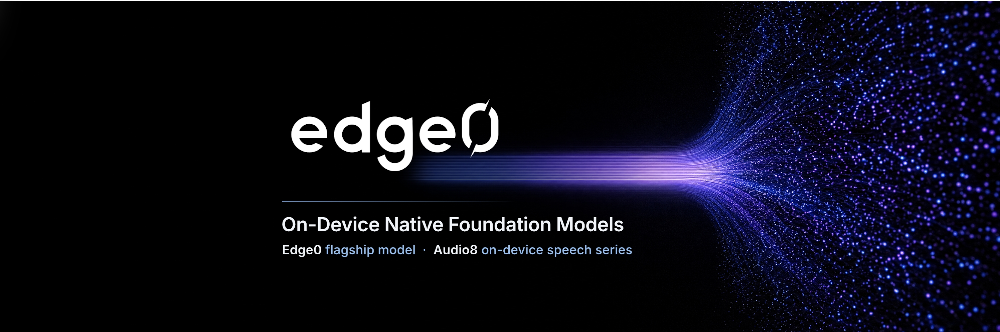

<div align="center">



# edge0

**오픈소스 스트리밍 MoE 추론 프레임워크 — SSD 전문가 오프로딩 + Recover-LoRA + prerouter 라우팅 예측.**

**macOS** · **iOS** · **Android** · **Linux** · **Windows** — 모든 Edge0 모델을 하나의 프로그램으로 실행합니다.

[](https://huggingface.co/Edge0/Edge0-35B-A3B-preview)
[](https://huggingface.co/Edge0/Edge0-8B-A1B-preview)
[](https://www.modelscope.cn/models/Edge0/Edge0-35B-A3B-preview)
[](https://www.modelscope.cn/models/Edge0/Edge0-8B-A1B-preview)
[](https://arxiv.org/abs/2609.18063)
[](https://github.com/Edge0-AI/Edge0)
[](https://edge0.ai/discord)
[](LICENSE)

[English](README.md) | [中文](README_zh.md) | [日本語](README_ja.md) | [Español](README_es.md) | [Français](README_fr.md) | 한국어

</div>

## 소식

- **[2026-11-13]** Qwen3.8-Flash-Next를 기반으로 한 잠재 전문가 혼합 모델 **`edge0-145b`**와 **`edge0-120b`**를 공개했습니다. Linux 또는 Windows에서 단일 NVIDIA GPU로 실행합니다. 두 모델은 [edge0-strata](edge0-strata/EDGE0.md)에서 실행하며, `edge0-infer serve`와 `edge0-infer chat`이 이를 시작합니다. [모델 페이지](docs/models/edge0-145b.md)를 참고하세요.
- **[2026-11-04]** **통합 추론 엔진 [`edge0-infer`](edge0-infer/README.md)**를 공개했습니다. [GGML](https://github.com/ggml-org/ggml)을 기반으로 하나의 엔진과 네이티브 C++ API를 통해 macOS, iOS, Android, Windows에서 같은 모델을 실행합니다. CLI, OpenAI 호환 로컬 서버, 데스크톱·Android·iOS 채팅 앱 예제도 제공합니다. 첫 릴리스는 `edge0-35b`를 지원하며 `edge0-8b`는 추후 지원할 예정입니다. 이 엔진은 Python 프레임워크와 플랫폼별 엔진을 대체하며 이전 코드는 [`pre-edge0-infer`](https://github.com/Edge0-AI/Edge0/tree/pre-edge0-infer) 태그에 보관합니다.
- **[2026-09-30]** **iOS, macOS, Android, Windows용 edge0 추론 엔진**을 공개했습니다(소스: [`pre-edge0-infer`](https://github.com/Edge0-AI/Edge0/tree/pre-edge0-infer) 태그).
- **[2026-09-16]** 기술 보고서를 arXiv에 공개했습니다: [The Other Half of the Memory Wall: Serving 35B MoEs from SSD with Trained Routing Prediction](https://arxiv.org/abs/2609.18063).
- **[2026-09-08]** **edge0**를 처음 오픈소스로 공개하고 두 모델 계층을 함께 공개했습니다. [`Edge0-35B-A3B-preview`](https://huggingface.co/Edge0/Edge0-35B-A3B-preview)와 [`Edge0-8B-A1B-preview`](https://huggingface.co/Edge0/Edge0-8B-A1B-preview)는 Hugging Face와 ModelScope에서 제공합니다.

## 소개

**edge0**는 오픈소스 스트리밍 MoE 추론 프레임워크입니다. 실제 서비스에서 검증한
**SSD 전문가 오프로딩 + Recover-LoRA + prerouter 라우팅 예측** 기법을 확장 가능한
프레임워크로 일반화하여 소비자용 하드웨어에서 대규모 희소 MoE 모델을 실행합니다.
최대 메모리 사용량은 파라미터 수가 아니라 *활성* 전문가 집합에 따라 결정됩니다.

### 핵심 원리

- **SSD 전문가 오프로딩**: 필요한 전문가 가중치를 스토리지에서 스트리밍합니다.
  최대 메모리 사용량은 파라미터 수가 아니라 활성 전문가 집합에 따라 결정됩니다.
- **Prerouter**: 학습된 헤드가 전문가 라우팅을 한 단계 앞서 예측합니다.
  순전파와 전문가 로드를 동시에 진행해 디코딩 처리량을 **최대 59%** 높입니다.
  스토리지 지연 시간, 모델 크기, 라우팅 폭 *K*가 클수록 이점도 커집니다.
- **Recover-LoRA**: int4 기본 모델은 고정하고 FP 교사 모델에서 지식 증류로 LoRA 어댑터를 학습해 4비트 양자화 손실을 대부분 복구합니다([품질](#품질) 참고).
  어댑터는 기본 모델과 별도로 저장하며 켜거나 끌 수 있습니다.

### 플랫폼

[`edge0-infer`](edge0-infer/README.md)는 모든 모델에 동일한 명령을 사용하는 실행 프로그램입니다(CLI, OpenAI 및 Anthropic 호환 로컬 서버, 채팅 앱). 모델마다 전용 엔진에서 실행하며 edge0-infer가 모델 폴더를 보고 엔진을 선택하므로 직접 선택할 필요가 없습니다. `edge0-35b`는 `edge0-infer/`의 **네이티브 엔진**(GGML 기반, 네이티브 C++ API)에서, `edge0-145b`와 `edge0-120b`는 Strata를 포크한 [`edge0-strata/`](edge0-strata/EDGE0.md)의 **edge0-strata**에서 실행합니다.

| 플랫폼 | `edge0-35b` (네이티브 엔진) | `edge0-145b`, `edge0-120b` (edge0-strata) |
|---|---|---|
| **macOS** (Apple Silicon) | Metal, CPU | — |
| **iOS** | Metal | — |
| **Android** | CPU | — |
| **Linux** | CPU | NVIDIA GPU (CUDA 13) |
| **Windows** | CPU, Vulkan | NVIDIA GPU (CUDA 13) |

측정 결과는 `edge0-35b`의 [벤치마크](edge0-infer/docs/benchmarking.md#reference-figures)와 `edge0-145b`, `edge0-120b`의 [모델 페이지](docs/models/edge0-145b.md)를 참고하세요. 네이티브 엔진에서는 같은 기기의 서로 다른 백엔드에서 프리필과 디코딩을 실행할 수 있습니다. 예를 들어 Metal로 프리필하고 CPU로 디코딩할 수 있습니다. 데스크톱(macOS, Windows), Android, iOS용 채팅 앱 예제는 [`edge0-infer/examples/`](edge0-infer/examples/README.md#chat-applications)에 있습니다.

### 모델

프레임워크는 `edge0-35b`와 `edge0-8b` 두 모델 계층을 제공합니다. 각 계층은 완결된 릴리스로,
공개된 체크포인트와 학습된 LoRA 어댑터 및 prerouter 헤드가 하나의 단위로 작동합니다.

| 계층 | 공개 체크포인트 | 추론 구성 | 엔진 |
|---|---|---|---|
| `edge0-35b` | [`Edge0/Edge0-35B-A3B-preview`](https://huggingface.co/Edge0/Edge0-35B-A3B-preview) · [ModelScope](https://www.modelscope.cn/models/Edge0/Edge0-35B-A3B-preview) | 4비트, 40개 레이어, 256개 전문가, prerouter K=4 | 네이티브 엔진 ✅ |
| `edge0-8b` | [`Edge0/Edge0-8B-A1B-preview`](https://huggingface.co/Edge0/Edge0-8B-A1B-preview) · [ModelScope](https://www.modelscope.cn/models/Edge0/Edge0-8B-A1B-preview) | 4비트, 24개 레이어, 128개 전문가, prerouter K=8 | 네이티브 엔진 (예정) |
| [`edge0-145b`](docs/models/edge0-145b.md) | 출시 예정 | Q3_K 또는 NVFP4 잠재 전문가 (1792), 48개 레이어, 512개 전문가, K=10 | edge0-strata ✅ (Linux 또는 Windows, NVIDIA GPU) |
| [`edge0-120b`](docs/models/edge0-145b.md) | 출시 예정 | Q3_K 또는 NVFP4 잠재 전문가 (1280), 48개 레이어, 512개 전문가, K=10 | edge0-strata ✅ (Linux 또는 Windows, NVIDIA GPU) |

공개된 두 체크포인트는 각각 오픈소스 희소 MoE 기본 모델(Qwen3.6-35B-A3B와 Ling 3.0 bailing hybrid)을 기반으로 하며,
이 프레임워크에 맞게 학습한 LoRA와 prerouter를 함께 제공합니다. edge0-infer는 에셋 도구로 공개 체크포인트를 내려받아
엔진의 모델 에셋으로 변환합니다([시작하기](#시작하기) 참고).
`edge0-145b`와 `edge0-120b`는 단일 NVIDIA GPU를 위한 별도의 잠재 MoE 계층입니다. edge0-strata에서 실행하며 `edge0-infer serve`와 `edge0-infer chat`이 이를 시작합니다([edge0-145b와 edge0-120b](docs/models/edge0-145b.md) 참고).

### 설계

- **GGML 기반, 모든 플랫폼에서 동일한 코드 사용**: 네이티브 라이브러리는 고정 버전의 GGML만 수정 없이 포함하여 의존합니다. 빌드 중에는 아무것도 내려받지 않습니다.
- **하나의 네이티브 API**: 애플리케이션은 CMake 타깃 `edge0::edge0`을 링크하고 `include/edge0/`의 헤더를 포함해 프로세스 내에서 엔진을 사용합니다. 참조 CLI와 로컬 서버는 네이티브 API와 같은 설정 및 기본값을 사용합니다.
- **필요할 때 전문가 로드**: 라우팅된 전문가는 필요할 때 스토리지에서 각 레이어의 정해진 수의 전문가 슬롯으로 읽어 들입니다. 따라서 기기 메모리보다 큰 모델도 전체를 로드하지 않고 실행합니다.
- **두 가지 라우팅 모드**: `predicted`(기본값)는 현재 토큰을 계산하는 동안 prerouter로 다음 토큰의 전문가를 백그라운드에서 준비합니다. `actual`은 비교를 위해 모델의 원래 연산을 사용합니다.
- **멀티턴 재사용**: 여러 턴으로 이루어진 대화에서는 보통 각 턴의 새 메시지만 계산하고 이전 결과를 재사용합니다.

[edge0-infer 아키텍처](edge0-infer/docs/architecture.md)를 참고하세요.

### 품질

모든 벤치마크는 [OpenCompass](https://github.com/open-compass/opencompass)로 직접 측정했습니다.
edge0 모델(int4 + 학습된 어댑터 + prerouter 라우팅)과 원본 fp16 기본 모델에 동일한 설정과 파라미터를 적용했습니다.
edge0 파이프라인의 성능 손실은 **edge0-35b가 평균 3.9점, edge0-8b가 2.8점**으로 작습니다
(MMLU-Pro에서는 오히려 기본 모델보다 높습니다). 만점은 100점입니다.

| 벤치마크 | edge0-35b (int4) | Qwen3.6-35B-A3B (fp16) | edge0-8b (int4) | Ling 3.0 tiny (fp16) |
|---|---:|---:|---:|---:|
| AIME 2026 | 86.6 | 92.7 | 63.3 | 73.3 |
| HumanEval | 90.9 | 95.1 | 91.5 | 92.7 |
| GPQA-Diamond | 79.8 | 81.8 | 70.7 | 71.2 |
| MMLU-Pro | 81.0 | 84.6 | 70.1 | 65.8 |
| IFBench | 57.9 | 61.7 | 53.9 | 60.6 |
| **평균** | **79.2** | **83.2** | **69.9** | **72.7** |

`edge0-145b`와 `edge0-120b` (**굵은 글씨** = 해당 열의 최고 점수; [모델 페이지](docs/models/edge0-145b.md#quality) 참고):

| 모델 | deepswe 1.1 | terminal-bench 2.1 | AA-LCR | IFBench | GPQA-Diamond | HLE |
| --- | ---: | ---: | ---: | ---: | ---: | ---: |
| **Edge0-145B** | **64.6** | **86.5** | 79.3 | 80.6 | 90.4 | 35.4 |
| **Edge0-120B** | 51.3 | 75.3 | 81.0 | 79.3 | 87.4 | 31.0 |
| DeepSeek-V4-Flash-0731 | 54.4 | 82.7 | 79.7 | 79.2 | 90.8 | 33.8 |
| Qwen3.8-Flash-Next | 58.7 | 83.3 | 79.1 | **81.3** | **91.7** | 35.9 |
| Qwen3.8-27B | 42.2 | 73.0 | **82.0** | 79.5 | 89.2 | 30.8 |
| Claude-Opus-4.6 (Max) | / | 78.2 | 78.0 | 62.5 | 91.3 | **40.0** |

### 벤치마크

`predicted` 라우팅을 사용한 `edge0-35b`를 edge0-infer로 측정했습니다(각 범위는 세 프로세스의 최솟값부터 최댓값까지입니다).

| 플랫폼 | 기기 | 프롬프트 | 첫 토큰 | 디코딩 속도 | 최대 메모리 |
|---|---|---|---|---|---|
| macOS Metal | Apple M5, 16 GiB | 3,084 tokens | 5.60–5.87 s | 24.8–24.9 tok/s | 3.43 GiB (`phys_footprint`) |
| macOS CPU | Apple M5, 16 GiB | 627 tokens | 11.5–11.7 s | 21.7–22.3 tok/s | 2.96 GiB (`phys_footprint`) |
| iOS Metal | iPhone 17 Pro Max, 12 GB | 627 tokens | 8.20–8.26 s | 13.2 tok/s | 3.05 GiB (`phys_footprint`) |
| Android CPU | OnePlus PKR110, 16 GB | 627 tokens | 18.4–18.8 s | 11.4–11.8 tok/s | 2.82 GiB (RSS) |
| Windows CPU | Intel Core i5-12400, 32 GB | 627 tokens | 16.9–17.3 s | 7.3–8.2 tok/s | 2.86 GiB (working set) |
| Windows Vulkan (두 단계 모두, 전문가 슬롯 32개) | RTX 4070 SUPER, 12 GB | 627 tokens | 3.75–3.76 s | 23.6–24.0 tok/s | GPU 메모리 증가량 5.35 GiB |

메모리 측정 기준은 플랫폼마다 달라 직접 비교할 수 없습니다. 측정 방법, `actual` 라우팅 결과와 재현 명령은 [벤치마크](edge0-infer/docs/benchmarking.md#reference-figures)를 참고하세요.

edge0-strata에서 NVIDIA GPU 한 개로 실행한 `edge0-145b`와 `edge0-120b`의 결과입니다(tok/s).

#### edge0-145b

| 기기 | 빌드 | 4K 프리필 | 16K 프리필 | 채팅 디코딩 | 에이전트 디코딩 |
| --- | --- | ---: | ---: | ---: | ---: |
| RTX 5090 D 24 GB | Q3_K | 2169.9 | 3554.9 | 99.7 | **121.2** |
| RTX 5090 D 24 GB | NVFP4 | 1839.6 | 3165.7 | 79.6 | 98.3 |
| RTX 4090 24 GB | Q3_K | 2042.0 | 3179.4 | 69.9 | 91.7 |
| RTX Spark N1X 60 GiB | Q3_K | 674.0 | 770.3 | 37.7 | 36.7 |
| RTX Spark N1X 60 GiB | NVFP4 | 821.2 | 922.4 | 40.1 | 46.0 |
| 16 GiB VRAM + 20 GiB RAM | Q3_K | 249 | 335 | 36.8 | 44.9 |

#### edge0-120b

| 기기 | 빌드 | 4K 프리필 | 16K 프리필 | 채팅 디코딩 | 에이전트 디코딩 |
| --- | --- | ---: | ---: | ---: | ---: |
| RTX 5090 D 24 GB | Q3_K | 3236.7 | 4576.5 | 130.2 | **144.6** |
| RTX 5090 D 24 GB | NVFP4 | 2668.5 | 4357.1 | 124.9 | 135.5 |
| RTX 4090 24 GB | Q3_K | 2637.5 | 3551.1 | 95.0 | 104.9 |
| RTX Spark N1X 60 GiB | Q3_K | 987.0 | 1081.7 | 47.2 | 68.4 |
| RTX Spark N1X 60 GiB | NVFP4 | 996.4 | 1066.9 | 45.1 | 68.9 |
| 16 GiB VRAM + 20 GiB RAM | Q3_K | 430 | 778 | 62.4 | 73.3 |
| 16 GiB VRAM + 20 GiB RAM | NVFP4 | 361.1 | 619.7 | 51.3 | 59.9 |

`16 GiB VRAM + 20 GiB RAM` 행은 같은 RTX 5090 D 24 GB의 GPU 메모리를 16 GiB, 시스템 메모리를 20 GiB로 cgroup에서 제한한 결과입니다. 자세한 내용은 [모델 페이지](docs/models/edge0-145b.md#speed-measured-one-card)를 참고하세요.

## 시작하기

다음 명령은 `edge0-infer/`에서 실행합니다. CMake 3.21 이상,
Ninja, C++17/C11 컴파일러, uv, Git이 필요합니다. 35B 모델에는 원본 가중치용으로 약 18 GB,
변환된 에셋용으로 약 20 GB가 필요하며 변환 중에는 그만큼의 여유 공간이 추가로 필요합니다.

### 1) 빌드

```bash
cd edge0-infer
cmake --preset mac-metal && cmake --build --preset mac-metal
build/mac-metal/bin/edge0-infer info        # expect a line: model.0: edge0_35b
```

Metal이 없는 기기에서는 아래 명령에서 `--preset cpu`, `build/cpu/bin/edge0-infer`,
`--device cpu`를 사용하세요.

### 2) 모델 가져오기

**edge0-35b (네이티브 엔진).** 모델 에셋을 내려받고 변환합니다.

```bash
export MOE_SOURCE_35B=<directory for the original weights>
export MOE_ASSETS_35B=<directory for the converted assets>

uv sync --project tools/assets
assets_py() { uv run --project tools/assets --offline --no-sync python -I "$@"; }

assets_py tools/assets/edge0_35b/fetch_source.py download --out "$MOE_SOURCE_35B"
assets_py tools/assets/edge0_35b/make_assets.py --source "$MOE_SOURCE_35B" --out "$MOE_ASSETS_35B"
assets_py tools/assets/check_assets.py check "$MOE_ASSETS_35B"
```

이 명령은 Hugging Face에서 `Edge0/Edge0-35B-A3B-preview`를 내려받고
고정된 리비전과 다이제스트를 대조해 검증합니다.

**edge0-145b와 edge0-120b (edge0-strata).** [`edge0-strata/EDGE0.md`](edge0-strata/EDGE0.md)의 설명에 따라 edge0-strata를 빌드하고 공개된 모델 폴더를 사용하세요([edge0-145b와 edge0-120b](docs/models/edge0-145b.md) 참고).

### 3) 실행

```bash
# one prompt
build/mac-metal/bin/edge0-infer run   --model "$MOE_ASSETS_35B" --device metal --user "Introduce yourself in one sentence."
# multi-turn chat
build/mac-metal/bin/edge0-infer chat  --model "$MOE_ASSETS_35B" --device metal
# serve (OpenAI- and Anthropic-compatible, default http://127.0.0.1:8000)
build/mac-metal/bin/edge0-infer serve --model "$MOE_ASSETS_35B" --device metal
```

edge0-145b와 edge0-120b에서도 `chat`과 `serve`에 같은 방식으로 모델 폴더를 지정합니다(`--model <model folder>`). `run`은 네이티브 엔진용입니다.

Android, Windows, iOS 빌드와 CMake 프로젝트에서 엔진을 사용하는 방법은
[시작하기](edge0-infer/docs/getting-started.md)를 참고하세요.

## 문서

**모델**

- [MoE 라우팅과 전문가](docs/moe.md) / [prerouter](docs/prerouter.md)
- [edge0-35b](docs/models/edge0-35b.md) / [edge0-8b](docs/models/edge0-8b.md) / [edge0-145b와 edge0-120b](docs/models/edge0-145b.md)
- 기술 보고서: [The Other Half of the Memory Wall](https://arxiv.org/abs/2609.18063) ([PDF](paper/main.pdf))

**edge0-infer**

- [시작하기](edge0-infer/docs/getting-started.md): 모든 플랫폼에서 빌드, 모델 에셋, 실행, 채팅, 서버 사용
- [설정](edge0-infer/docs/configuration.md) / [네이티브 API](edge0-infer/docs/native-api.md) / [로컬 서버](edge0-infer/docs/local-server.md)
- [아키텍처](edge0-infer/docs/architecture.md) / [알려진 제약 사항](edge0-infer/docs/limitations.md)
- [벤치마크](edge0-infer/docs/benchmarking.md) / [테스트](edge0-infer/docs/testing.md)
- [모델 에셋 도구와 모델 추가](edge0-infer/tools/assets/README.md)

**엔진**

- 네이티브 엔진: [아키텍처](edge0-infer/docs/architecture.md#native-engine) / [네이티브 API](edge0-infer/docs/native-api.md)
- edge0-strata: [빌드 및 실행 규약](edge0-strata/EDGE0.md) / edge0-infer의 [edge0-145b](edge0-infer/docs/edge0-145b.md)와 [edge0-120b](edge0-infer/docs/edge0-120b.md)

## 로드맵

### 2026년 4분기

**플랫폼과 시스템**

- ✅ **edge0 통합 추론 엔진 오픈소스 공개** (2026-11-04) —
  [`edge0-infer`](edge0-infer/README.md): macOS, iOS, Android, Windows에서
  하나의 엔진과 네이티브 API를 사용합니다.
- **edge0-infer에서 `edge0-8b` 지원**.

**모델과 알고리즘**

4분기에는 차세대 아키텍처를 프레임워크에 도입하고, 잠재 추론의 연산량뿐 아니라
실제 지연 시간도 줄이는 두 가지 작업을 진행합니다.

- **차세대 아키텍처 지원 (Qwen3.8-Flash급)** — 하이브리드 선형 어텐션(GDN + QSA), 게이트가 있는 다중 분기 잔차 구조, N-gram 임베딩 토폴로지를 edge0에서 실행합니다. 이 설계는 SSD 스트리밍 오프로딩에 잘 맞습니다. O(1) 상태 어텐션은 긴 사고 과정이 KV 캐시 문제가 되는 것을 막고, 조회 전용 N-gram 테이블은 필요할 때 스트리밍합니다. 단일 기기에서 이 계층을 실행하면서 벤치마크 점수가 fp16 기본 모델과 허용 가능한 차이 안에 들도록 하는 것이 목표입니다.
- **잠재 사고 + 배치 단위 전문가 사전 예측** — 잠재 추론의 연산량뿐 아니라 *지연 시간*도 줄입니다. 핵심 과제는 전문가 라우팅을 위치마다 수행하는 방식에서 **블록마다 한 번** 수행하는 방식으로 바꾸는 것입니다. 이렇게 하면 한 번의 예측으로 블록의 모든 위치와 라운드를 처리하고 **전문가 로드 양이 추론 루프 횟수와 무관해집니다**. 또한 현재 블록을 계산하는 동안 다음 블록의 전문가를 미리 불러옵니다. 진행 상황은 **동일한 정확도에서 전체 사고 단계에 걸린 시간**으로 측정합니다(tokens/s는 사용하지 않습니다).
- 기존 파이프라인에 더 많은 모델 계층과 어댑터를 공개합니다.

## 기여하기

이슈, PR, 벤치마크 보고서, 모델 포팅 등 다양한 기여를 환영합니다.

빌드 및 테스트 방법은 [테스트](edge0-infer/docs/testing.md)를 참고하세요.
모델 에셋 없이 실행할 수 있는 검사는 다음과 같습니다.

```bash
cd edge0-infer
cmake --preset cpu && cmake --build --preset cpu
ctest --preset cpu -L "L0|L1"
```

`edge0-infer/`의 변경 사항도 이 저장소에서 평소처럼 이슈와 PR을 열어 주세요.
해당 디렉터리는 별도 저장소에서 개발하며, 관리자가 승인한 변경을 그곳에 먼저 적용한 뒤
다음 동기화 때 이 저장소에 반영합니다. [CONTRIBUTING](CONTRIBUTING.md)을 참고하세요.

작업 순서: 포크 → 기능 브랜치 → `main` 대상 PR. 테스트가 통과하도록 유지하고
새로운 동작에는 테스트를 추가해 주세요.

## 인용

edge0가 유용하다면 기술 보고서를 인용해 주세요.

```bibtex
@article{lin2026other,
  title   = {The Other Half of the Memory Wall: Serving 35B MoEs from SSD
             with Trained Routing Prediction},
  author  = {Lin, Yu and Wang, Yiming and Cai, Runyuan and Liu, Hanze and
             Zeng, Xiaodong},
  journal = {arXiv preprint arXiv:2609.18063},
  year    = {2026},
  url     = {https://arxiv.org/abs/2609.18063}
}
```

## 문의

- **Discord**: [edge0.ai/discord](https://edge0.ai/discord) — 커뮤니티 채팅 및 지원
- **이메일**: samuel@edge0.ai

버그 보고와 기능 요청은 [GitHub Issues](https://github.com/Edge0-AI/Edge0/issues)를 이용해 주세요.

## 라이선스

Apache-2.0. 함께 제공하는 서드파티 구성 요소에는 각자의 라이선스가 적용됩니다([NOTICE](NOTICE) 참고).
