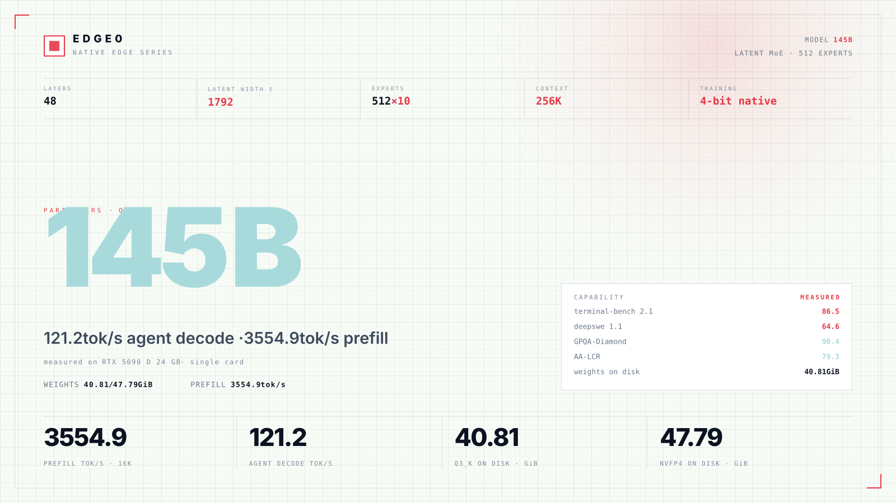
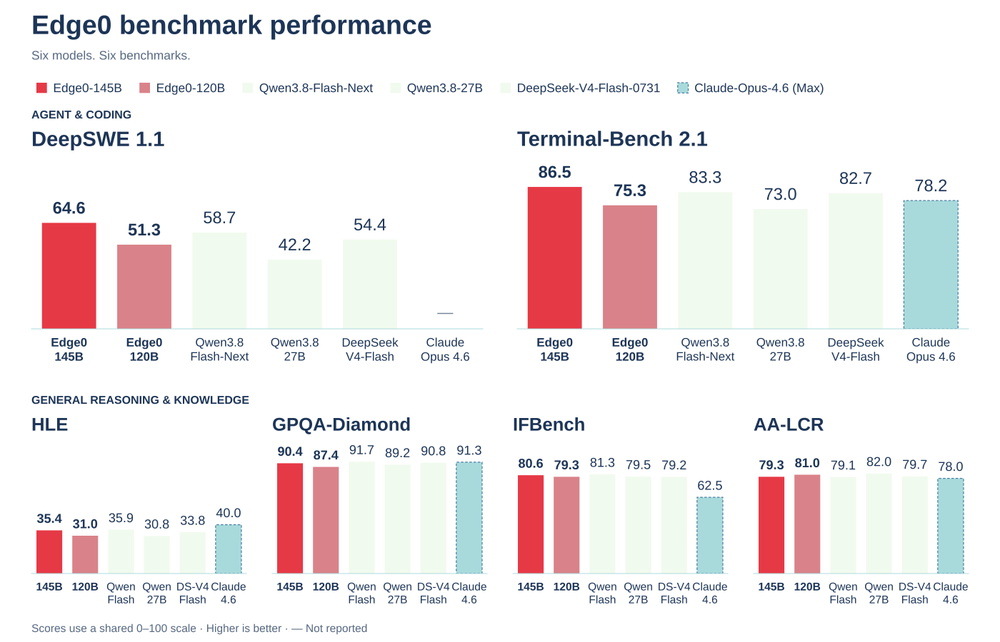
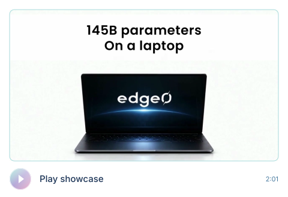

<p align="center"></p>

<h1 align="center">Edge0</h1>

<p align="center">开源流式 MoE 推理框架</p>

<br>

<p align="center">大模型，就在本机。<br>稀疏，源于设计。</p>

<br>

<p align="center">macOS · iOS · Android · Linux · Windows<br>一个程序，运行所有 Edge0 模型</p>

<p align="center"><sub>项目</sub><br>
<br>
<a href="https://arxiv.org/abs/2609.18063"></a> <a href="https://github.com/Edge0-AI/Edge0"></a> <a href="https://edge0.ai/discord"></a> <a href="LICENSE"></a> <a href="https://github.com/Edge0-AI/Edge0/releases"></a>
</p>

<p align="center"><sub>最新版本</sub><br>
<br>
<a href="https://huggingface.co/Edge0/Edge0-145B-q3k"></a> <a href="https://huggingface.co/Edge0/Edge0-145B-NVFP4"></a> <a href="https://huggingface.co/Edge0/Edge0-120B-q3k"></a> <a href="https://huggingface.co/Edge0/Edge0-120B-NVFP4"></a>
</p>

<p align="center"><sub>此前版本</sub><br>
<br>
<a href="https://huggingface.co/Edge0/Edge0-35B-A3B-preview"></a> <a href="https://huggingface.co/Edge0/Edge0-8B-A1B-preview"></a> <a href="https://www.modelscope.cn/models/Edge0/Edge0-35B-A3B-preview"></a> <a href="https://www.modelscope.cn/models/Edge0/Edge0-8B-A1B-preview"></a>
</p>

<p align="center"><a href="README.md">English</a> · 中文 · <a href="README_ja.md">日本語</a> · <a href="README_es.md">Español</a> · <a href="README_fr.md">Français</a></p>

<p align="center"><a href="#news">动态</a> · <a href="#about">关于</a> · <a href="#models">模型</a> · <a href="#quality">能力评测</a> · <a href="#benchmark">性能测试</a> · <a href="#getting-started">快速开始</a></p>

<br>

<a name="news"></a>

## 动态

<p><a href="docs/models/edge0-145b.md"></a></p>

<p><a href="edge0-infer/README.md"></a></p>

<p><a href="https://github.com/Edge0-AI/Edge0/tree/pre-edge0-infer"></a></p>

<details open>
<summary>更多动态</summary>

<p><a href="https://arxiv.org/abs/2609.18063"></a></p>

<p><a href="https://huggingface.co/Edge0/Edge0-35B-A3B-preview"></a></p>

<details>
<summary>完整发布说明</summary>

- **[2026-11-13]** 我们发布了 **`edge0-145b`** 和 **`edge0-120b`**：基于 Qwen3.8-Flash-Next 的潜空间混合专家模型，可在 Linux 或 Windows 上使用单张 NVIDIA GPU 运行。模型由 [edge0-strata](edge0-strata/EDGE0.md) 驱动，`edge0-infer serve` 和 `edge0-infer chat` 会为其启动该引擎；详见[模型页面](docs/models/edge0-145b.md)。Hugging Face 权重：[`Edge0-145B-q3k`](https://huggingface.co/Edge0/Edge0-145B-q3k) · [`Edge0-145B-NVFP4`](https://huggingface.co/Edge0/Edge0-145B-NVFP4) · [`Edge0-120B-q3k`](https://huggingface.co/Edge0/Edge0-120B-q3k) · [`Edge0-120B-NVFP4`](https://huggingface.co/Edge0/Edge0-120B-NVFP4)。
- **[2026-11-04]** 我们发布了**统一推理引擎 [`edge0-infer`](edge0-infer/README.md)**：基于 [GGML](https://github.com/ggml-org/ggml)，通过同一个引擎和原生 C++ API 在 macOS、iOS、Android 和 Windows 上运行同一模型，提供 CLI、兼容 OpenAI 的本地服务，以及桌面、Android 和 iOS 聊天应用示例。首版支持 `edge0-35b`；`edge0-8b` 将在后续版本中支持。它取代了 Python 框架和各平台独立引擎；旧代码保留在 [`pre-edge0-infer`](https://github.com/Edge0-AI/Edge0/tree/pre-edge0-infer) 标签下。
- **[2026-09-30]** 我们发布了 **iOS、macOS、Android 和 Windows 四个平台的 edge0 推理引擎**（源码位于 [`pre-edge0-infer`](https://github.com/Edge0-AI/Edge0/tree/pre-edge0-infer) 标签）。
- **[2026-09-16]** 技术报告已发布于 arXiv：[The Other Half of the Memory Wall: Serving 35B MoEs from SSD with Trained Routing Prediction](https://arxiv.org/abs/2609.18063)。
- **[2026-09-08]** 首次开源发布 **edge0**，并在 Hugging Face 和 ModelScope 同时发布两个模型档位：[`Edge0-35B-A3B-preview`](https://huggingface.co/Edge0/Edge0-35B-A3B-preview) 和 [`Edge0-8B-A1B-preview`](https://huggingface.co/Edge0/Edge0-8B-A1B-preview)。

</details>

</details>

<a name="previous-release"></a>

<details open>
<summary><h2>此前版本</h2></summary>

→ [35B / 8B 版本指南](docs/legacy-models_zh.md) — 模型下载、架构、评测、支持平台与安装说明。

</details>

<a name="about"></a>

## 关于

<p>Edge0 是一个开源流式 MoE 推理框架，用于在消费级硬件上运行大型稀疏模型。</p>

可通过命令行、本地 API 服务或 Edge0 Chat 应用使用。

最新版本让 145B 和 120B 潜空间 MoE 模型能够在单张 NVIDIA GPU 或 Apple Silicon Mac 上运行。

两款模型均采用原生 4 位训练，提供 Q3_K 和 NVFP4 格式，面向本地 agent 任务。

[`edge0-infer`](edge0-infer/README.md) 提供统一的 `serve` 和 `chat` 命令，并根据模型文件夹选择引擎。最新模型运行于 Strata 的分支 [edge0-strata](edge0-strata/EDGE0.md)；此前的 35B 版本使用[基于 GGML 的原生引擎](docs/legacy-models_zh.md#native-engine-design)。

<a name="platforms"></a>

### 支持平台

平台支持取决于模型及其引擎。

| 平台 | `edge0-145b`, `edge0-120b` (edge0-strata) | `edge0-35b`（原生引擎） |
| --- | --- | --- |
| **Linux** | NVIDIA GPU (CUDA 13) | CPU |
| **Windows** | NVIDIA GPU (CUDA 13) | CPU, Vulkan |
| **macOS** (Apple Silicon) | Metal | Metal, CPU |
| **iOS** | — | Metal |
| **Android** | — | CPU |

最新版本请参阅 [145B / 120B 安装说明](#getting-started)。[此前版本指南](docs/legacy-models_zh.md#platforms)涵盖原生后端、各平台构建和聊天示例。8B 检查点已发布，原生引擎支持仍在计划中。

<a name="models"></a>

## 模型

<p>145B / 120B 是当前的潜空间 MoE 系列，基于 Qwen3.8-Flash-Next，采用原生 4 位训练。</p>

通过 `edge0-infer serve` 和 `edge0-infer chat` 调用 edge0-strata，在配备 NVIDIA GPU 和 CUDA 13 的 Linux 或 Windows 上运行，或在 macOS 的 Apple Silicon 上用 Metal 运行。

**145B Q3_K · RTX 5090 D 24 GB：** agent 解码 121.2 tok/s · 16K 预填充 3554.9 tok/s。

| 型号 | 已发布检查点 | 推理配置 | 引擎 |
|---|---|---|---|
| [`edge0-145b`](docs/models/edge0-145b.md) | [`Edge0/Edge0-145B-q3k`](https://huggingface.co/Edge0/Edge0-145B-q3k) · [NVFP4](https://huggingface.co/Edge0/Edge0-145B-NVFP4) | Q3_K 或 NVFP4 潜空间专家（1792），48 层，512 个专家，K=10 | edge0-strata ✅（Linux 或 Windows，NVIDIA GPU；macOS Apple Silicon，Metal，Q3_K） |
| [`edge0-120b`](docs/models/edge0-145b.md) | [`Edge0/Edge0-120B-q3k`](https://huggingface.co/Edge0/Edge0-120B-q3k) · [NVFP4](https://huggingface.co/Edge0/Edge0-120B-NVFP4) | Q3_K 或 NVFP4 潜空间专家（1280），48 层，512 个专家，K=10 | edge0-strata ✅（Linux 或 Windows，NVIDIA GPU；macOS Apple Silicon，Metal，Q3_K） |

<a name="model-overview--145b-q3_k"></a>

<details open>
<summary><h3>模型概览 · 145B Q3_K</h3></summary>

Q3_K · RTX 5090 D 24 GB。预填充使用 16K token 输入。能力分数为模型层面的评测结果。

<a href="assets/edge0-release/model-overview-145B-q3k.svg"></a>

</details>

<a name="quality"></a>

## 能力评测

### 145B / 120B

六项评测，六个模型。分数越高越好。分数按模型报告，并非对 Q3_K 和 NVFP4 分别进行评测。

<a href="assets/edge0-release/quality-overview.svg"></a>

[可复制的分数及完整模型名称](docs/models/edge0-145b.md#quality)

<details>
<summary>可复制分数 · 全部六个模型</summary>

粗体表示该列最高分。

| 模型 | deepswe 1.1 | terminal-bench 2.1 | AA-LCR | IFBench | GPQA-Diamond | HLE |
| --- | ---: | ---: | ---: | ---: | ---: | ---: |
| **Edge0-145B** | **64.6** | **86.5** | 79.3 | 80.6 | 90.4 | 35.4 |
| **Edge0-120B** | 51.3 | 75.3 | 81.0 | 79.3 | 87.4 | 31.0 |
| DeepSeek-V4-Flash-0731 | 54.4 | 82.7 | 79.7 | 79.2 | 90.8 | 33.8 |
| Qwen3.8-Flash-Next | 58.7 | 83.3 | 79.1 | **81.3** | **91.7** | 35.9 |
| Qwen3.8-27B | 42.2 | 73.0 | **82.0** | 79.5 | 89.2 | 30.8 |
| Claude-Opus-4.6 (Max) | / | 78.2 | 78.0 | 62.5 | 91.3 | **40.0** |

</details>

<a name="speed"></a>

<a name="benchmark"></a>

## 性能测试

<a name="145b--120b-1"></a>

### 145B / 120B

所有吞吐量均以 tok/s 为单位。主展示数据来自 RTX 5090 D 24 GB 上的 **145B Q3_K**。

<details open>
<summary>145B 速度表 · 全部设备与格式</summary>

高亮行对应 Q3_K。点击表格可查看原尺寸图片。

<a href="assets/edge0-release/speed-145B.svg"></a>

<details>
<summary>可复制的 145B 速度数据</summary>

| 设备 | 格式 | 4K 预填充 | 16K 预填充 | 聊天解码 | Agent 解码 |
|---|---|---:|---:|---:|---:|
| RTX 5090 D 24 GB | Q3_K | 2169.9 | 3554.9 | 99.7 | **121.2** |
| RTX 5090 D 24 GB | NVFP4 | 1839.6 | 3165.7 | 79.6 | 98.3 |
| RTX 4090 24 GB | Q3_K | 2042.0 | 3179.4 | 69.9 | 91.7 |
| RTX Spark N1X 60 GiB | Q3_K | 674.0 | 770.3 | 37.7 | 36.7 |
| RTX Spark N1X 60 GiB | NVFP4 | 821.2 | 922.4 | 40.1 | 46.0 |
| Apple M2 Ultra (Metal) | Q3_K | 755.6 | 800.3 | 60.9 | 57.0 |
| 16 GiB VRAM + 20 GiB RAM | Q3_K | 249 | 335 | 36.8 | 44.9 |

</details>

</details>

<details>
<summary>145B 测量条件 · 限定预算与内存驻留</summary>

`16 GiB VRAM + 20 GiB RAM` 行仍使用同一张 RTX 5090 D 24 GB，并非另一张显卡。显存通过 `--vram-reserve-mib 8192` 限制，系统内存通过 cgroup（`MemoryMax=20G`，无 swap）限制。启用驻留后，同一张显卡上 **Q3_K**（权重 40.81 GiB）占用 23.14 GiB VRAM + 31.28 GiB RAM，**NVFP4**（47.79 GiB）占用 23.25 GiB VRAM + 38.27 GiB RAM；两处存放的专家集合互不重叠，没有重复计数。

16 GiB VRAM + 20 GiB RAM 是测试时的预算限制，不是最低系统要求。Apple M2 Ultra 行是 Metal 后端的测量结果。

</details>

<details open>
<summary>120B 速度表 · 全部设备与格式</summary>

<a href="assets/edge0-release/speed-120B.svg"></a>

<details>
<summary>可复制的 120B 速度数据</summary>

| 设备 | 格式 | 4K 预填充 | 16K 预填充 | 聊天解码 | Agent 解码 |
|---|---|---:|---:|---:|---:|
| RTX 5090 D 24 GB | Q3_K | 3236.7 | 4576.5 | 130.2 | **144.6** |
| RTX 5090 D 24 GB | NVFP4 | 2668.5 | 4357.1 | 124.9 | 135.5 |
| RTX 4090 24 GB | Q3_K | 2637.5 | 3551.1 | 95.0 | 104.9 |
| RTX Spark N1X 60 GiB | Q3_K | 987.0 | 1081.7 | 47.2 | 68.4 |
| RTX Spark N1X 60 GiB | NVFP4 | 996.4 | 1066.9 | 45.1 | 68.9 |
| Apple M2 Ultra (Metal) | Q3_K | 867.6 | 908.7 | 60.4 | 63.0 |
| 16 GiB VRAM + 20 GiB RAM | Q3_K | 430 | 778 | 62.4 | 73.3 |
| 16 GiB VRAM + 20 GiB RAM | NVFP4 | 361.1 | 619.7 | 51.3 | 59.9 |

</details>

`16 GiB VRAM + 20 GiB RAM` 行仍使用 RTX 5090 D 24 GB，通过 cgroup 将预算限制为 16 GiB 显存和 20 GiB 系统内存，并非另一张显卡。启用驻留后，同一张显卡上 **Q3_K**（权重 27.98 GiB）占用 22.93 GiB VRAM + 18.40 GiB RAM，**NVFP4**（32.96 GiB）占用 23.02 GiB VRAM + 23.40 GiB RAM；两处存放的专家集合互不重叠，没有重复计数。

</details>

<a name="in-action"></a>

<details open>
<summary><h2>实际演示</h2></summary>

<p align="center"><a href="assets/edge0-release/showcase.mp4"></a></p>

<p align="center">使用 Edge0-145B 录制 · <a href="assets/edge0-release/showcase.mp4">打开视频 ↗</a></p>

<details>
<summary>五项演示 · 章节导览</summary>

| 时间 | 演示内容 |
| --- | --- |
| 0:00 | 本地聊天与编程 |
| 0:36 | 视频制作 |
| 0:58 | 3D 曼哈顿 |
| 1:19 | 大教堂场景搭建 |
| 1:38 | PCB 设计 |

[章节标记（VTT）](assets/edge0-release/showcase-chapters.vtt)

</details>

</details>

<a name="architecture"></a>

## 架构

潜空间 MoE 压缩专家输入，同时保持注意力的完整宽度。145B 模型的潜空间宽度为 1792，120B 为 1280。两者均将每个 token 路由至 512 个专家中的 10 个，并另设一个共享专家。

<details open>
<summary>架构详情 · 示意图与配置</summary>

<a href="assets/edge0-release/arch-145B.svg"></a>

[完整配置、路由与两款模型规格](docs/models/edge0-145b.md#model-profile)。

</details>

<a name="quick-start"></a>

<a name="getting-started"></a>

## 快速开始

### 145B / 120B · edge0-strata

每个模型文件夹（Q3_K 或 NVFP4，Edge0-145B 或 Edge0-120B）均通过 `edge0-infer` 运行，可使用命令行或 Edge0 Chat 桌面应用。请保持文件夹原有结构：`edge0-infer` 根据 `model.json` 中的 `model_name` 识别模型。

145B 和 120B 使用 `serve` 或 `chat`；`run` 属于原生引擎。

<details>
<summary>平台与文档说明</summary>

构建说明涵盖 Linux 或 Windows（x64 或 ARM64）上带 CUDA 13 的 NVIDIA GPU，以及 Apple Silicon macOS 上的 Metal。

</details>

<details>
<summary>构建与命令行说明</summary>

**1. 构建。** 克隆仓库，然后构建两个部分。以下启动命令均在 `edge0-infer/` 目录下执行：

```bash
git clone https://github.com/Edge0-AI/Edge0.git edge0
```

- **edge0-strata** 引擎：参照 [edge0-strata/EDGE0.md](edge0-strata/EDGE0.md) 中的“Build (Linux, NVIDIA)”、“Build (Windows, NVIDIA)”或“Build (macOS, Apple Silicon)”。
- **edge0-infer**：参照 [edge0-infer/docs/getting-started.md](edge0-infer/docs/getting-started.md) 中的“Build”（Linux）或“Windows”。

**2. 从命令行运行。** 传入单个模型文件夹，例如 `Edge0-145B-q3k`，而非包含多个模型的上级目录。Windows 程序路径为 `build\windows\bin\edge0-infer.exe`。

```bash
build/cpu/bin/edge0-infer serve --model /path/to/Edge0-145B-q3k
```

权重加载完成后会输出 `Listening: http://127.0.0.1:8000 model=<name>`，其中 `<name>` 为 `edge0_145b`，随后提供兼容 OpenAI 和 Anthropic 的接口：

```bash
curl localhost:8000/v1/chat/completions -H 'content-type: application/json' -d '{"model":"edge0_145b","messages":[{"role":"user","content":"hi"}],"max_tokens":64}'
```

`edge0-infer chat --model /path/to/Edge0-145B-q3k` 则启动交互会话。更多选项见 [edge0-infer/docs/edge0-145b.md](edge0-infer/docs/edge0-145b.md)。

</details>

<details>
<summary>桌面应用 · Windows · macOS</summary>

⬇️ **下载：** **[GitHub Releases](https://github.com/Edge0-AI/Edge0/releases)**

在 Windows 或 macOS（Apple Silicon）上打开 **Edge0 Chat**，选择模型文件夹（如 `Edge0-145B-q3k`）即可本地运行。如需从源码构建应用，请参阅 [Edge0 Chat](edge0-infer/examples/desktop/README.md) 指南。

</details>

<a name="documentation"></a>

## 文档

**最新版本 · 145B / 120B**

- [模型、测量结果与架构](docs/models/edge0-145b.md)
- [edge0-strata · 构建与启动约定](edge0-strata/EDGE0.md)
- edge0-infer 模型指南：[145B](edge0-infer/docs/edge0-145b.md) / [120B](edge0-infer/docs/edge0-120b.md)

**框架**

- [edge0-infer](edge0-infer/README.md) · 命令行、本地服务与聊天应用
- [本地服务](edge0-infer/docs/local-server.md) / [测试](edge0-infer/docs/testing.md)
- [模型资产工具与新增模型](edge0-infer/tools/assets/README.md)

<details>
<summary>此前版本 · 模型与原生引擎文档</summary>

- [35B / 8B 版本指南](docs/legacy-models_zh.md)
- [MoE 路由与专家](docs/moe.md) / [prerouter](docs/prerouter.md)
- 模型参考：[edge0-35b](docs/models/edge0-35b.md) / [edge0-8b](docs/models/edge0-8b.md)
- [快速开始](edge0-infer/docs/getting-started.md)：各支持平台上的原生构建、模型资产、run、chat 与 serve
- [配置](edge0-infer/docs/configuration.md) / [原生 API](edge0-infer/docs/native-api.md)
- [架构](edge0-infer/docs/architecture.md) / [原生引擎设计](edge0-infer/docs/architecture.md#native-engine) / [已知限制](edge0-infer/docs/limitations.md)
- [性能测试](edge0-infer/docs/benchmarking.md)
- 技术报告：[The Other Half of the Memory Wall](https://arxiv.org/abs/2609.18063)（[PDF](paper/main.pdf)）

</details>

<a name="roadmap"></a>

## 路线图

<details>
<summary>2026 年第四季度 · 架构与推理</summary>

**模型与算法**

第四季度重点推进两条路线：将下一代架构接入框架，以及让潜空间推理真正降低延迟，而不只是减少计算量。

- **下一代架构支持（Qwen3.8-Flash 类）** — 在 edge0 上运行混合线性注意力（GDN + QSA）、门控多分支残差和 N-gram 嵌入拓扑。这些设计天然适合 SSD 流式卸载：O(1) 状态的注意力避免长思考演变为 KV-cache 容量问题，只需查表的 N-gram 表可按需流式加载。目标是在单台设备上运行，并将评测成绩与 fp16 基座的差距控制在可接受范围内。
- **潜空间思考 + 批量专家预预测** — 让潜空间推理节省的是*延迟*，而不仅是算术运算。核心工程问题是将专家路由从逐位置改为**每个块一次**，使一次预测覆盖块内所有位置和轮次，令**专家加载量与推理循环次数解耦**；同时跨块预取，在当前块的计算窗口内加载下一块的专家。进展以**相同准确率下的端到端思考阶段耗时**衡量，绝不以 tokens/s 衡量。

[此前版本里程碑与原生引擎支持计划](docs/legacy-models_zh.md#roadmap)。

</details>

<a name="contributing"></a>

## 参与贡献

<details>
<summary>开发流程与检查</summary>

欢迎各种贡献，包括 issue、PR、评测报告和模型移植。

构建和测试方法见[测试文档](edge0-infer/docs/testing.md)；以下检查无需模型资产：

```bash
cd edge0-infer
cmake --preset cpu && cmake --build --preset cpu
ctest --preset cpu -L "L0|L1"
```

修改 `edge0-infer/` 时，仍在本仓库提交 issue 和 PR；该目录在独立仓库中开发，获接受的修改由维护者先应用到该仓库，再随下一次同步进入此处。详见 [CONTRIBUTING](CONTRIBUTING.md)。

流程：fork → 功能分支 → 向 `main` 提交 PR。请确保测试通过，并为新行为添加测试。

</details>

<a name="citation"></a>

## 引用

技术报告介绍 35B 的 SSD 流式推理与经过训练的路由预测。

如果 edge0 对你有帮助，请引用我们的技术报告：

```bibtex
@article{lin2026other,
  title   = {The Other Half of the Memory Wall: Serving 35B MoEs from SSD
             with Trained Routing Prediction},
  author  = {Lin, Yu and Wang, Yiming and Cai, Runyuan and Liu, Hanze and
             Zeng, Xiaodong},
  journal = {arXiv preprint arXiv:2609.18063},
  year    = {2026},
  url     = {https://arxiv.org/abs/2609.18063}
}
```

<a name="contact-us"></a>

## 联系我们

- **Discord**：[edge0.ai/discord](https://edge0.ai/discord) — 社区交流与支持
- **邮箱**：samuel@edge0.ai

报告问题或提出功能需求，请使用 [GitHub Issues](https://github.com/Edge0-AI/Edge0/issues)。

<a name="license"></a>

<details>
<summary><h2>许可</h2></summary>

<a name="framework-code"></a>

### 框架代码

框架代码继续采用 [Apache-2.0](LICENSE)。随附组件保留各自的许可与[声明](NOTICE)，包括 Strata 的 [MIT 许可](edge0-strata/LICENSE)。

<a name="model-license"></a>

### 模型许可

Edge0 专属的模型贡献采用 [Edge0 Community Model License 1.0](licenses/edge0-model/LICENSE)，仅适用于 Edge0 拥有或获授权许可的贡献。此前有效的许可保持不变。

在遵守适用上游条款的前提下，该许可允许个人使用、研究、教育、修改、非商业分享、内部使用，以及对生成结果的商业使用。它不要求公开私有修改，也不要求在界面展示 Edge0 标识。

以下情形需另行取得 Edge0 的书面许可：

- **模型销售与付费分发**，包括许可覆盖的适配器、差量权重，以及主要价值在于模型访问的商业捆绑产品。
- **商业模型服务**，通过费用、订阅、广告或相关赞助获得收入，提供推理或微调服务。
- **独立商业编程或办公助手**，无论推理运行于服务器还是用户设备。

定义、例外与再分发要求请参阅完整许可。商业授权联系：[info@edge0.ai](mailto:info@edge0.ai)。

<a name="upstream-terms-and-scope"></a>

### 上游条款与范围

Qwen 材料继续受适用的上游许可约束。保留的 [Qwen Community License 1.0](licenses/edge0-model/third-party/Qwen-LICENSE.txt) 按原文收录；Edge0 的授权不豁免 Qwen 的署名要求或另行商业授权要求。

署名与许可范围见[模型 NOTICE](licenses/edge0-model/NOTICE)。框架及第三方代码的许可不受影响。

<details>
<summary><b>致谢 · 模型谱系与引擎来源</b></summary>

感谢 [Qwen3.8-Flash-Next](https://huggingface.co/Qwen/Qwen3.8-Flash-Next) 与 [Strata](https://github.com/Niko1221/Strata) 团队。Edge0 为 Strata 引擎增加了潜空间 MoE 支持。`edge0-strata` 是 Niko1221 与 Strata 贡献者所开发 Strata 的分支，并保留其 [MIT 许可](edge0-strata/LICENSE)。

Edge0 框架代码采用 [Apache-2.0](LICENSE)；随附第三方组件保留各自的许可（见 [NOTICE](NOTICE)）。[此前版本](docs/legacy-models_zh.md#models)保留其 Qwen3.6 与 Ling 模型谱系。

</details>

</details>
