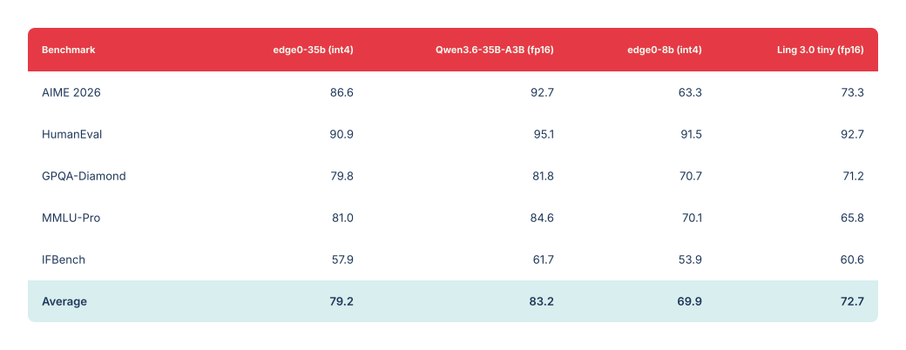
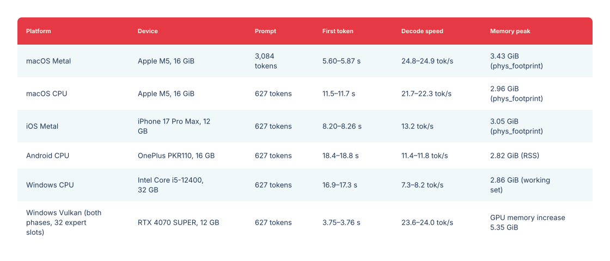

<p align="center"></p>

# Previous release · 35B / 8B

<p align="center">English · <a href="legacy-models_zh.md">中文</a> · <a href="legacy-models_ja.md">日本語</a> · <a href="legacy-models_es.md">Español</a> · <a href="legacy-models_fr.md">Français</a></p>

[← Edge0 homepage · Latest release: 145B / 120B](../README.md)

The previous Edge0 release: 35B / 8B checkpoints, streaming inference design, benchmarks and setup. The 35B tier runs on the native engine; native-engine support for the released 8B checkpoint remains planned.

[Models](#models) · [Platforms](#platforms) · [Design](#native-engine-design) · [Quality](#quality) · [Benchmark](#benchmark) · [Getting started](#getting-started) · [Citation](#citation)

## Streaming inference

**edge0** is an open-source streaming MoE inference framework. It
generalizes the production-proven recipe — **SSD expert offload +
Recover-LoRA + prerouter routing prediction** — into an extensible
framework that runs large sparse-MoE models on consumer hardware: peak
memory is bounded by the *active* expert set, not the parameter count.

### Core mechanisms

- **SSD expert offload**: expert weights are streamed from storage on
  demand; peak memory is bounded by the active set, not the parameter
  count.
- **Prerouter**: a trained head predicts expert routing one step
  ahead, so expert loads overlap the forward pass instead of stalling
  it — **up to +59%** decode throughput; the gain grows with storage
  latency, model size, and routed width *K*.
- **Recover-LoRA**: the int4 base is frozen and LoRA adapters are
  trained by distillation from the FP teacher, recovering most of the
  quantization loss at 4-bit (see [Quality](#quality)). Adapters are
  stored separately from the base and can be switched on or off.

## Models

Two model tiers, `edge0-35b` and `edge0-8b`, ship with the framework. Each tier is an end-to-end
release: the released checkpoint, the trained LoRA adapters, and the
trained prerouter heads work together as one unit.

| Tier | Released checkpoint | Inference profile | Engine |
|---|---|---|---|
| `edge0-35b` | [`Edge0/Edge0-35B-A3B-preview`](https://huggingface.co/Edge0/Edge0-35B-A3B-preview) · [ModelScope](https://www.modelscope.cn/models/Edge0/Edge0-35B-A3B-preview) | 4-bit, 40 layers, 256 experts, prerouter K=4 | Native engine ✅ |
| `edge0-8b` | [`Edge0/Edge0-8B-A1B-preview`](https://huggingface.co/Edge0/Edge0-8B-A1B-preview) · [ModelScope](https://www.modelscope.cn/models/Edge0/Edge0-8B-A1B-preview) | 4-bit, 24 layers, 128 experts, prerouter K=8 | Native engine (planned) |

The two released checkpoints are built on open sparse-MoE base models (Qwen3.6-35B-A3B
and the Ling 3.0 bailing hybrid respectively) and ship with the
LoRA and prerouter training done for this framework. edge0-infer downloads
the released checkpoint with its asset tools and converts it into the
engine's model assets (see [Getting Started](#getting-started)).

## Platforms

[`edge0-infer`](../edge0-infer/README.md) is the program you run (CLI, local OpenAI- and Anthropic-compatible server, chat apps), with shared `serve` and `chat` commands across supported models. Each model runs on the engine built for it, and edge0-infer picks the engine from the model folder; there is nothing to choose: `edge0-35b` runs on the **native engine** in `edge0-infer/` (built on GGML, with a native C++ API), and `edge0-145b` and `edge0-120b` run on **edge0-strata** in [`edge0-strata/`](../edge0-strata/EDGE0.md), a fork of Strata.

| Platform | `edge0-35b` (native engine) | `edge0-145b`, `edge0-120b` (edge0-strata) |
|---|---|---|
| **macOS** (Apple Silicon) | Metal, CPU | — |
| **iOS** | Metal | — |
| **Android** | CPU | — |
| **Linux** | CPU | NVIDIA GPU (CUDA 13) |
| **Windows** | CPU, Vulkan | NVIDIA GPU (CUDA 13) |

Measurements: [Benchmarking](../edge0-infer/docs/benchmarking.md#reference-figures) for `edge0-35b`, and the [model page](models/edge0-145b.md) for `edge0-145b` and `edge0-120b`. On the native engine, prefill and decode can run on different backends of the same device, for example Metal prefill with CPU decode. Chat app examples for desktop (macOS, Windows), Android and iOS are in [`edge0-infer/examples/`](../edge0-infer/examples/README.md#chat-applications).

## Native-engine design

- **GGML-based, the same code on every platform**: the native library
  depends only on GGML, vendored unmodified at a fixed version; the build
  downloads nothing;
- **One native API**: applications link the CMake target `edge0::edge0`
  and include the headers in `include/edge0/` to use the engine in
  process; the reference CLI and the local server use the same
  settings and defaults as the native API;
- **Experts on demand**: routed experts are read from storage on demand
  into a fixed number of expert slots per layer, so a model larger than the
  device memory budget runs without being loaded whole;
- **Two routing modes**: `predicted` (default) uses the prerouter to
  prepare the next token's experts in the background while the current
  token computes; `actual` is the model's original computation, for
  comparison;
- **Multi-turn reuse**: in a multi-turn conversation usually only each
  turn's new message is computed; earlier results are reused.

See the [edge0-infer architecture](../edge0-infer/docs/architecture.md).

## Quality

All benchmarks were run by us with [OpenCompass](https://github.com/open-compass/opencompass)
under identical settings and parameters for both the edge0 models (int4 +
trained adapters + prerouter routing) and the original fp16 base models.
The loss of the edge0 pipeline is small: **3.9 points on average for
edge0-35b, 2.8 for edge0-8b** (MMLU-Pro is even above the base). Max 100:

<a href="../assets/edge0-release/legacy-quality.svg"></a>

<details>
<summary><b>Copyable quality data</b></summary>

| Benchmark | edge0-35b (int4) | Qwen3.6-35B-A3B (fp16) | edge0-8b (int4) | Ling 3.0 tiny (fp16) |
|---|---:|---:|---:|---:|
| AIME 2026 | 86.6 | 92.7 | 63.3 | 73.3 |
| HumanEval | 90.9 | 95.1 | 91.5 | 92.7 |
| GPQA-Diamond | 79.8 | 81.8 | 70.7 | 71.2 |
| MMLU-Pro | 81.0 | 84.6 | 70.1 | 65.8 |
| IFBench | 57.9 | 61.7 | 53.9 | 60.6 |
| **Average** | **79.2** | **83.2** | **69.9** | **72.7** |

</details>

## Benchmark

`edge0-35b` with `predicted` routing, measured with edge0-infer (each range is the minimum to maximum of three processes):

<a href="../assets/edge0-release/legacy-speed.svg"></a>

<details>
<summary><b>Copyable benchmark data</b></summary>

| Platform | Device | Prompt | First token | Decode speed | Memory peak |
|---|---|---|---|---|---|
| macOS Metal | Apple M5, 16 GiB | 3,084 tokens | 5.60–5.87 s | 24.8–24.9 tok/s | 3.43 GiB (`phys_footprint`) |
| macOS CPU | Apple M5, 16 GiB | 627 tokens | 11.5–11.7 s | 21.7–22.3 tok/s | 2.96 GiB (`phys_footprint`) |
| iOS Metal | iPhone 17 Pro Max, 12 GB | 627 tokens | 8.20–8.26 s | 13.2 tok/s | 3.05 GiB (`phys_footprint`) |
| Android CPU | OnePlus PKR110, 16 GB | 627 tokens | 18.4–18.8 s | 11.4–11.8 tok/s | 2.82 GiB (RSS) |
| Windows CPU | Intel Core i5-12400, 32 GB | 627 tokens | 16.9–17.3 s | 7.3–8.2 tok/s | 2.86 GiB (working set) |
| Windows Vulkan (both phases, 32 expert slots) | RTX 4070 SUPER, 12 GB | 627 tokens | 3.75–3.76 s | 23.6–24.0 tok/s | GPU memory increase 5.35 GiB |

</details>

Memory metrics differ by platform and cannot be compared directly. The measurement method, the `actual` routing figures and the commands to reproduce them are in [Benchmarking](../edge0-infer/docs/benchmarking.md#reference-figures).

## Getting Started

Run the following commands in `edge0-infer/`. You need CMake 3.21+,
Ninja, a C++17/C11 compiler, uv and Git; the 35B needs about 18 GB for the
original weights and about 20 GB for the converted assets, plus as much free
space again while converting.

### 1) Build

```bash
cd edge0-infer
cmake --preset mac-metal && cmake --build --preset mac-metal
build/mac-metal/bin/edge0-infer info        # expect a line: model.0: edge0_35b
```

On machines without Metal use `--preset cpu`, `build/cpu/bin/edge0-infer`,
and `--device cpu` in the commands below.

### 2) Get a model

**edge0-35b (native engine).** Download and convert the model assets:

```bash
export MOE_SOURCE_35B=<directory for the original weights>
export MOE_ASSETS_35B=<directory for the converted assets>

uv sync --project tools/assets
assets_py() { uv run --project tools/assets --offline --no-sync python -I "$@"; }

assets_py tools/assets/edge0_35b/fetch_source.py download --out "$MOE_SOURCE_35B"
assets_py tools/assets/edge0_35b/make_assets.py --source "$MOE_SOURCE_35B" --out "$MOE_ASSETS_35B"
assets_py tools/assets/check_assets.py check "$MOE_ASSETS_35B"
```

This downloads `Edge0/Edge0-35B-A3B-preview` from Hugging Face and checks
it against the locked revision and digests.

### 3) Run

```bash
# one prompt
build/mac-metal/bin/edge0-infer run   --model "$MOE_ASSETS_35B" --device metal --user "Introduce yourself in one sentence."
# multi-turn chat
build/mac-metal/bin/edge0-infer chat  --model "$MOE_ASSETS_35B" --device metal
# serve (OpenAI- and Anthropic-compatible, default http://127.0.0.1:8000)
build/mac-metal/bin/edge0-infer serve --model "$MOE_ASSETS_35B" --device metal
```

For edge0-145b and edge0-120b, `chat` and `serve` take the model folder the same way (`--model <model folder>`); `run` is for the native engine.

For the Android, Windows and iOS builds, and for using the engine from
your own CMake project, see [Getting started](../edge0-infer/docs/getting-started.md).

## Documentation

- [35B model](models/edge0-35b.md) · [8B model](models/edge0-8b.md)
- [MoE routing and experts](moe.md) · [Prerouter](prerouter.md)
- [Technical report](https://arxiv.org/abs/2609.18063) · [PDF](../paper/main.pdf)
- [Native engine setup](../edge0-infer/docs/getting-started.md) · [Benchmark reproduction](../edge0-infer/docs/benchmarking.md)
- [Configuration](../edge0-infer/docs/configuration.md) · [Native API](../edge0-infer/docs/native-api.md) · [Local server](../edge0-infer/docs/local-server.md)
- [Architecture](../edge0-infer/docs/architecture.md) · [Known limitations](../edge0-infer/docs/limitations.md) · [Testing](../edge0-infer/docs/testing.md)
- [Model asset tools and adding a model](../edge0-infer/tools/assets/README.md)
- Project homepages by language: [中文](../README_zh.md) · [日本語](../README_ja.md) · [Español](../README_es.md) · [Français](../README_fr.md)

## Roadmap

### Q4 2026 · native engine and streaming pipeline

- ✅ **edge0 unified inference engine open-sourced** (2026-11-04) —
  [`edge0-infer`](../edge0-infer/README.md): one engine and one native API
  across macOS, iOS, Android and Windows.
- **`edge0-8b` support in edge0-infer**.
- More model tiers and adapter releases on the existing pipeline.

See the [framework roadmap](roadmap.md) for next-generation architecture support and latent thinking with batched expert pre-prediction.

## Citation

The technical report covers 35B SSD streaming and trained routing prediction.

If you find edge0 useful, please cite our technical report:

```bibtex
@article{lin2026other,
  title   = {The Other Half of the Memory Wall: Serving 35B MoEs from SSD
             with Trained Routing Prediction},
  author  = {Lin, Yu and Wang, Yiming and Cai, Runyuan and Liu, Hanze and
             Zeng, Xiaodong},
  journal = {arXiv preprint arXiv:2609.18063},
  year    = {2026},
  url     = {https://arxiv.org/abs/2609.18063}
}
```

## Release history

- **[2026-11-04]** We released the **unified inference engine [`edge0-infer`](../edge0-infer/README.md)**: built on [GGML](https://github.com/ggml-org/ggml), one engine and one native C++ API run the same model on macOS, iOS, Android and Windows, with a CLI, an OpenAI-compatible local server, and chat app examples for desktop, Android and iOS. The first release supports `edge0-35b`; `edge0-8b` follows in a later release. It replaces the Python framework and the per-platform engines; the previous code is kept at tag [`pre-edge0-infer`](https://github.com/Edge0-AI/Edge0/tree/pre-edge0-infer).
- **[2026-09-30]** We released the **edge0 inference engines for four platforms — iOS, macOS, Android and Windows** (source at tag [`pre-edge0-infer`](https://github.com/Edge0-AI/Edge0/tree/pre-edge0-infer)).
- **[2026-09-16]** Our technical report is on arXiv: [The Other Half of the Memory Wall: Serving 35B MoEs from SSD with Trained Routing Prediction](https://arxiv.org/abs/2609.18063).
- **[2026-09-08]** Initial open-source release of **edge0**, together with both model tiers — [`Edge0-35B-A3B-preview`](https://huggingface.co/Edge0/Edge0-35B-A3B-preview) and [`Edge0-8B-A1B-preview`](https://huggingface.co/Edge0/Edge0-8B-A1B-preview) — on Hugging Face and ModelScope.

[← Edge0 homepage](../README.md)
