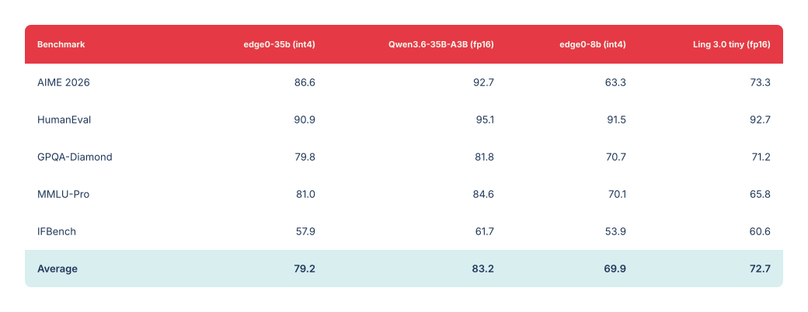
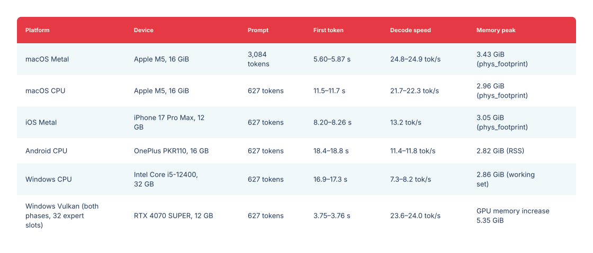

<p align="center"></p>

<a name="previous-release--35b--8b"></a>

# Versión anterior · 35B / 8B

<p align="center"><a href="legacy-models.md">English</a> · <a href="legacy-models_zh.md">中文</a> · <a href="legacy-models_ja.md">日本語</a> · Español · <a href="legacy-models_fr.md">Français</a></p>

[← Inicio de Edge0 · Última versión: 145B / 120B](../README_es.md)

La versión anterior de Edge0: checkpoints de 35B / 8B, diseño de inferencia en streaming, evaluaciones e instalación. El modelo de 35B utiliza el motor nativo; la compatibilidad del checkpoint publicado de 8B con el motor nativo sigue prevista.

[Modelos](#models) · [Plataformas](#platforms) · [Diseño](#native-engine-design) · [Calidad](#quality) · [Rendimiento](#benchmark) · [Primeros pasos](#getting-started) · [Cita](#citation)

<a name="streaming-inference"></a>

## Inferencia en streaming

**edge0** es un framework de inferencia MoE en streaming de código abierto. Generaliza una receta validada en producción —**descarga de expertos a SSD + Recover-LoRA + predicción de enrutamiento con prerouter**— en un framework extensible que ejecuta grandes modelos MoE dispersos en hardware de consumo: el pico de memoria está limitado por el conjunto de expertos *activos*, no por el número de parámetros.

<a name="core-mechanisms"></a>

### Mecanismos principales

- **Descarga de expertos a SSD**: los pesos de los expertos se leen del almacenamiento bajo demanda; el pico de memoria depende del conjunto activo, no del número de parámetros.
- **Prerouter**: una cabeza entrenada predice el enrutamiento de expertos con un paso de antelación, solapando la carga con la pasada hacia delante en lugar de bloquearla; **hasta +59%** de rendimiento de decodificación. La mejora crece con la latencia del almacenamiento, el tamaño del modelo y la anchura de enrutamiento *K*.
- **Recover-LoRA**: se congela la base int4 y se entrenan adaptadores LoRA mediante destilación de un modelo profesor FP, recuperando la mayor parte de la pérdida por cuantización a 4 bits (véase [Calidad](#quality)). Los adaptadores se almacenan por separado y pueden activarse o desactivarse.

<a name="models"></a>

## Modelos

El framework incluye dos tamaños de modelo, `edge0-35b` y `edge0-8b`. Cada uno constituye una publicación integral: el checkpoint publicado, los adaptadores LoRA entrenados y las cabezas prerouter entrenadas trabajan como una unidad.

| Tamaño | Checkpoint publicado | Perfil de inferencia | Motor |
|---|---|---|---|
| `edge0-35b` | [`Edge0/Edge0-35B-A3B-preview`](https://huggingface.co/Edge0/Edge0-35B-A3B-preview) · [ModelScope](https://www.modelscope.cn/models/Edge0/Edge0-35B-A3B-preview) | 4 bits, 40 capas, 256 expertos, prerouter K=4 | Motor nativo ✅ |
| `edge0-8b` | [`Edge0/Edge0-8B-A1B-preview`](https://huggingface.co/Edge0/Edge0-8B-A1B-preview) · [ModelScope](https://www.modelscope.cn/models/Edge0/Edge0-8B-A1B-preview) | 4 bits, 24 capas, 128 expertos, prerouter K=8 | Motor nativo (previsto) |

Los dos checkpoints publicados se basan en modelos MoE dispersos abiertos —Qwen3.6-35B-A3B y Ling 3.0 bailing hybrid, respectivamente— e incluyen el entrenamiento de LoRA y prerouter realizado para este framework. edge0-infer descarga el checkpoint con sus herramientas de recursos y lo convierte en recursos de modelo para el motor (véase [Primeros pasos](#getting-started)).

<a name="platforms"></a>

## Plataformas

[`edge0-infer`](../edge0-infer/README.md) es el programa que se ejecuta: CLI, servidor local compatible con OpenAI y Anthropic, y aplicaciones de chat. Comparte los comandos `serve` y `chat` entre los modelos compatibles. Cada modelo utiliza su motor correspondiente, seleccionado automáticamente a partir de la carpeta del modelo. `edge0-35b` usa el **motor nativo** de `edge0-infer/` (basado en GGML, con API nativa de C++), mientras que `edge0-145b` y `edge0-120b` usan **edge0-strata** en [`edge0-strata/`](../edge0-strata/EDGE0.md), un fork de Strata.

| Plataforma | `edge0-35b` (motor nativo) | `edge0-145b`, `edge0-120b` (edge0-strata) |
|---|---|---|
| **macOS** (Apple Silicon) | Metal, CPU | — |
| **iOS** | Metal | — |
| **Android** | CPU | — |
| **Linux** | CPU | NVIDIA GPU (CUDA 13) |
| **Windows** | CPU, Vulkan | NVIDIA GPU (CUDA 13) |

Mediciones: [Rendimiento](../edge0-infer/docs/benchmarking.md#reference-figures) para `edge0-35b` y la [página de modelos](models/edge0-145b.md) para `edge0-145b` y `edge0-120b`. En el motor nativo, el prefill y la decodificación pueden usar distintos backends del mismo dispositivo; por ejemplo, prefill en Metal y decodificación en CPU. Los ejemplos de chat para escritorio (macOS, Windows), Android e iOS están en [`edge0-infer/examples/`](../edge0-infer/examples/README.md#chat-applications).

<a name="native-engine-design"></a>

## Diseño del motor nativo

- **Basado en GGML, el mismo código en todas las plataformas**: la biblioteca nativa solo depende de GGML, incluido sin modificaciones y con una versión fija; la compilación no descarga nada.
- **Una API nativa**: las aplicaciones enlazan el destino CMake `edge0::edge0` e incluyen las cabeceras de `include/edge0/` para usar el motor dentro del proceso. La CLI de referencia y el servidor local usan los mismos ajustes y valores predeterminados que la API nativa.
- **Expertos bajo demanda**: los expertos seleccionados se leen del almacenamiento a un número fijo de espacios por capa, permitiendo ejecutar un modelo mayor que el presupuesto de memoria sin cargarlo entero.
- **Dos modos de enrutamiento**: `predicted` (predeterminado) usa el prerouter para preparar en segundo plano los expertos del siguiente token mientras se calcula el actual; `actual` realiza el cálculo original del modelo, para comparar.
- **Reutilización entre turnos**: en una conversación de varios turnos, normalmente solo se calcula el nuevo mensaje de cada turno; se reutilizan los resultados anteriores.

Consulta la [arquitectura de edge0-infer](../edge0-infer/docs/architecture.md).

<a name="quality"></a>

## Calidad

Realizamos todas las evaluaciones con [OpenCompass](https://github.com/open-compass/opencompass), usando los mismos ajustes y parámetros para los modelos edge0 (int4 + adaptadores entrenados + enrutamiento prerouter) y sus bases fp16 originales. La pérdida de la canalización edge0 es pequeña: **3.9 puntos de media para edge0-35b y 2.8 para edge0-8b** (MMLU-Pro incluso supera a la base). Máximo: 100.

<a href="../assets/edge0-release/legacy-quality.svg"></a>

<details>
<summary><b>Datos copiables de calidad</b></summary>

| Evaluación | edge0-35b (int4) | Qwen3.6-35B-A3B (fp16) | edge0-8b (int4) | Ling 3.0 tiny (fp16) |
|---|---:|---:|---:|---:|
| AIME 2026 | 86.6 | 92.7 | 63.3 | 73.3 |
| HumanEval | 90.9 | 95.1 | 91.5 | 92.7 |
| GPQA-Diamond | 79.8 | 81.8 | 70.7 | 71.2 |
| MMLU-Pro | 81.0 | 84.6 | 70.1 | 65.8 |
| IFBench | 57.9 | 61.7 | 53.9 | 60.6 |
| **Media** | **79.2** | **83.2** | **69.9** | **72.7** |

</details>

<a name="benchmark"></a>

## Rendimiento

`edge0-35b` con enrutamiento `predicted`, medido con edge0-infer (cada intervalo abarca del mínimo al máximo de tres procesos):

<a href="../assets/edge0-release/legacy-speed.svg"></a>

<details>
<summary><b>Datos copiables de rendimiento</b></summary>

| Plataforma | Dispositivo | Longitud del prompt | Primer token | Velocidad de decodificación | Pico de memoria |
|---|---|---|---|---|---|
| macOS Metal | Apple M5, 16 GiB | 3,084 tokens | 5.60–5.87 s | 24.8–24.9 tok/s | 3.43 GiB (`phys_footprint`) |
| macOS CPU | Apple M5, 16 GiB | 627 tokens | 11.5–11.7 s | 21.7–22.3 tok/s | 2.96 GiB (`phys_footprint`) |
| iOS Metal | iPhone 17 Pro Max, 12 GB | 627 tokens | 8.20–8.26 s | 13.2 tok/s | 3.05 GiB (`phys_footprint`) |
| Android CPU | OnePlus PKR110, 16 GB | 627 tokens | 18.4–18.8 s | 11.4–11.8 tok/s | 2.82 GiB (RSS) |
| Windows CPU | Intel Core i5-12400, 32 GB | 627 tokens | 16.9–17.3 s | 7.3–8.2 tok/s | 2.86 GiB (conjunto de trabajo) |
| Windows Vulkan (ambas fases, 32 espacios para expertos) | RTX 4070 SUPER, 12 GB | 627 tokens | 3.75–3.76 s | 23.6–24.0 tok/s | Incremento de memoria GPU de 5.35 GiB |

</details>

Las métricas de memoria varían según la plataforma y no se pueden comparar directamente. El método de medición, las cifras de enrutamiento `actual` y los comandos para reproducirlas están en [Rendimiento](../edge0-infer/docs/benchmarking.md#reference-figures).

<a name="getting-started"></a>

## Primeros pasos

Ejecuta los siguientes comandos en `edge0-infer/`. Necesitas CMake 3.21+, Ninja, un compilador C++17/C11, uv y Git. El modelo de 35B requiere unos 18 GB para los pesos originales y unos 20 GB para los recursos convertidos, más otro tanto de espacio libre durante la conversión.

<a name="1-build"></a>

### 1) Compilar

```bash
cd edge0-infer
cmake --preset mac-metal && cmake --build --preset mac-metal
build/mac-metal/bin/edge0-infer info        # expect a line: model.0: edge0_35b
```

En equipos sin Metal, usa `--preset cpu`, `build/cpu/bin/edge0-infer` y `--device cpu` en los comandos siguientes.

<a name="2-get-a-model"></a>

### 2) Obtener un modelo

**edge0-35b (motor nativo).** Descarga y convierte los recursos del modelo:

```bash
export MOE_SOURCE_35B=<directory for the original weights>
export MOE_ASSETS_35B=<directory for the converted assets>

uv sync --project tools/assets
assets_py() { uv run --project tools/assets --offline --no-sync python -I "$@"; }

assets_py tools/assets/edge0_35b/fetch_source.py download --out "$MOE_SOURCE_35B"
assets_py tools/assets/edge0_35b/make_assets.py --source "$MOE_SOURCE_35B" --out "$MOE_ASSETS_35B"
assets_py tools/assets/check_assets.py check "$MOE_ASSETS_35B"
```

Esto descarga `Edge0/Edge0-35B-A3B-preview` desde Hugging Face y lo verifica frente a la revisión y los resúmenes criptográficos fijados.

<a name="3-run"></a>

### 3) Ejecutar

```bash
# one prompt
build/mac-metal/bin/edge0-infer run   --model "$MOE_ASSETS_35B" --device metal --user "Introduce yourself in one sentence."
# multi-turn chat
build/mac-metal/bin/edge0-infer chat  --model "$MOE_ASSETS_35B" --device metal
# serve (OpenAI- and Anthropic-compatible, default http://127.0.0.1:8000)
build/mac-metal/bin/edge0-infer serve --model "$MOE_ASSETS_35B" --device metal
```

Para edge0-145b y edge0-120b, `chat` y `serve` reciben de la misma forma la carpeta del modelo (`--model <model folder>`); `run` corresponde al motor nativo.

Para compilar en Android, Windows e iOS, o usar el motor desde tu propio proyecto CMake, consulta [Primeros pasos](../edge0-infer/docs/getting-started.md).

<a name="documentation"></a>

## Documentación

- [Modelo de 35B](models/edge0-35b.md) · [Modelo de 8B](models/edge0-8b.md)
- [Enrutamiento MoE y expertos](moe.md) · [Prerouter](prerouter.md)
- [Informe técnico](https://arxiv.org/abs/2609.18063) · [PDF](../paper/main.pdf)
- [Instalación del motor nativo](../edge0-infer/docs/getting-started.md) · [Reproducción de las mediciones](../edge0-infer/docs/benchmarking.md)
- [Configuración](../edge0-infer/docs/configuration.md) · [API nativa](../edge0-infer/docs/native-api.md) · [Servidor local](../edge0-infer/docs/local-server.md)
- [Arquitectura](../edge0-infer/docs/architecture.md) · [Limitaciones conocidas](../edge0-infer/docs/limitations.md) · [Pruebas](../edge0-infer/docs/testing.md)
- [Herramientas de recursos de modelos y cómo añadir un modelo](../edge0-infer/tools/assets/README.md)
- Páginas del proyecto por idioma: [中文](../README_zh.md) · [日本語](../README_ja.md) · [Español](../README_es.md) · [Français](../README_fr.md)

<a name="roadmap"></a>

## Hoja de ruta

<a name="q4-2026--native-engine-and-streaming-pipeline"></a>

### Cuarto trimestre de 2026 · motor nativo y canalización en streaming

- ✅ **Motor unificado de inferencia edge0 publicado como código abierto** (2026-11-04) — [`edge0-infer`](../edge0-infer/README.md): un motor y una API nativa para macOS, iOS, Android y Windows.
- **Compatibilidad de `edge0-8b` con edge0-infer**.
- Más tamaños de modelo y versiones de adaptadores sobre la canalización existente.

Consulta la [hoja de ruta del framework](roadmap.md) para la compatibilidad con arquitecturas de nueva generación y el razonamiento latente con predicción anticipada de expertos por lotes.

<a name="citation"></a>

## Cita

El informe técnico trata la inferencia de 35B en streaming desde SSD y la predicción de enrutamiento entrenada.

Si edge0 te resulta útil, cita nuestro informe técnico:

```bibtex
@article{lin2026other,
  title   = {The Other Half of the Memory Wall: Serving 35B MoEs from SSD
             with Trained Routing Prediction},
  author  = {Lin, Yu and Wang, Yiming and Cai, Runyuan and Liu, Hanze and
             Zeng, Xiaodong},
  journal = {arXiv preprint arXiv:2609.18063},
  year    = {2026},
  url     = {https://arxiv.org/abs/2609.18063}
}
```

<a name="release-history"></a>

## Historial de versiones

- **[2026-11-04]** Publicamos el **motor de inferencia unificado [`edge0-infer`](../edge0-infer/README.md)**: basado en [GGML](https://github.com/ggml-org/ggml), un motor y una API nativa de C++ ejecutan el mismo modelo en macOS, iOS, Android y Windows, con CLI, servidor local compatible con OpenAI y ejemplos de aplicaciones de chat para escritorio, Android e iOS. La primera versión admite `edge0-35b`; `edge0-8b` llegará en una versión posterior. Sustituye al framework de Python y a los motores específicos de cada plataforma; el código anterior se conserva en la etiqueta [`pre-edge0-infer`](https://github.com/Edge0-AI/Edge0/tree/pre-edge0-infer).
- **[2026-09-30]** Publicamos los **motores de inferencia edge0 para cuatro plataformas: iOS, macOS, Android y Windows** (código en la etiqueta [`pre-edge0-infer`](https://github.com/Edge0-AI/Edge0/tree/pre-edge0-infer)).
- **[2026-09-16]** Nuestro informe técnico está disponible en arXiv: [The Other Half of the Memory Wall: Serving 35B MoEs from SSD with Trained Routing Prediction](https://arxiv.org/abs/2609.18063).
- **[2026-09-08]** Primera publicación de **edge0** como código abierto, junto con los dos tamaños de modelo —[`Edge0-35B-A3B-preview`](https://huggingface.co/Edge0/Edge0-35B-A3B-preview) y [`Edge0-8B-A1B-preview`](https://huggingface.co/Edge0/Edge0-8B-A1B-preview)— en Hugging Face y ModelScope.

[← Inicio de Edge0](../README_es.md)
