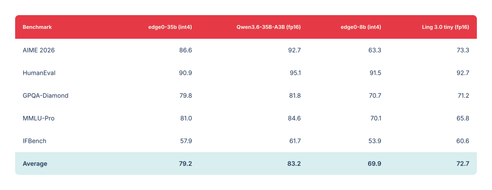
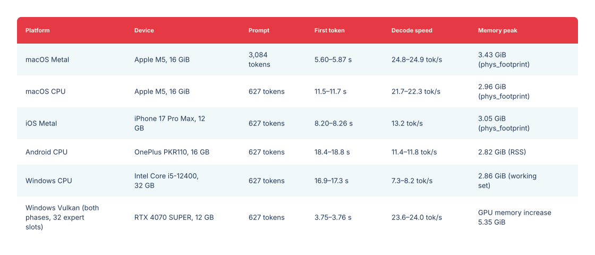

<p align="center"></p>

<a name="previous-release--35b--8b"></a>

# Version précédente · 35B / 8B

<p align="center"><a href="legacy-models.md">English</a> · <a href="legacy-models_zh.md">中文</a> · <a href="legacy-models_ja.md">日本語</a> · <a href="legacy-models_es.md">Español</a> · Français</p>

[← Accueil Edge0 · Dernière version : 145B / 120B](../README_fr.md)

La version précédente d’Edge0 : checkpoints 35B / 8B, conception de l’inférence en streaming, évaluations et installation. Le modèle 35B utilise le moteur natif ; la prise en charge du checkpoint 8B publié par ce moteur reste prévue.

[Modèles](#models) · [Plateformes](#platforms) · [Conception](#native-engine-design) · [Qualité](#quality) · [Performances](#benchmark) · [Premiers pas](#getting-started) · [Citation](#citation)

<a name="streaming-inference"></a>

## Inférence en streaming

**edge0** est un framework d’inférence MoE en streaming, open source. Il généralise une méthode éprouvée en production — **décharge des experts vers un SSD + Recover-LoRA + prédiction de routage par prerouter** — en un framework extensible pour exécuter de grands modèles MoE parcimonieux sur du matériel grand public. Le pic de mémoire dépend de l’ensemble d’experts *actifs*, et non du nombre de paramètres.

<a name="core-mechanisms"></a>

### Mécanismes essentiels

- **Décharge des experts vers un SSD** : les poids des experts sont lus à la demande depuis le stockage ; le pic de mémoire dépend de l’ensemble actif, pas du nombre de paramètres.
- **Prerouter** : une tête entraînée prédit le routage des experts avec une étape d’avance, ce qui fait chevaucher leur chargement et la passe avant au lieu de la bloquer. Le débit de décodage augmente de **jusqu’à +59%** ; le gain croît avec la latence du stockage, la taille du modèle et la largeur de routage *K*.
- **Recover-LoRA** : la base int4 est figée et les adaptateurs LoRA sont entraînés par distillation depuis le modèle enseignant FP, récupérant l’essentiel de la perte de quantification à 4 bits (voir [Qualité](#quality)). Les adaptateurs sont stockés séparément de la base et peuvent être activés ou désactivés.

<a name="models"></a>

## Modèles

Le framework est fourni avec deux tailles de modèle, `edge0-35b` et `edge0-8b`. Chaque version forme un ensemble complet : le checkpoint publié, les adaptateurs LoRA entraînés et les têtes prerouter entraînées fonctionnent de concert.

| Taille | Checkpoint publié | Profil d’inférence | Moteur |
|---|---|---|---|
| `edge0-35b` | [`Edge0/Edge0-35B-A3B-preview`](https://huggingface.co/Edge0/Edge0-35B-A3B-preview) · [ModelScope](https://www.modelscope.cn/models/Edge0/Edge0-35B-A3B-preview) | 4 bits, 40 couches, 256 experts, prerouter K=4 | Moteur natif ✅ |
| `edge0-8b` | [`Edge0/Edge0-8B-A1B-preview`](https://huggingface.co/Edge0/Edge0-8B-A1B-preview) · [ModelScope](https://www.modelscope.cn/models/Edge0/Edge0-8B-A1B-preview) | 4 bits, 24 couches, 128 experts, prerouter K=8 | Moteur natif (prévu) |

Les deux checkpoints publiés reposent sur des modèles de base MoE parcimonieux ouverts — respectivement Qwen3.6-35B-A3B et Ling 3.0 bailing hybrid — et intègrent l’entraînement LoRA et prerouter réalisé pour ce framework. edge0-infer télécharge le checkpoint avec ses outils de ressources, puis le convertit en fichiers de modèle destinés au moteur (voir [Premiers pas](#getting-started)).

<a name="platforms"></a>

## Plateformes

[`edge0-infer`](../edge0-infer/README.md) est le programme à exécuter : CLI, serveur local compatible OpenAI et Anthropic, applications de chat. Les commandes `serve` et `chat` sont communes aux modèles pris en charge. Chaque modèle utilise son moteur, sélectionné automatiquement à partir du dossier du modèle. `edge0-35b` emploie le **moteur natif** de `edge0-infer/` (fondé sur GGML, avec une API native C++), tandis que `edge0-145b` et `edge0-120b` utilisent **edge0-strata** dans [`edge0-strata/`](../edge0-strata/EDGE0.md), un fork de Strata.

| Plateforme | `edge0-35b` (moteur natif) | `edge0-145b`, `edge0-120b` (edge0-strata) |
|---|---|---|
| **macOS** (Apple Silicon) | Metal, CPU | — |
| **iOS** | Metal | — |
| **Android** | CPU | — |
| **Linux** | CPU | NVIDIA GPU (CUDA 13) |
| **Windows** | CPU, Vulkan | NVIDIA GPU (CUDA 13) |

Mesures : [Performances](../edge0-infer/docs/benchmarking.md#reference-figures) pour `edge0-35b`, et [page des modèles](models/edge0-145b.md) pour `edge0-145b` et `edge0-120b`. Sur le moteur natif, le préremplissage et le décodage peuvent utiliser des backends différents d’un même appareil, par exemple Metal pour le préremplissage et le CPU pour le décodage. Les exemples d’applications de chat pour ordinateur (macOS, Windows), Android et iOS se trouvent dans [`edge0-infer/examples/`](../edge0-infer/examples/README.md#chat-applications).

<a name="native-engine-design"></a>

## Conception du moteur natif

- **Fondé sur GGML, avec le même code sur chaque plateforme** : la bibliothèque native ne dépend que de GGML, intégré sans modification à une version fixe ; la compilation ne télécharge rien.
- **Une API native** : les applications se lient à la cible CMake `edge0::edge0` et incluent les en-têtes de `include/edge0/` pour utiliser le moteur dans leur processus. La CLI de référence et le serveur local partagent les réglages et valeurs par défaut de l’API native.
- **Experts à la demande** : les experts sélectionnés sont lus depuis le stockage dans un nombre fixe d’emplacements par couche. Un modèle plus grand que le budget mémoire peut ainsi fonctionner sans être chargé entièrement.
- **Deux modes de routage** : `predicted` (par défaut) utilise le prerouter pour préparer en arrière-plan les experts du prochain token pendant le calcul du token actuel ; `actual` exécute le calcul original du modèle, à titre de comparaison.
- **Réutilisation entre les tours** : dans une conversation à plusieurs tours, seul le nouveau message de chaque tour est généralement calculé ; les résultats précédents sont réutilisés.

Voir l’[architecture d’edge0-infer](../edge0-infer/docs/architecture.md).

<a name="quality"></a>

## Qualité

Nous avons réalisé toutes les évaluations avec [OpenCompass](https://github.com/open-compass/opencompass), en utilisant les mêmes réglages et paramètres pour les modèles edge0 (int4 + adaptateurs entraînés + routage prerouter) et les modèles de base fp16 d’origine. La perte du pipeline edge0 est faible : **3.9 points en moyenne pour edge0-35b, 2.8 pour edge0-8b** (MMLU-Pro dépasse même la base). Maximum : 100.

<a href="../assets/edge0-release/legacy-quality.svg"></a>

<details>
<summary><b>Données de qualité copiables</b></summary>

| Évaluation | edge0-35b (int4) | Qwen3.6-35B-A3B (fp16) | edge0-8b (int4) | Ling 3.0 tiny (fp16) |
|---|---:|---:|---:|---:|
| AIME 2026 | 86.6 | 92.7 | 63.3 | 73.3 |
| HumanEval | 90.9 | 95.1 | 91.5 | 92.7 |
| GPQA-Diamond | 79.8 | 81.8 | 70.7 | 71.2 |
| MMLU-Pro | 81.0 | 84.6 | 70.1 | 65.8 |
| IFBench | 57.9 | 61.7 | 53.9 | 60.6 |
| **Moyenne** | **79.2** | **83.2** | **69.9** | **72.7** |

</details>

<a name="benchmark"></a>

## Performances

`edge0-35b` avec le routage `predicted`, mesuré par edge0-infer (chaque intervalle va du minimum au maximum de trois processus) :

<a href="../assets/edge0-release/legacy-speed.svg"></a>

<details>
<summary><b>Données de performances copiables</b></summary>

| Plateforme | Appareil | Longueur du prompt | Premier token | Vitesse de décodage | Pic de mémoire |
|---|---|---|---|---|---|
| macOS Metal | Apple M5, 16 GiB | 3,084 tokens | 5.60–5.87 s | 24.8–24.9 tok/s | 3.43 GiB (`phys_footprint`) |
| macOS CPU | Apple M5, 16 GiB | 627 tokens | 11.5–11.7 s | 21.7–22.3 tok/s | 2.96 GiB (`phys_footprint`) |
| iOS Metal | iPhone 17 Pro Max, 12 GB | 627 tokens | 8.20–8.26 s | 13.2 tok/s | 3.05 GiB (`phys_footprint`) |
| Android CPU | OnePlus PKR110, 16 GB | 627 tokens | 18.4–18.8 s | 11.4–11.8 tok/s | 2.82 GiB (RSS) |
| Windows CPU | Intel Core i5-12400, 32 GB | 627 tokens | 16.9–17.3 s | 7.3–8.2 tok/s | 2.86 GiB (ensemble de travail) |
| Windows Vulkan (les deux phases, 32 emplacements d’experts) | RTX 4070 SUPER, 12 GB | 627 tokens | 3.75–3.76 s | 23.6–24.0 tok/s | Augmentation de mémoire GPU de 5.35 GiB |

</details>

Les métriques mémoire diffèrent selon la plateforme et ne sont pas directement comparables. La méthode de mesure, les résultats du routage `actual` et les commandes de reproduction figurent dans [Performances](../edge0-infer/docs/benchmarking.md#reference-figures).

<a name="getting-started"></a>

## Premiers pas

Exécutez les commandes suivantes dans `edge0-infer/`. Il vous faut CMake 3.21+, Ninja, un compilateur C++17/C11, uv et Git. Le modèle 35B nécessite environ 18 GB pour les poids d’origine et 20 GB pour les fichiers convertis, plus autant d’espace libre supplémentaire pendant la conversion.

<a name="1-build"></a>

### 1) Compiler

```bash
cd edge0-infer
cmake --preset mac-metal && cmake --build --preset mac-metal
build/mac-metal/bin/edge0-infer info        # expect a line: model.0: edge0_35b
```

Sur les machines sans Metal, utilisez `--preset cpu`, `build/cpu/bin/edge0-infer` et `--device cpu` dans les commandes ci-dessous.

<a name="2-get-a-model"></a>

### 2) Obtenir un modèle

**edge0-35b (moteur natif).** Téléchargez et convertissez les fichiers du modèle :

```bash
export MOE_SOURCE_35B=<directory for the original weights>
export MOE_ASSETS_35B=<directory for the converted assets>

uv sync --project tools/assets
assets_py() { uv run --project tools/assets --offline --no-sync python -I "$@"; }

assets_py tools/assets/edge0_35b/fetch_source.py download --out "$MOE_SOURCE_35B"
assets_py tools/assets/edge0_35b/make_assets.py --source "$MOE_SOURCE_35B" --out "$MOE_ASSETS_35B"
assets_py tools/assets/check_assets.py check "$MOE_ASSETS_35B"
```

Cette opération télécharge `Edge0/Edge0-35B-A3B-preview` depuis Hugging Face et le vérifie par rapport à la révision et aux empreintes fixées.

<a name="3-run"></a>

### 3) Exécuter

```bash
# one prompt
build/mac-metal/bin/edge0-infer run   --model "$MOE_ASSETS_35B" --device metal --user "Introduce yourself in one sentence."
# multi-turn chat
build/mac-metal/bin/edge0-infer chat  --model "$MOE_ASSETS_35B" --device metal
# serve (OpenAI- and Anthropic-compatible, default http://127.0.0.1:8000)
build/mac-metal/bin/edge0-infer serve --model "$MOE_ASSETS_35B" --device metal
```

Pour edge0-145b et edge0-120b, `chat` et `serve` reçoivent le dossier du modèle de la même façon (`--model <model folder>`) ; `run` est destiné au moteur natif.

Pour les compilations Android, Windows et iOS, ou l’utilisation du moteur depuis votre propre projet CMake, consultez [Premiers pas](../edge0-infer/docs/getting-started.md).

## Documentation

- [Modèle 35B](models/edge0-35b.md) · [Modèle 8B](models/edge0-8b.md)
- [Routage MoE et experts](moe.md) · [Prerouter](prerouter.md)
- [Rapport technique](https://arxiv.org/abs/2609.18063) · [PDF](../paper/main.pdf)
- [Installation du moteur natif](../edge0-infer/docs/getting-started.md) · [Reproduction des mesures](../edge0-infer/docs/benchmarking.md)
- [Configuration](../edge0-infer/docs/configuration.md) · [API native](../edge0-infer/docs/native-api.md) · [Serveur local](../edge0-infer/docs/local-server.md)
- [Architecture](../edge0-infer/docs/architecture.md) · [Limitations connues](../edge0-infer/docs/limitations.md) · [Tests](../edge0-infer/docs/testing.md)
- [Outils de ressources des modèles et ajout d’un modèle](../edge0-infer/tools/assets/README.md)
- Pages d’accueil par langue : [中文](../README_zh.md) · [日本語](../README_ja.md) · [Español](../README_es.md) · [Français](../README_fr.md)

<a name="roadmap"></a>

## Feuille de route

<a name="q4-2026--native-engine-and-streaming-pipeline"></a>

### Quatrième trimestre 2026 · moteur natif et pipeline de streaming

- ✅ **Moteur d’inférence unifié edge0 publié en open source** (2026-11-04) — [`edge0-infer`](../edge0-infer/README.md) : un moteur et une API native pour macOS, iOS, Android et Windows.
- **Prise en charge d’`edge0-8b` dans edge0-infer**.
- De nouvelles tailles de modèle et versions d’adaptateurs sur le pipeline existant.

Voir la [feuille de route du framework](roadmap.md) pour la prise en charge des architectures de nouvelle génération et la réflexion latente avec préprédiction d’experts par lots.

## Citation

Le rapport technique porte sur l’inférence de 35B en streaming depuis un SSD et la prédiction de routage apprise.

Si edge0 vous est utile, veuillez citer notre rapport technique :

```bibtex
@article{lin2026other,
  title   = {The Other Half of the Memory Wall: Serving 35B MoEs from SSD
             with Trained Routing Prediction},
  author  = {Lin, Yu and Wang, Yiming and Cai, Runyuan and Liu, Hanze and
             Zeng, Xiaodong},
  journal = {arXiv preprint arXiv:2609.18063},
  year    = {2026},
  url     = {https://arxiv.org/abs/2609.18063}
}
```

<a name="release-history"></a>

## Historique des versions

- **[2026-11-04]** Nous avons publié le **moteur d’inférence unifié [`edge0-infer`](../edge0-infer/README.md)** : fondé sur [GGML](https://github.com/ggml-org/ggml), un moteur et une API native C++ exécutent le même modèle sous macOS, iOS, Android et Windows, avec une CLI, un serveur local compatible OpenAI et des exemples d’applications de chat pour ordinateur, Android et iOS. La première version prend en charge `edge0-35b` ; `edge0-8b` suivra dans une prochaine version. Ce moteur remplace le framework Python et les moteurs propres à chaque plateforme ; l’ancien code est conservé sous le tag [`pre-edge0-infer`](https://github.com/Edge0-AI/Edge0/tree/pre-edge0-infer).
- **[2026-09-30]** Nous avons publié les **moteurs d’inférence edge0 pour quatre plateformes : iOS, macOS, Android et Windows** (sources sous le tag [`pre-edge0-infer`](https://github.com/Edge0-AI/Edge0/tree/pre-edge0-infer)).
- **[2026-09-16]** Notre rapport technique est disponible sur arXiv : [The Other Half of the Memory Wall: Serving 35B MoEs from SSD with Trained Routing Prediction](https://arxiv.org/abs/2609.18063).
- **[2026-09-08]** Première publication open source d’**edge0**, accompagnée des deux tailles de modèle — [`Edge0-35B-A3B-preview`](https://huggingface.co/Edge0/Edge0-35B-A3B-preview) et [`Edge0-8B-A1B-preview`](https://huggingface.co/Edge0/Edge0-8B-A1B-preview) — sur Hugging Face et ModelScope.

[← Accueil Edge0](../README_fr.md)
