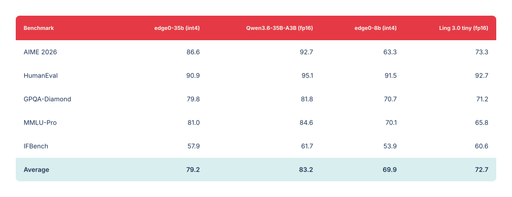
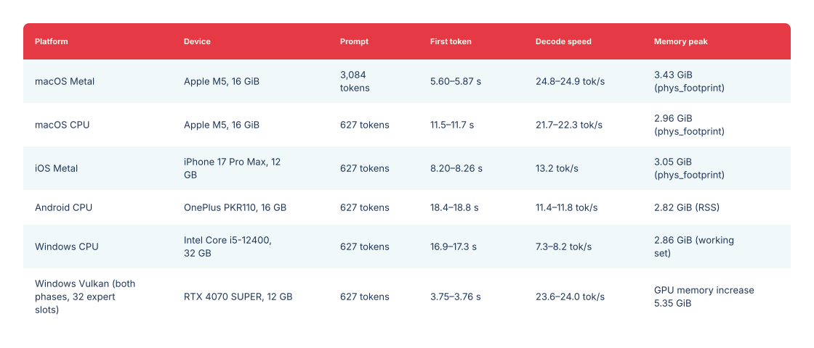

<p align="center"></p>

<a name="previous-release--35b--8b"></a>

# 以前のリリース · 35B / 8B

<p align="center"><a href="legacy-models.md">English</a> · <a href="legacy-models_zh.md">中文</a> · 日本語 · <a href="legacy-models_es.md">Español</a> · <a href="legacy-models_fr.md">Français</a></p>

[← Edge0 ホーム · 最新リリース：145B / 120B](../README_ja.md)

以前の Edge0 リリースの 35B / 8B チェックポイント、ストリーミング推論設計、ベンチマーク、セットアップをまとめています。35B はネイティブエンジンで動作します。公開済み 8B チェックポイントのネイティブエンジン対応は引き続き計画中です。

[モデル](#models) · [プラットフォーム](#platforms) · [設計](#native-engine-design) · [性能評価](#quality) · [速度測定](#benchmark) · [はじめに](#getting-started) · [引用](#citation)

<a name="streaming-inference"></a>

## ストリーミング推論

**edge0** はオープンソースのストリーミング MoE 推論フレームワークです。実運用で検証された **SSD エキスパートオフロード + Recover-LoRA + prerouter ルーティング予測**を拡張可能なフレームワークへ一般化し、コンシューマー向けハードウェアで大規模スパース MoE モデルを実行します。ピークメモリは総パラメーター数ではなく、*アクティブな*エキスパート集合によって制限されます。

<a name="core-mechanisms"></a>

### 中核となる仕組み

- **SSD エキスパートオフロード**：重みをストレージから必要に応じて読み込みます。ピークメモリは総パラメーター数ではなくアクティブ集合で制限されます。
- **Prerouter**：学習済みヘッドが1ステップ先のルーティングを予測し、エキスパートのロードを順伝播と重ねて待ち時間を削減します。デコードスループットは**最大 +59%**向上し、ストレージ遅延、モデル規模、ルーティング幅 *K* が大きいほど効果が増します。
- **Recover-LoRA**：int4 ベースを固定し、FP 教師モデルからの蒸留で LoRA アダプターを学習して、4ビット量子化による損失の大部分を回復します（[性能評価](#quality)参照）。アダプターはベースとは別に保存され、有効・無効を切り替えられます。

<a name="models"></a>

## モデル

フレームワークには `edge0-35b` と `edge0-8b` の2つのモデル規模が付属します。各リリースは、公開チェックポイント、学習済み LoRA アダプター、学習済み prerouter ヘッドが一体として動作する構成です。

| モデル規模 | 公開チェックポイント | 推論構成 | エンジン |
|---|---|---|---|
| `edge0-35b` | [`Edge0/Edge0-35B-A3B-preview`](https://huggingface.co/Edge0/Edge0-35B-A3B-preview) · [ModelScope](https://www.modelscope.cn/models/Edge0/Edge0-35B-A3B-preview) | 4ビット、40層、256エキスパート、prerouter K=4 | ネイティブエンジン ✅ |
| `edge0-8b` | [`Edge0/Edge0-8B-A1B-preview`](https://huggingface.co/Edge0/Edge0-8B-A1B-preview) · [ModelScope](https://www.modelscope.cn/models/Edge0/Edge0-8B-A1B-preview) | 4ビット、24層、128エキスパート、prerouter K=8 | ネイティブエンジン（予定） |

2つの公開チェックポイントは、それぞれオープンなスパース MoE ベースモデル Qwen3.6-35B-A3B と Ling 3.0 bailing hybrid に基づき、本フレームワーク向けに学習した LoRA と prerouter を含みます。edge0-infer はアセットツールで公開チェックポイントを取得し、エンジン用モデルアセットに変換します（[はじめに](#getting-started)参照）。

<a name="platforms"></a>

## 対応プラットフォーム

実行するプログラムは [`edge0-infer`](../edge0-infer/README.md) です。CLI、OpenAI・Anthropic 互換ローカルサーバー、チャットアプリを提供し、対応モデルで共通の `serve` と `chat` を使用します。各モデルには専用のエンジンがあり、モデルフォルダーから自動選択されるため、手動選択は不要です。`edge0-35b` は `edge0-infer/` の**ネイティブエンジン**（GGML ベース、ネイティブ C++ API）で動作し、`edge0-145b` と `edge0-120b` は Strata のフォークである [`edge0-strata/`](../edge0-strata/EDGE0.md) の **edge0-strata** で動作します。

| プラットフォーム | `edge0-35b`（ネイティブエンジン） | `edge0-145b`, `edge0-120b` (edge0-strata) |
|---|---|---|
| **macOS** (Apple Silicon) | Metal, CPU | — |
| **iOS** | Metal | — |
| **Android** | CPU | — |
| **Linux** | CPU | NVIDIA GPU (CUDA 13) |
| **Windows** | CPU, Vulkan | NVIDIA GPU (CUDA 13) |

測定結果は `edge0-35b` の[ベンチマーク](../edge0-infer/docs/benchmarking.md#reference-figures)、`edge0-145b` と `edge0-120b` の[モデルページ](models/edge0-145b.md)をご覧ください。ネイティブエンジンでは、同一デバイスでプリフィルとデコードに別のバックエンドを使用できます。例えば Metal でプリフィル、CPU でデコードを行えます。デスクトップ（macOS、Windows）、Android、iOS のチャットアプリ例は [`edge0-infer/examples/`](../edge0-infer/examples/README.md#chat-applications) にあります。

<a name="native-engine-design"></a>

## ネイティブエンジンの設計

- **GGML ベースで全プラットフォーム共通のコード**：ネイティブライブラリが依存するのは GGML のみです。固定バージョンを無変更で同梱し、ビルド時のダウンロードはありません。
- **ひとつのネイティブ API**：アプリは CMake ターゲット `edge0::edge0` とリンクし、`include/edge0/` のヘッダーを使ってプロセス内で実行します。参考 CLI とローカルサーバーは、ネイティブ API と同じ設定・既定値を使います。
- **エキスパートのオンデマンド読み込み**：各層の固定数スロットへストレージから必要なエキスパートを読み込むため、メモリ予算を超えるモデルも全体をロードせずに実行できます。
- **2つのルーティングモード**：`predicted`（既定）は現在の token の計算中に prerouter が次の token のエキスパートをバックグラウンドで準備します。`actual` は比較用にモデル本来の計算を行います。
- **複数ターンでの再利用**：通常は各ターンの新しいメッセージだけを計算し、以前の結果を再利用します。

[edge0-infer のアーキテクチャ](../edge0-infer/docs/architecture.md)を参照してください。

<a name="quality"></a>

## 性能評価

すべてのベンチマークは、当チームが [OpenCompass](https://github.com/open-compass/opencompass) を使用し、edge0 モデル（int4 + 学習済みアダプター + prerouter ルーティング）と元の fp16 ベースモデルに同一の設定・パラメーターを適用して測定しました。edge0 パイプラインによる低下は小さく、**edge0-35b は平均 3.9 ポイント、edge0-8b は 2.8 ポイント**です（MMLU-Pro はベースを上回ります）。上限は100です。

<a href="../assets/edge0-release/legacy-quality.svg"></a>

<details>
<summary><b>コピー可能な性能評価データ</b></summary>

| ベンチマーク | edge0-35b (int4) | Qwen3.6-35B-A3B (fp16) | edge0-8b (int4) | Ling 3.0 tiny (fp16) |
|---|---:|---:|---:|---:|
| AIME 2026 | 86.6 | 92.7 | 63.3 | 73.3 |
| HumanEval | 90.9 | 95.1 | 91.5 | 92.7 |
| GPQA-Diamond | 79.8 | 81.8 | 70.7 | 71.2 |
| MMLU-Pro | 81.0 | 84.6 | 70.1 | 65.8 |
| IFBench | 57.9 | 61.7 | 53.9 | 60.6 |
| **平均** | **79.2** | **83.2** | **69.9** | **72.7** |

</details>

<a name="benchmark"></a>

## 速度測定

edge0-infer で `edge0-35b` の `predicted` ルーティングを測定しました（各範囲は3プロセスでの最小値から最大値）。

<a href="../assets/edge0-release/legacy-speed.svg"></a>

<details>
<summary><b>コピー可能な速度測定データ</b></summary>

| プラットフォーム | デバイス | プロンプト長 | 最初の token までの時間 | デコード速度 | ピークメモリ |
|---|---|---|---|---|---|
| macOS Metal | Apple M5, 16 GiB | 3,084 tokens | 5.60–5.87 s | 24.8–24.9 tok/s | 3.43 GiB (`phys_footprint`) |
| macOS CPU | Apple M5, 16 GiB | 627 tokens | 11.5–11.7 s | 21.7–22.3 tok/s | 2.96 GiB (`phys_footprint`) |
| iOS Metal | iPhone 17 Pro Max, 12 GB | 627 tokens | 8.20–8.26 s | 13.2 tok/s | 3.05 GiB (`phys_footprint`) |
| Android CPU | OnePlus PKR110, 16 GB | 627 tokens | 18.4–18.8 s | 11.4–11.8 tok/s | 2.82 GiB (RSS) |
| Windows CPU | Intel Core i5-12400, 32 GB | 627 tokens | 16.9–17.3 s | 7.3–8.2 tok/s | 2.86 GiB（ワーキングセット） |
| Windows Vulkan（両フェーズ、32エキスパートスロット） | RTX 4070 SUPER, 12 GB | 627 tokens | 3.75–3.76 s | 23.6–24.0 tok/s | GPU メモリ増加量 5.35 GiB |

</details>

メモリ指標はプラットフォームによって異なり、直接比較できません。測定方法、`actual` ルーティングの数値、再現用コマンドは[ベンチマーク](../edge0-infer/docs/benchmarking.md#reference-figures)に記載しています。

<a name="getting-started"></a>

## はじめに

以下のコマンドは `edge0-infer/` で実行します。CMake 3.21+、Ninja、C++17/C11 コンパイラー、uv、Git が必要です。35B は元の重みに約18 GB、変換後アセットに約20 GBを要し、変換中にはさらに同程度の空き容量が必要です。

<a name="1-build"></a>

### 1) ビルド

```bash
cd edge0-infer
cmake --preset mac-metal && cmake --build --preset mac-metal
build/mac-metal/bin/edge0-infer info        # expect a line: model.0: edge0_35b
```

Metal のないマシンでは `--preset cpu` と `build/cpu/bin/edge0-infer` を使用し、以下のコマンドで `--device cpu` を指定してください。

<a name="2-get-a-model"></a>

### 2) モデルの取得

**edge0-35b（ネイティブエンジン）。** モデルアセットをダウンロードして変換します。

```bash
export MOE_SOURCE_35B=<directory for the original weights>
export MOE_ASSETS_35B=<directory for the converted assets>

uv sync --project tools/assets
assets_py() { uv run --project tools/assets --offline --no-sync python -I "$@"; }

assets_py tools/assets/edge0_35b/fetch_source.py download --out "$MOE_SOURCE_35B"
assets_py tools/assets/edge0_35b/make_assets.py --source "$MOE_SOURCE_35B" --out "$MOE_ASSETS_35B"
assets_py tools/assets/check_assets.py check "$MOE_ASSETS_35B"
```

Hugging Face から `Edge0/Edge0-35B-A3B-preview` を取得し、固定されたリビジョンとダイジェストで検証します。

<a name="3-run"></a>

### 3) 実行

```bash
# one prompt
build/mac-metal/bin/edge0-infer run   --model "$MOE_ASSETS_35B" --device metal --user "Introduce yourself in one sentence."
# multi-turn chat
build/mac-metal/bin/edge0-infer chat  --model "$MOE_ASSETS_35B" --device metal
# serve (OpenAI- and Anthropic-compatible, default http://127.0.0.1:8000)
build/mac-metal/bin/edge0-infer serve --model "$MOE_ASSETS_35B" --device metal
```

edge0-145b と edge0-120b でも `chat` と `serve` は同様にモデルフォルダーを受け取ります（`--model <model folder>`）。`run` はネイティブエンジン用です。

Android、Windows、iOS のビルドと、自分の CMake プロジェクトからエンジンを使う方法は[はじめに](../edge0-infer/docs/getting-started.md)を参照してください。

<a name="documentation"></a>

## ドキュメント

- [35B モデル](models/edge0-35b.md) · [8B モデル](models/edge0-8b.md)
- [MoE のルーティングとエキスパート](moe.md) · [Prerouter](prerouter.md)
- [技術報告書](https://arxiv.org/abs/2609.18063) · [PDF](../paper/main.pdf)
- [ネイティブエンジンのセットアップ](../edge0-infer/docs/getting-started.md) · [ベンチマークの再現](../edge0-infer/docs/benchmarking.md)
- [設定](../edge0-infer/docs/configuration.md) · [ネイティブ API](../edge0-infer/docs/native-api.md) · [ローカルサーバー](../edge0-infer/docs/local-server.md)
- [アーキテクチャ](../edge0-infer/docs/architecture.md) · [既知の制限](../edge0-infer/docs/limitations.md) · [テスト](../edge0-infer/docs/testing.md)
- [モデルアセット用ツールとモデルの追加](../edge0-infer/tools/assets/README.md)
- 各言語のプロジェクトホーム：[中文](../README_zh.md) · [日本語](../README_ja.md) · [Español](../README_es.md) · [Français](../README_fr.md)

<a name="roadmap"></a>

## ロードマップ

<a name="q4-2026--native-engine-and-streaming-pipeline"></a>

### 2026年第4四半期 · ネイティブエンジンとストリーミングパイプライン

- ✅ **edge0 統合推論エンジンをオープンソース化**（2026-11-04）— [`edge0-infer`](../edge0-infer/README.md)：macOS、iOS、Android、Windows で共通のエンジンとネイティブ API。
- **edge0-infer の `edge0-8b` 対応**。
- 既存パイプライン向けのモデル規模とアダプターの追加リリース。

次世代アーキテクチャ対応、潜在空間での思考とエキスパートの一括事前予測については、[フレームワークのロードマップ](roadmap.md)を参照してください。

<a name="citation"></a>

## 引用

技術報告書は、35B の SSD ストリーミングと学習済みルーティング予測を扱っています。

edge0 が役立った場合は、技術報告書を引用してください。

```bibtex
@article{lin2026other,
  title   = {The Other Half of the Memory Wall: Serving 35B MoEs from SSD
             with Trained Routing Prediction},
  author  = {Lin, Yu and Wang, Yiming and Cai, Runyuan and Liu, Hanze and
             Zeng, Xiaodong},
  journal = {arXiv preprint arXiv:2609.18063},
  year    = {2026},
  url     = {https://arxiv.org/abs/2609.18063}
}
```

<a name="release-history"></a>

## リリース履歴

- **[2026-11-04]** **統合推論エンジン [`edge0-infer`](../edge0-infer/README.md)** を公開しました。[GGML](https://github.com/ggml-org/ggml) を基盤に、ひとつのエンジンとネイティブ C++ API で同じモデルを macOS、iOS、Android、Windows 上で実行できます。CLI、OpenAI 互換のローカルサーバー、デスクトップ・Android・iOS 向けチャットアプリのサンプルを提供します。初回リリースは `edge0-35b` に対応し、`edge0-8b` は今後対応予定です。Python フレームワークとプラットフォーム別エンジンを置き換え、従来のコードは [`pre-edge0-infer`](https://github.com/Edge0-AI/Edge0/tree/pre-edge0-infer) タグに保存しています。
- **[2026-09-30]** **iOS、macOS、Android、Windows の4プラットフォーム向け edge0 推論エンジン**を公開しました（ソースは [`pre-edge0-infer`](https://github.com/Edge0-AI/Edge0/tree/pre-edge0-infer) タグ）。
- **[2026-09-16]** 技術報告書を arXiv で公開しました：[The Other Half of the Memory Wall: Serving 35B MoEs from SSD with Trained Routing Prediction](https://arxiv.org/abs/2609.18063)。
- **[2026-09-08]** **edge0** を初めてオープンソースで公開し、2つのモデル規模、[`Edge0-35B-A3B-preview`](https://huggingface.co/Edge0/Edge0-35B-A3B-preview) と [`Edge0-8B-A1B-preview`](https://huggingface.co/Edge0/Edge0-8B-A1B-preview) を Hugging Face と ModelScope で公開しました。

[← Edge0 ホーム](../README_ja.md)
