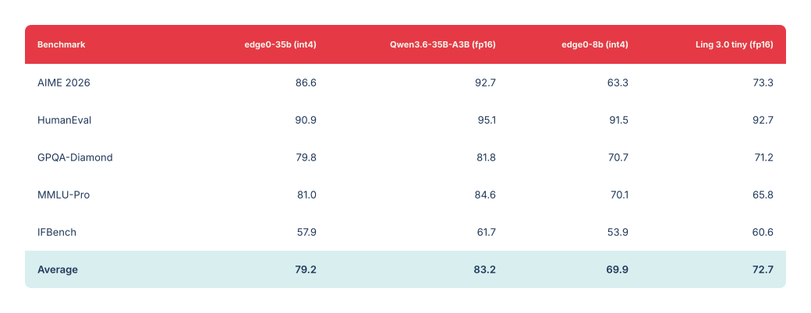
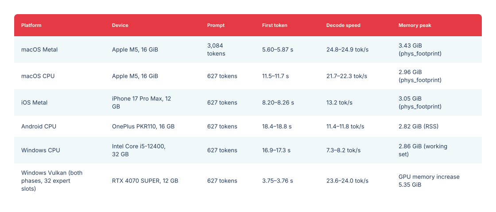

<p align="center"></p>

<a name="previous-release--35b--8b"></a>

# 此前版本 · 35B / 8B

<p align="center"><a href="legacy-models.md">English</a> · 中文 · <a href="legacy-models_ja.md">日本語</a> · <a href="legacy-models_es.md">Español</a> · <a href="legacy-models_fr.md">Français</a></p>

[← Edge0 首页 · 最新版本：145B / 120B](../README_zh.md)

Edge0 此前版本的 35B / 8B 检查点、流式推理设计、评测与安装说明。35B 使用原生引擎；已发布 8B 检查点的原生引擎支持仍在计划中。

[模型](#models) · [平台](#platforms) · [设计](#native-engine-design) · [能力评测](#quality) · [性能测试](#benchmark) · [快速开始](#getting-started) · [引用](#citation)

<a name="streaming-inference"></a>

## 流式推理

**edge0** 是一个开源流式 MoE 推理框架。它将经过生产验证的方案——**SSD 专家卸载 + Recover-LoRA + prerouter 路由预测**——推广为可扩展框架，在消费级硬件上运行大型稀疏 MoE 模型：内存峰值由*活跃*专家集合限定，而非参数总量。

<a name="core-mechanisms"></a>

### 核心机制

- **SSD 专家卸载**：专家权重按需从存储流式加载；内存峰值由活跃专家集合限定，而非参数总量。
- **Prerouter**：训练后的预测头提前一步预测专家路由，使专家加载与前向计算重叠，而不阻塞计算；解码吞吐量**最高提升 +59%**，收益随存储延迟、模型规模及路由宽度 *K* 增大。
- **Recover-LoRA**：冻结 int4 基座，通过 FP 教师模型蒸馏训练 LoRA 适配器，在 4 位下恢复大部分量化损失（见[能力评测](#quality)）。适配器与基座分别存储，可随时启用或关闭。

<a name="models"></a>

## 模型

框架随附 `edge0-35b` 和 `edge0-8b` 两个模型档位。每个档位都是端到端发布：已发布检查点、训练后的 LoRA 适配器和 prerouter 预测头作为一个整体协同工作。

| 型号 | 已发布检查点 | 推理配置 | 引擎 |
|---|---|---|---|
| `edge0-35b` | [`Edge0/Edge0-35B-A3B-preview`](https://huggingface.co/Edge0/Edge0-35B-A3B-preview) · [ModelScope](https://www.modelscope.cn/models/Edge0/Edge0-35B-A3B-preview) | 4 位，40 层，256 个专家，prerouter K=4 | 原生引擎 ✅ |
| `edge0-8b` | [`Edge0/Edge0-8B-A1B-preview`](https://huggingface.co/Edge0/Edge0-8B-A1B-preview) · [ModelScope](https://www.modelscope.cn/models/Edge0/Edge0-8B-A1B-preview) | 4 位，24 层，128 个专家，prerouter K=8 | 原生引擎（计划中） |

两个已发布检查点分别基于开源稀疏 MoE 基座模型 Qwen3.6-35B-A3B 和 Ling 3.0 bailing hybrid，并包含针对本框架完成的 LoRA 与 prerouter 训练成果。edge0-infer 使用资产工具下载已发布检查点，并将其转换为引擎所需的模型资产（见[快速开始](#getting-started)）。

<a name="platforms"></a>

## 支持平台

[`edge0-infer`](../edge0-infer/README.md) 是实际运行的程序（CLI、兼容 OpenAI 和 Anthropic 的本地服务、聊天应用），为支持的模型提供统一的 `serve` 和 `chat` 命令。每个模型使用对应引擎，edge0-infer 根据模型文件夹自动选择，无需手动指定：`edge0-35b` 使用 `edge0-infer/` 中的**原生引擎**（基于 GGML，提供原生 C++ API），`edge0-145b` 与 `edge0-120b` 使用 [`edge0-strata/`](../edge0-strata/EDGE0.md) 中的 **edge0-strata**，它是 Strata 的分支。

| 平台 | `edge0-35b`（原生引擎） | `edge0-145b`, `edge0-120b` (edge0-strata) |
|---|---|---|
| **macOS** (Apple Silicon) | Metal, CPU | — |
| **iOS** | Metal | — |
| **Android** | CPU | — |
| **Linux** | CPU | NVIDIA GPU (CUDA 13) |
| **Windows** | CPU, Vulkan | NVIDIA GPU (CUDA 13) |

测量结果：`edge0-35b` 见[性能测试](../edge0-infer/docs/benchmarking.md#reference-figures)，`edge0-145b` 与 `edge0-120b` 见[模型页面](models/edge0-145b.md)。原生引擎允许同一设备上的预填充和解码使用不同后端，例如 Metal 预填充配合 CPU 解码。桌面（macOS、Windows）、Android 和 iOS 聊天应用示例位于 [`edge0-infer/examples/`](../edge0-infer/examples/README.md#chat-applications)。

<a name="native-engine-design"></a>

## 原生引擎设计

- **基于 GGML，跨平台使用同一套代码**：原生库仅依赖 GGML，以固定版本原样随附，构建时不下载任何内容。
- **统一的原生 API**：应用链接 CMake 目标 `edge0::edge0`，并引入 `include/edge0/` 中的头文件，在进程内使用引擎；参考 CLI 与本地服务使用和原生 API 相同的设置与默认值。
- **按需加载专家**：被路由选中的专家从存储按需读取到每层固定数量的专家槽位中，因此超出设备内存预算的模型无需整体加载也能运行。
- **两种路由模式**：`predicted`（默认）使用 prerouter，在计算当前 token 时于后台准备下一个 token 的专家；`actual` 执行模型原有计算，用于对照。
- **多轮复用**：多轮对话通常只计算每一轮新增的消息，之前的结果直接复用。

详见 [edge0-infer 架构](../edge0-infer/docs/architecture.md)。

<a name="quality"></a>

## 能力评测

所有评测均由我们使用 [OpenCompass](https://github.com/open-compass/opencompass) 完成，edge0 模型（int4 + 训练后的适配器 + prerouter 路由）与原始 fp16 基座使用完全相同的设置和参数。edge0 流水线的损失较小：**edge0-35b 平均下降 3.9 分，edge0-8b 下降 2.8 分**（MMLU-Pro 甚至高于基座）。满分 100：

<a href="../assets/edge0-release/legacy-quality.svg"></a>

<details>
<summary><b>可复制的能力评测数据</b></summary>

| 评测 | edge0-35b (int4) | Qwen3.6-35B-A3B (fp16) | edge0-8b (int4) | Ling 3.0 tiny (fp16) |
|---|---:|---:|---:|---:|
| AIME 2026 | 86.6 | 92.7 | 63.3 | 73.3 |
| HumanEval | 90.9 | 95.1 | 91.5 | 92.7 |
| GPQA-Diamond | 79.8 | 81.8 | 70.7 | 71.2 |
| MMLU-Pro | 81.0 | 84.6 | 70.1 | 65.8 |
| IFBench | 57.9 | 61.7 | 53.9 | 60.6 |
| **平均分** | **79.2** | **83.2** | **69.9** | **72.7** |

</details>

<a name="benchmark"></a>

## 性能测试

使用 edge0-infer 测量 `edge0-35b` 的 `predicted` 路由模式（每个范围为三个进程测量的最小值至最大值）：

<a href="../assets/edge0-release/legacy-speed.svg"></a>

<details>
<summary><b>可复制的性能测试数据</b></summary>

| 平台 | 设备 | 提示词长度 | 首 token 耗时 | 解码速度 | 内存峰值 |
|---|---|---|---|---|---|
| macOS Metal | Apple M5, 16 GiB | 3,084 tokens | 5.60–5.87 s | 24.8–24.9 tok/s | 3.43 GiB (`phys_footprint`) |
| macOS CPU | Apple M5, 16 GiB | 627 tokens | 11.5–11.7 s | 21.7–22.3 tok/s | 2.96 GiB (`phys_footprint`) |
| iOS Metal | iPhone 17 Pro Max, 12 GB | 627 tokens | 8.20–8.26 s | 13.2 tok/s | 3.05 GiB (`phys_footprint`) |
| Android CPU | OnePlus PKR110, 16 GB | 627 tokens | 18.4–18.8 s | 11.4–11.8 tok/s | 2.82 GiB (RSS) |
| Windows CPU | Intel Core i5-12400, 32 GB | 627 tokens | 16.9–17.3 s | 7.3–8.2 tok/s | 2.86 GiB（工作集） |
| Windows Vulkan（两个阶段，32 个专家槽位） | RTX 4070 SUPER, 12 GB | 627 tokens | 3.75–3.76 s | 23.6–24.0 tok/s | GPU 内存增量 5.35 GiB |

</details>

各平台使用不同内存指标，不能直接比较。测量方法、`actual` 路由数据与复现命令见[性能测试](../edge0-infer/docs/benchmarking.md#reference-figures)。

<a name="getting-started"></a>

## 快速开始

在 `edge0-infer/` 中执行以下命令。需要 CMake 3.21+、Ninja、C++17/C11 编译器、uv 和 Git；35B 的原始权重约需 18 GB，转换后资产约需 20 GB，转换期间还需再预留同等大小的空闲空间。

<a name="1-build"></a>

### 1) 构建

```bash
cd edge0-infer
cmake --preset mac-metal && cmake --build --preset mac-metal
build/mac-metal/bin/edge0-infer info        # expect a line: model.0: edge0_35b
```

没有 Metal 的设备请使用 `--preset cpu`、`build/cpu/bin/edge0-infer`，并在以下命令中使用 `--device cpu`。

<a name="2-get-a-model"></a>

### 2) 获取模型

**edge0-35b（原生引擎）。** 下载并转换模型资产：

```bash
export MOE_SOURCE_35B=<directory for the original weights>
export MOE_ASSETS_35B=<directory for the converted assets>

uv sync --project tools/assets
assets_py() { uv run --project tools/assets --offline --no-sync python -I "$@"; }

assets_py tools/assets/edge0_35b/fetch_source.py download --out "$MOE_SOURCE_35B"
assets_py tools/assets/edge0_35b/make_assets.py --source "$MOE_SOURCE_35B" --out "$MOE_ASSETS_35B"
assets_py tools/assets/check_assets.py check "$MOE_ASSETS_35B"
```

该操作从 Hugging Face 下载 `Edge0/Edge0-35B-A3B-preview`，并按锁定的版本和摘要校验。

<a name="3-run"></a>

### 3) 运行

```bash
# one prompt
build/mac-metal/bin/edge0-infer run   --model "$MOE_ASSETS_35B" --device metal --user "Introduce yourself in one sentence."
# multi-turn chat
build/mac-metal/bin/edge0-infer chat  --model "$MOE_ASSETS_35B" --device metal
# serve (OpenAI- and Anthropic-compatible, default http://127.0.0.1:8000)
build/mac-metal/bin/edge0-infer serve --model "$MOE_ASSETS_35B" --device metal
```

对于 edge0-145b 和 edge0-120b，`chat` 与 `serve` 同样接收模型文件夹（`--model <model folder>`）；`run` 用于原生引擎。

Android、Windows、iOS 的构建方法，以及如何从自己的 CMake 项目使用引擎，请参阅[快速开始](../edge0-infer/docs/getting-started.md)。

<a name="documentation"></a>

## 文档

- [35B 模型](models/edge0-35b.md) · [8B 模型](models/edge0-8b.md)
- [MoE 路由与专家](moe.md) · [Prerouter](prerouter.md)
- [技术报告](https://arxiv.org/abs/2609.18063) · [PDF](../paper/main.pdf)
- [原生引擎安装](../edge0-infer/docs/getting-started.md) · [性能复现](../edge0-infer/docs/benchmarking.md)
- [配置](../edge0-infer/docs/configuration.md) · [原生 API](../edge0-infer/docs/native-api.md) · [本地服务](../edge0-infer/docs/local-server.md)
- [架构](../edge0-infer/docs/architecture.md) · [已知限制](../edge0-infer/docs/limitations.md) · [测试](../edge0-infer/docs/testing.md)
- [模型资产工具与新增模型](../edge0-infer/tools/assets/README.md)
- 各语种项目首页：[中文](../README_zh.md) · [日本語](../README_ja.md) · [Español](../README_es.md) · [Français](../README_fr.md)

<a name="roadmap"></a>

## 路线图

<a name="q4-2026--native-engine-and-streaming-pipeline"></a>

### 2026 年第四季度 · 原生引擎与流式流水线

- ✅ **edge0 统一推理引擎已开源**（2026-11-04）— [`edge0-infer`](../edge0-infer/README.md)：macOS、iOS、Android 和 Windows 共用一个引擎与原生 API。
- **在 edge0-infer 中支持 `edge0-8b`**。
- 在现有流水线上发布更多模型档位与适配器。

下一代架构支持、潜空间思考与批量专家预预测见[框架路线图](roadmap.md)。

<a name="citation"></a>

## 引用

技术报告介绍 35B 的 SSD 流式推理与经过训练的路由预测。

如果 edge0 对你有帮助，请引用我们的技术报告：

```bibtex
@article{lin2026other,
  title   = {The Other Half of the Memory Wall: Serving 35B MoEs from SSD
             with Trained Routing Prediction},
  author  = {Lin, Yu and Wang, Yiming and Cai, Runyuan and Liu, Hanze and
             Zeng, Xiaodong},
  journal = {arXiv preprint arXiv:2609.18063},
  year    = {2026},
  url     = {https://arxiv.org/abs/2609.18063}
}
```

<a name="release-history"></a>

## 发布历史

- **[2026-11-04]** 我们发布了**统一推理引擎 [`edge0-infer`](../edge0-infer/README.md)**：基于 [GGML](https://github.com/ggml-org/ggml)，通过同一个引擎和原生 C++ API 在 macOS、iOS、Android 和 Windows 上运行同一模型，提供 CLI、兼容 OpenAI 的本地服务，以及桌面、Android 和 iOS 聊天应用示例。首版支持 `edge0-35b`；`edge0-8b` 将在后续版本中支持。它取代了 Python 框架和各平台独立引擎；旧代码保留在 [`pre-edge0-infer`](https://github.com/Edge0-AI/Edge0/tree/pre-edge0-infer) 标签下。
- **[2026-09-30]** 我们发布了 **iOS、macOS、Android 和 Windows 四个平台的 edge0 推理引擎**（源码位于 [`pre-edge0-infer`](https://github.com/Edge0-AI/Edge0/tree/pre-edge0-infer) 标签）。
- **[2026-09-16]** 技术报告已发布于 arXiv：[The Other Half of the Memory Wall: Serving 35B MoEs from SSD with Trained Routing Prediction](https://arxiv.org/abs/2609.18063)。
- **[2026-09-08]** 首次开源发布 **edge0**，并在 Hugging Face 和 ModelScope 同时发布两个模型档位：[`Edge0-35B-A3B-preview`](https://huggingface.co/Edge0/Edge0-35B-A3B-preview) 和 [`Edge0-8B-A1B-preview`](https://huggingface.co/Edge0/Edge0-8B-A1B-preview)。

[← Edge0 首页](../README_zh.md)
