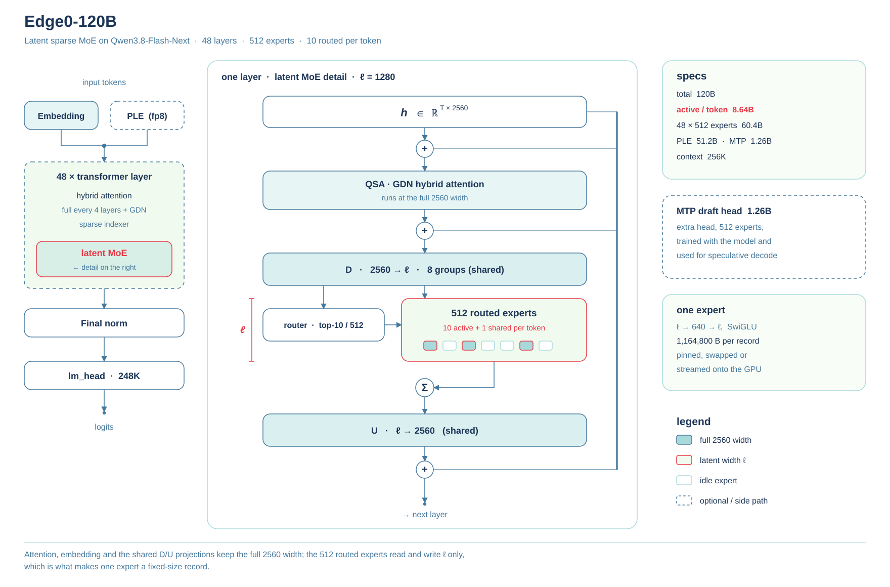

# Edge0 145B and Edge0 120B

Two latent mixture-of-experts models for a single NVIDIA GPU, derived from Qwen3.8-Flash-Next: Edge0 145B and Edge0 120B. Their experts read compressed inputs, and both models run on [edge0-strata](../../edge0-strata/EDGE0.md), a fork of [Strata](https://github.com/Niko1221/Strata) whose scheduling of CPU, GPU and PCIe work they depend on. [edge0-infer](../../edge0-infer/README.md) starts edge0-strata for `serve` and `chat`, so the commands and endpoints are those of the other models.

Weights on Hugging Face: [`Edge0-145B-q3k`](https://huggingface.co/Edge0/Edge0-145B-q3k) · [`Edge0-145B-NVFP4`](https://huggingface.co/Edge0/Edge0-145B-NVFP4) · [`Edge0-120B-q3k`](https://huggingface.co/Edge0/Edge0-120B-q3k) · [`Edge0-120B-NVFP4`](https://huggingface.co/Edge0/Edge0-120B-NVFP4).

[← Edge0](../../README.md)

## Model profile

| Item | Value |
| --- | --- |
| Total parameters | Edge0 145B: 145B, 10.12B active per token; Edge0 120B: 120B, 8.64B active per token |
| Number of layers | 48: 36 linear-attention layers, and one indexed-attention layer in every 4 |
| Number of experts | 512 routed experts per layer, plus one shared expert |
| top_k (K) | 10 |
| Latent compression | Expert inputs compressed from 2560 to 1792 (Edge0 145B) or 1280 (Edge0 120B) dimensions; each layer has 8 groups of down/up (D/U) projections, chosen by each expert's group label |
| Expert formats | Q3_K (Q3_K gate/up and IQ4_NL down, with column scales) or NVFP4, released as separate model folders |
| D/U formats | Q8 or Q4; default Q8 for Edge0 145B, Q4 for Edge0 120B |
| Other parts | Hyper-connections, a per-layer n-gram embedding (PLE) table, one multi-token-prediction (MTP) layer for speculative decoding |

## Quality

Model-level results; not separate quality evaluations of Q3_K and NVFP4. Higher is better.

| Model | deepswe 1.1 | terminal-bench 2.1 | AA-LCR | IFBench | GPQA-Diamond | HLE |
| --- | ---: | ---: | ---: | ---: | ---: | ---: |
| **Edge0-145B** | **64.6** | **86.5** | 79.3 | 80.6 | 90.4 | 35.4 |
| **Edge0-120B** | 51.3 | 75.3 | 81.0 | 79.3 | 87.4 | 31.0 |
| DeepSeek-V4-Flash-0731 | 54.4 | 82.7 | 79.7 | 79.2 | 90.8 | 33.8 |
| Qwen3.8-Flash-Next | 58.7 | 83.3 | 79.1 | **81.3** | **91.7** | 35.9 |
| Qwen3.8-27B | 42.2 | 73.0 | **82.0** | 79.5 | 89.2 | 30.8 |
| Claude-Opus-4.6 (Max) | / | 78.2 | 78.0 | 62.5 | 91.3 | **40.0** |

**Bold** = best in column.

## Speed

All throughput figures are in tok/s. The 4K and 16K columns denote prefill input length.

### Edge0 145B

Copyable speed data

| Machine | Build | 4K prefill | 16K prefill | Chat decode | Agent decode |
|---|---|---:|---:|---:|---:|
| RTX 5090 D 24 GB | Q3_K | 2169.9 | 3554.9 | 99.7 | **121.2** |
| RTX 5090 D 24 GB | NVFP4 | 1839.6 | 3165.7 | 79.6 | 98.3 |
| RTX 4090 24 GB | Q3_K | 2042.0 | 3179.4 | 69.9 | 91.7 |
| RTX Spark N1X 60 GiB | Q3_K | 674.0 | 770.3 | 37.7 | 36.7 |
| RTX Spark N1X 60 GiB | NVFP4 | 821.2 | 922.4 | 40.1 | 46.0 |
| Apple M2 Ultra (Metal) | Q3_K | 755.6 | 800.3 | 60.9 | 57.0 |
| 16 GiB VRAM + 20 GiB RAM | Q3_K | 249 | 335 | 36.8 | 44.9 |

`16 GiB VRAM + 20 GiB RAM` rows are the RTX 5090 D 24 GB again, constrained by cgroup to a 16 GiB VRAM and 20 GiB system-RAM budget — not a different card. With residency on, the same card holds **Q3_K** (40.81 GiB of weights) as 23.14 GiB VRAM + 31.28 GiB RAM, and **NVFP4** (47.79 GiB) as 23.25 GiB VRAM + 38.27 GiB RAM — disjoint expert sets, nothing counted twice.

### Edge0 120B

Copyable speed data

| Machine | Build | 4K prefill | 16K prefill | Chat decode | Agent decode |
|---|---|---:|---:|---:|---:|
| RTX 5090 D 24 GB | Q3_K | 3236.7 | 4576.5 | 130.2 | **144.6** |
| RTX 5090 D 24 GB | NVFP4 | 2668.5 | 4357.1 | 124.9 | 135.5 |
| RTX 4090 24 GB | Q3_K | 2637.5 | 3551.1 | 95.0 | 104.9 |
| RTX Spark N1X 60 GiB | Q3_K | 987.0 | 1081.7 | 47.2 | 68.4 |
| RTX Spark N1X 60 GiB | NVFP4 | 996.4 | 1066.9 | 45.1 | 68.9 |
| Apple M2 Ultra (Metal) | Q3_K | 867.6 | 908.7 | 60.4 | 63.0 |
| 16 GiB VRAM + 20 GiB RAM | Q3_K | 430 | 778 | 62.4 | 73.3 |
| 16 GiB VRAM + 20 GiB RAM | NVFP4 | 361.1 | 619.7 | 51.3 | 59.9 |

`16 GiB VRAM + 20 GiB RAM` rows are the RTX 5090 D 24 GB again, constrained by cgroup to a 16 GiB VRAM and 20 GiB system-RAM budget — not a different card. With residency on, the same card holds **Q3_K** (27.98 GiB of weights) as 22.93 GiB VRAM + 18.40 GiB RAM, and **NVFP4** (32.96 GiB) as 23.02 GiB VRAM + 23.40 GiB RAM — disjoint expert sets, nothing counted twice.

## Edge0-145B architecture

| | Edge0-145B |
|---|---|
| Total parameters | **145B** · **10.12 B active per token** |
| Layers | 48 · hybrid attention, full every 4 layers + sparse indexer |
| Experts | **512 per layer**, 10 routed + 1 shared active per token, SwiGLU width 640 |
| Expert pool | 84.6 B parameters at latent width ℓ = **1792** |
| PLE | **51.2 B** n-gram embedding table, fp8, memory-mapped |
| MTP head | 1.26 B draft model, 512 experts, for speculative decode |
| Context | 256K · KV int8 with 32K resident |
| Builds | Q3_K 40.81 GiB · NVFP4 47.79 GiB |

**Left**: the stack the model actually runs — token embedding, 48 hybrid-attention layers, final norm, lm_head.
**Right**: one layer opened up. Attention reads and writes the full 2560 width. **D** then projects the token down to
ℓ per routing group, the router picks 10 of 512 experts, each expert runs ℓ → 640 → ℓ, a shared expert runs
alongside, and **U** projects the combined result back to 2560.

Everything outside the expert pool stays at 2560: D and U are shared, one copy per layer. Only the 512 experts work at
ℓ. That is why an expert is a fixed **1,630,720 B** record — the engine keeps a few thousand of them on the card and streams
the rest from host memory, at a cost that tracks how many experts are resident and not how big the model is.

## Edge0-120B architecture

| | Edge0-120B |
|---|---|
| Total parameters | **120B** · **8.64 B active per token** |
| Layers | 48 · hybrid attention, full every 4 layers + sparse indexer |
| Experts | **512 per layer**, 10 routed + 1 shared active per token, SwiGLU width 640 |
| Expert pool | 60.4 B parameters at latent width ℓ = **1280** |
| PLE | **51.2 B** n-gram embedding table, fp8, memory-mapped |
| MTP head | 1.26 B draft model, 512 experts, for speculative decode |
| Context | 256K · KV int8 with 32K resident |
| Builds | Q3_K 27.98 GiB · NVFP4 32.96 GiB |

**Left**: the stack the model actually runs — token embedding, 48 hybrid-attention layers, final norm, lm_head.
**Right**: one layer opened up. Attention reads and writes the full 2560 width. **D** then projects the token down to
ℓ per routing group, the router picks 10 of 512 experts, each expert runs ℓ → 640 → ℓ, a shared expert runs
alongside, and **U** projects the combined result back to 2560.

Everything outside the expert pool stays at 2560: D and U are shared, one copy per layer. Only the 512 experts work at
ℓ. That is why an expert is a fixed **1,164,800 B** record — the engine keeps a few thousand of them on the card and streams
the rest from host memory, at a cost that tracks how many experts are resident and not how big the model is.

## Model folders

Each model folder holds one model in one expert format: `Edge0-145B-q3k`, `Edge0-145B-NVFP4`, `Edge0-120B-q3k` or `Edge0-120B-NVFP4` (`-q3k` is Q3_K, `-NVFP4` is NVFP4). Use a folder as it is provided; `edge0-infer` identifies the model and the expert format by `model_name` in its `model.json`. The files a folder must hold are listed in Model directory for [Edge0 145B](../../edge0-infer/docs/edge0-145b.md#model-directory) and [Edge0 120B](../../edge0-infer/docs/edge0-120b.md#model-directory) in the edge0-infer documentation; `edge0-infer inspect --model <folder> --json` checks them.

## Requirements

Linux or Windows with an NVIDIA GPU and CUDA 13. The constrained-memory results in the speed tables are measured test budgets, not general minimum requirements. A 16 GiB VRAM + 20 GiB host RAM test is available for 145B Q3_K and both 120B builds; no such result is available for 145B NVFP4.

Apple M2 Ultra (Metal) measurements are retained in the speed tables. They do not establish macOS release availability.

## Running

Use `serve` or `chat` for these models; `run` is for the native engine.

Both models run on edge0-strata, the engine built for them, which edge0-infer starts for these models (see [Documentation](../../README.md#documentation)). Build edge0-strata as [Build (Linux, NVIDIA)](../../edge0-strata/EDGE0.md#build-linux-nvidia) or [Build (Windows, NVIDIA)](../../edge0-strata/EDGE0.md#build-windows-nvidia) in `edge0-strata/EDGE0.md` describes, build edge0-infer as in its [Getting started](../../edge0-infer/docs/getting-started.md#build), and start a model folder with `edge0-infer serve --model <model folder>` or `edge0-infer chat --model <model folder>`. The pages [Edge0 145B](../../edge0-infer/docs/edge0-145b.md) and [Edge0 120B](../../edge0-infer/docs/edge0-120b.md) in the edge0-infer documentation cover `serve`, `chat` and `inspect` for these models, how `edge0-infer` finds edge0-strata, the options (`--device`, `du`, `ple-io`, `--context`, `--strata-arg`) and the known limitations.

## Acknowledgements

Qwen3.8-Flash-Next is the base model. edge0-strata is a fork of [Strata](https://github.com/Niko1221/Strata) by Niko1221 and the Strata contributors, released under the MIT license, with latent MoE support added on top. These models run at this speed because of the engine they built.
